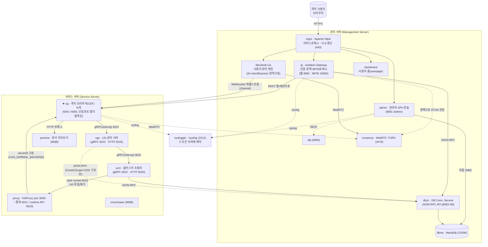
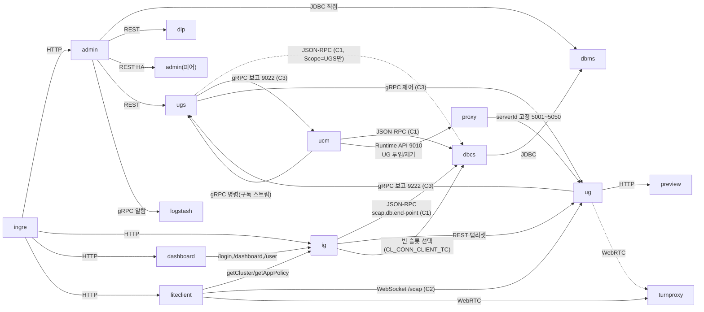
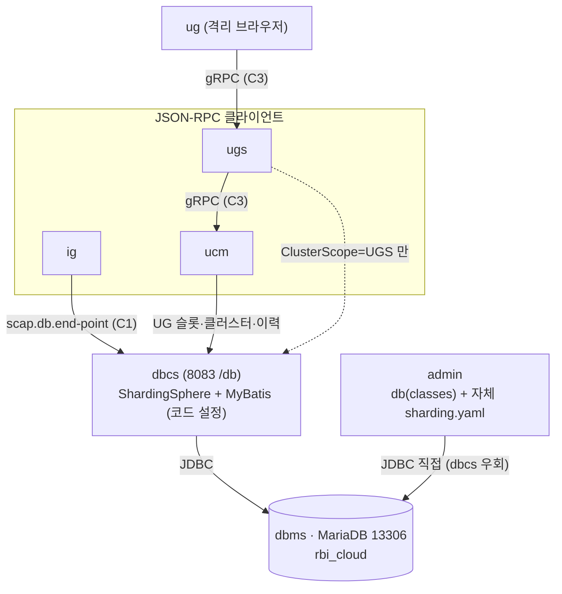

# RBI 솔루션 아키텍처 & 유지보수 가이드

> **목적**: RBI(Remote Browser Isolation, 원격 브라우저 격리) 솔루션을 구성하는 전체 모듈의 구조와 **상관관계**를 정리하고, 향후 **유지보수 · 기능 수정 · 신규 서비스 추가** 시 "어디를 봐야 하는지 / 무엇을 함께 바꿔야 하는지"를 빠르게 찾기 위한 기준 문서.
>
> **작성 기준일**: 2026-06-26 · 소스 코드 정적 분석 기반 (재작성판: `ug` 모듈 추가 및 전 모듈 재검증)
> **분석 대상 소스 저장소 (11개)**:
> `rbi.ig` · `rbi.admin` · `rbi.ig.security` · `db-parent` · `rbi-dashboard` · `rbi-liteclient` · `rbi-liteclient-ui` · `rbi-install-scripts` · **`ucm`**(`RBI\ucm\ucm`) · **`ugs`**(`RBI\ugs`) (모두 `C:\Development\Project\RBI\` 하위) + **`ug`** (`C:\Development\Project\ug`)
> **2026-10-07 보강**: `ucm`·`ugs` 소스 편입 — UG 클러스터 제어 평면(5.9·5.10장) 신설, 2·3·4장 구조도·계약·매트릭스, 9.9 장애 역추적, 10장 포트(UCM 제어 9011→**9010** 정정) 갱신. 실측 근거는 WSL 스택(ucm 1.2.4·ugs 1.2.3) 로그·DB·HAProxy runtime API.

---

## 목차

1. [솔루션 개요](#1-솔루션-개요)
2. [전체 아키텍처 & 트래픽 흐름](#2-전체-아키텍처--트래픽-흐름)
3. [소스 저장소 ↔ 배포 모듈 매핑](#3-소스-저장소--배포-모듈-매핑)
4. [모듈 상관관계 — ★6대 모듈 간 계약](#4-모듈-상관관계--6대-모듈-간-계약)
5. [모듈별 상세](#5-모듈별-상세)
6. [데이터 계층 (DB · 샤딩 · 핵심 테이블)](#6-데이터-계층-db--샤딩--핵심-테이블)
7. [보안 · 인증 · 라이선스](#7-보안--인증--라이선스)
8. [빌드 · 배포 체계](#8-빌드--배포-체계)
9. [시나리오별 작업 가이드 (유지보수·기능수정·신규서비스)](#9-시나리오별-작업-가이드-유지보수기능수정신규서비스)
10. [부록 — 포트표 · 환경변수 · 용어집](#10-부록--포트표--환경변수--용어집)

> **이전 가이드 대비 주요 정정** (소스 재검증 결과)
> - **IG MITM 프록시 포트 = `19000`** (이전 18000 오기), IG 웹 포트 `8082`(DEV)/`8080`(기본)
> - **dbcs 포트 = `8083`, 컨텍스트 `/db/`** (소스 기본값)
> - **샤딩 기본 분할 수 = `1`(비샤딩)** — 코드 기본값. 10분할은 *배포 관례*(DDL이 `TC0~TC9` 물리테이블 사전 정의)
> - **admin 뷰 = 순수 JSP include 레이아웃** (Apache Tiles 아님)
> - **admin Retry DB = 4종** (`cadmin`/`admin`/`alarm`/`connection-client-statistics`)
> - **ug = Java 8 + CEF 기반 격리 브라우저** (신규 분석)

---

## 1. 솔루션 개요

**RBI(Remote Browser Isolation)** 는 사용자가 위험한 웹사이트를 자기 PC 브라우저로 직접 여는 대신, **서버 측 격리 브라우저(원격 브라우저)** 를 통해 접속하게 하여 악성코드/유출 위협을 사용자 단말로부터 차단하는 보안 솔루션이다.

동작의 큰 그림:

1. 사용자가 **사용자 홈(dashboard)** 에서 사이트를 클릭하거나 주소를 입력한다.
2. **IG(Isolation Gateway)** 가 인증·정책을 적용하고 어느 격리 브라우저(UG)로 연결할지 결정(`getCluster`)한다.
3. 서버에서 **격리 브라우저(UG)** 가 **CEF(Chromium)** 로 실제 사이트를 렌더링한다.
4. **LiteClient** 가 UG의 화면을 **픽셀(이미지) 스트리밍**(WebSocket 바이너리)으로 받아 OffscreenCanvas에 그리고, 사용자의 마우스/키보드 입력을 UG로 되돌려 보낸다.
5. 파일 다운로드/업로드·클립보드는 **사이트 정책(sitePolicy)** 게이팅 + 감사로그를 거치며, CDR(무해화)·DLP(유출방지)·백신 검사로 연계된다.

전체 솔루션은 **18개 배포 모듈**(컨테이너, `rbi-install-scripts` 기준)로 구성되며, 본 9개 저장소는 그중 핵심 애플리케이션 소스를 담는다. 배포·오케스트레이션은 `rbi-install-scripts`가 Docker(host networking) 기반으로 담당한다.

> **기술 스택 한눈에**
> - **백엔드(Java 21)**: Spring Boot 3.4.3 · MyBatis · Apache ShardingSphere 5.4.1 · JSON-RPC(jsonrpc4j) — `ig`, `admin`, `dbcs`, `security`
> - **격리 브라우저(Java 8)**: CEF(JCEF) · Netty(자체 `channel` 라이브러리) · gRPC(interop) · FFmpeg/Opus · pngj/turbojpeg/webp — `ug`
> - **프론트엔드(JS)**: Vanilla JS(프레임워크 없음) · Webpack 5 · Babel · javascript-obfuscator · jQuery/Bootstrap(liteclient) — `liteclient`, `liteclient-ui`, `dashboard`
> - **관리 UI**: 순수 JSP(include 레이아웃) + Vue 2 컴포넌트 번들(admin)
> - **인프라**: Docker(host networking) · MariaDB 11.8-rc(dbms/.env MODULE_BASE, 2026-09 확인 — 구 문서의 10.11 은 옛 값) · Apache httpd(ingre) · HAProxy(proxy) · rsyslog(syslogger)

---

## 2. 전체 아키텍처 & 트래픽 흐름

모든 컨테이너는 **`network_mode: host`** 로 동작한다. 즉 포트 매핑이 없고 호스트 IP(`RBI_IP`) 위에 모든 포트가 평면적으로 노출되며, 모듈 간 통신은 `localhost:<포트>` 또는 `${RBI_IP}:<포트>` 로 이뤄진다.



### 트래픽 흐름 요약

- **제어 평면(인증/정책)**: 사용자 → `ingre`(TLS 종단·경로 라우팅) → `admin`/`ig`/`dashboard`/`liteclient` → `dbcs`(내부 DB API) → `dbms`(MariaDB)
- **데이터 평면(격리 브라우징 화면)**: `liteclient` ↔ `ug` 간 **WebSocket 바이너리 픽셀 스트림**(`com.aircode.scap.channel` 프로토콜), 미디어는 `turnproxy`를 통한 WebRTC
- **격리 브라우저 오케스트레이션(UG 클러스터 제어 평면)**: `ug` ─gRPC 9222→ **`ugs`**(UG 접속·상태·감사 수집) ─gRPC 9022→ **`ucm`**(클러스터 조정) ─stats socket 9010→ `proxy`(HAProxy `UGS_NORMAL_BACKEND` 에 UG 투입/제거). `ucm` 은 같은 상태를 dbcs 로 `CL_CONN_CLIENT_TC`(UG 슬롯)·`CL_CLUSTER_TC` 에 쓴다. `ug` → `preview`(문서 미리보기 HTTP 프록시)
- **사용자 할당**: LC → ig `getCluster` → **ig 가 DB 의 빈 슬롯을 고름**(없으면 E-07805) → LC 가 `wss://<CL_CLUSTER_TC.DOMAIN>:9000/scap?serverId=<UG_SERVER_ID>` → HAProxy 가 serverId 로 그 UG 에 고정. ucm·ugs 는 할당 로직이 없다(슬롯 가용 상태를 만들 뿐).
- **UG의 데이터 영속화 경로**: `ug`는 DB에 직접 붙지 않음. `ug` → **gRPC** → `ugs` → **gRPC** → `ucm` → **JSON-RPC** → `dbcs` → **JDBC** → `dbms` (ClusterScope=UCM 기본값 기준 4-hop. ClusterScope=UGS 구성이면 ugs 가 직접 dbcs 에 씀)
- **로그**: 모든 컨테이너 → Docker syslog 드라이버(`udp://localhost:1514`) → `syslogger`

> **두 개의 서버 역할**: mgmt(제어 평면: dbms/dbcs/admin/ig/ingre/liteclient/turnproxy/dlp), svc(데이터 평면: proxy/ucm/preview/ug/ugs/viruschaser). `syslogger`는 양쪽 모두. `.local.env`의 `MANAGEMENT_SERVER_MODULES`/`SERVICE_SERVER_MODULES`로 분리.

---

## 3. 소스 저장소 ↔ 배포 모듈 매핑

**핵심**: 분석 대상 소스 저장소(11개)는 배포 모듈(18개)의 **일부**다. 나머지 배포 모듈은 별도 저장소이거나 외부 이미지다.

| 소스 저장소 | 빌드 산출물 | 대응 배포 모듈 | 좌표/버전 |
|---|---|---|---|
| `rbi.ig` | `ig.war` | **ig** | `com.aircode.scap:rbi.ig:1.1.9` |
| `rbi.admin` (`c-admin`) | `admin.war` | **admin** | `com.aircode.scap:admin:1.1.6` |
| `rbi.ig.security` (`security-parent`) | `security-*.jar` | (라이브러리) | `com.aircode.common:security-parent:1.1.9` |
| `db-parent` | `dbcs.war` + `db-*.jar` | **dbcs** | `com.aircode.scap:db-parent:1.2.5` |
| **`ug`** ★신규 | `ug.jar`(fat) | **ug** | `com.aircode.scap:ug:3.3.5` |
| `rbi-liteclient` (`rbi-lc`) | `dist/*.js` | **liteclient** | `rbi-lc 1.6.0` |
| `rbi-liteclient-ui` (`rbi-ui`) | `aircode-rbi-ui-*.min.js` | (liteclient에 합쳐짐) | `rbi-ui 1.5.36` |
| `rbi-dashboard` | `dist/*` | (사용자 홈, `rbi-client/userpage`) | `rbi-dashboard 1.5.6` |
| `rbi-install-scripts` | `deplo`/`insta`/`rbictl` + `.xpack` | (배포 인프라) | — |
| **`ucm`** (`RBI\ucm\ucm`) ★2026-10-07 | `ucm.war` | **ucm** | `com.aircode.scap:ucm:1.2.6-SNAPSHOT`(릴리스 1.2.5, rc 1.2.6-rc0) — 5.9 |
| **`ugs`** (`RBI\ugs`) ★2026-10-07 | `ugs.war` | **ugs** | `com.aircode.scap:ugs:1.2.5-SNAPSHOT`(릴리스 1.2.4) — 5.10 |

### 소스가 본 저장소에 없는 배포 모듈 (참고)

| 배포 모듈 | 역할 | UG와의 관계 |
|---|---|---|
| **proxy** | HAProxy 리버스 프록시 | 9000 한 포트로 받아 `UGS_NORMAL_BACKEND` 의 UG(5001~5050)로 `serverId` 고정 분배. UG 서버 행은 **ucm 이 stats socket(9010)으로 투입/제거**(5.9) |
| **ug-base / preview-base** | ug·preview 기반 이미지 | `ug`는 `ug-base` 위에 빌드 |
| **preview** | 문서 미리보기 | `ug`가 `/preview/*` HTTP 프록시 |
| **turnproxy** | WebRTC TURN/STUN 미디어 릴레이 | `liteclient`·`ug` in-page WebRTC |
| **ingre** | Apache httpd 프론트도어 | 모든 사용자 트래픽 진입점 |
| **dbms** | MariaDB 11.8-rc (dbms/.env MODULE_BASE) | 공식 이미지 + 초기화 SQL |
| **cdr / dlp / viruschaser** | 무해화 / 유출방지 / 백신 (add-on) | `*_PORT=-1`이면 비활성 |
| **syslogger** | rsyslog 로그 수집 | 공통 |

> **프론트엔드 3종 혼동 주의**:
> - `rbi-dashboard` = **로그인 후 사용자 홈/포털**(즐겨찾기·검색·파일보관함). `rbi-client/userpage`로 배포되는 "허브".
> - `rbi-liteclient` = **격리 브라우저 뷰어(엔진)**. 사이트 클릭 후 원격 화면을 렌더링.
> - `rbi-liteclient-ui` = liteclient의 **UI 부품**(주소창·메뉴·팝업), 빌드 시 liteclient에 합쳐짐(전역 `RBIUI`).

---

## 4. 모듈 상관관계 — ★6대 모듈 간 계약

> 유지보수에서 가장 중요한 것은 "이 모듈을 바꾸면 **어떤 다른 모듈이 함께 깨지는가**"이다. RBI에는 **여러 모듈이 공유하는 6개의 계약(contract)** 이 있고, 이 계약을 건드리면 양쪽(또는 그 이상)을 **동시에 배포**해야 한다.

### 4.1 6대 계약 (변경 시 동시 배포 필요)

| # | 계약 | 정의 위치(소유자) | 소비자 | 깨지면? |
|---|---|---|---|---|
| **C1** | **DB 서비스 인터페이스 FQCN + 모델** (`com.aircode.scap.db.*`) | `db-parent/db` | dbcs(서버), ig·ucm·ugs(JSON-RPC 클라), admin(classes 직접) | 인터페이스 FQCN/시그니처/모델 필드 변경 → JSON-RPC 경로(`/jsonRpc/{FQCN}.json`) 및 클라 컴파일 깨짐 |
| **C2** | **SCAP 바이너리 프로토콜** (`com.aircode.scap:channel` 1.0.46) | 외부 `channel` 라이브러리 | **ug**(서버), **liteclient**(`CMDReader`/`CMDSender`) | 화면/입력 프레임 포맷·opcode 변경 → 화면 깨짐, 입력 오작동 |
| **C3** | **UG↔UGS↔UCM gRPC proto** (`com.aircode.scap:interop` — 현행 1.0.32, `Ug.proto`(UgService)·`Ugs.proto`(UgsService)) | 외부 `interop` 라이브러리 | **ug**(UgNode), **ugs**(UgCoordinator 서버 + UgsNode 클라), **ucm**(UgsCoordinator 서버) | proto 필드/번호 변경 → 등록·상태·감사·에러 보고 깨짐. ⚠ **proto 가 같아도 라이브러리 기본값 변경이 계약을 깬다** — 1.0.32 에서 코디네이터 `permitKeepAliveTime` 기본 0→300000 으로 ucm≥1.2.5 × ugs 10초 ping 이 too_many_pings(5.10 ★). protobuf 는 3.25.8 고정(4.x 는 gencode 비호환) |
| **C4** | **HMAC 서명 페이로드** (`ScapAppLaunchSignParameter`/`ScapAppPaintSignParameter`) | **ug** `server/` | **liteclient**(서명 생성), ig(토큰 발급) | sitePolicy 항목 추가 시 서명 필드 순서 어긋나면 `ScapSignatureException` 인증 실패 |
| **C5** | **공통 보안 설정** (`CommonSecurityConfiguration`/`CommonSecurityProperties`, prefix `common.security`) | `rbi.ig.security` | **ig**, **admin** (`application.properties`) | 필터체인/프로퍼티 키 변경 → ig·admin 양쪽 인증 흐름 동시 영향 |
| **C6** | **샤딩 룰** (`cl_conn_client_tc` 분할/컬럼/알고리즘) | **이중 정의**: dbcs `DbcsConfiguration.java`(코드) ↔ admin `sharding.yaml` | dbcs, admin | 한쪽만 바꾸면 두 모듈이 서로 다른 물리 테이블을 봄(데이터 불일치) |

### 4.2 런타임 의존성 그래프 (누가 누구를 호출하는가)



### 4.3 통신 방식 매트릭스

| 호출자 | 피호출자 | 프로토콜 | 핵심 키 / 엔드포인트 |
|---|---|---|---|
| ingre | admin / ig / dashboard / liteclient | HTTP 프록시 | `ADMIN_PORT`/`IG_PORT`/… |
| **ig** | **dbcs** | HTTP **JSON-RPC** (C1) | `scap.db.end-point`(=`DBCS_URL`), `/db/jsonRpc/{FQCN}.json` |
| **ig** | **ug** | HTTP REST | `rbi.home.web-isolation-api-client.*` (탭/세션 리셋, `UgApiClientService`) |
| **admin** | **dbms** | **JDBC 직접** | `jdbc:shardingsphere:classpath:sharding.yaml` (dbcs 경유 안 함) |
| admin | dlp | REST | `scap.admin.http-url-dlp`(기본 `:8084`) |
| admin | admin(피어) | REST | `scap.admin.servers[N].end-point` (이중화 전파) |
| admin | ugs/cugs/ig/certification | REST | `ApiClientService` (`ServerModel.TYPE_*`) |
| admin | Logstash | gRPC | `scap.admin.alarm.logstash-alarm-manager.*` |
| **ucm** | dbcs | HTTP JSON-RPC (C1) | `scap.db.end-point`(=`DBCS_URL`), `UcmService` — 서버·클러스터·UG 슬롯·이력 기록 |
| ugs | dbcs | HTTP JSON-RPC (C1) | `UgsService` — **ClusterScope=UGS 구성일 때만**(RBI 운영 UCM scope 에선 인증서 조회 외 미사용) |
| **ugs** | **ucm** | **gRPC** (C3, `Ugs.proto`) | `scap.ugs.server.grpc-ugs-node.service-targets`(=`GRPC_UGS_NODE_SERVICE_TARGETS`) → UCM 9022, 신원=`ip-address:port` 자기신고 |
| **ucm** | **ugs** | gRPC 역방향 명령 | `subscribeUgsEvent` 구독 스트림으로 알림·재기동 명령 |
| **ucm** | **proxy** | HAProxy Runtime API(TCP stats socket) | `scap.ucm.ha-proxy-server.control-port`(=`UCM_CONTROL_PORT` 9010) — `set server UGS_NORMAL_BACKEND/<id> addr …`·enable/disable |
| admin / ops | ucm / ugs | HTTP `/api/*` | ucm 9020·ugs 9220, accessKey(기동마다 UUID, DB 서버 행) |
| dbcs | dbms | JDBC | ShardingSphere DataSource |
| **liteclient** | **ig** | HTTP fetch | `getCluster`, `getAppPolicy` (헤더 `ac-rbi-api-access-key`) |
| **liteclient** | **ug** | **WebSocket 바이너리** (C2) | `/scap?serverId=...` + HTTP `/resource`,`/file`,`/command`,`/preview`,`/auth` |
| liteclient / ug | turnproxy | WebRTC | `iceServers: turn:...:3478` |
| **ug** | **ugs** | **gRPC** (C3, `Ug.proto`) | `scap.server.coordinator.ip/port`(=UGS_IP:9222, `UgNode`, keepalive 없음) |
| **ug** | **preview** | HTTP 프록시 | `scap.app.preview.coordinator.ip/port` |
| **ugs** | **ug** | gRPC 역방향 제어 (C3) | `subscribeUgEvent` → Pause/Resume/Shutdown/Command |
| **proxy** | **ug** | HTTP(S 종단 후) `use-server` | `UGS_NORMAL_BACKEND` 의 `UG_SERVER_<3옥텟>_<포트>_<4옥텟>`(`haproxy.cfg.sh` 가 `PROXY_NODE_LIST` 4옥텟 범위 × `UG_MIN_PORT~UG_MAX_PORT` 만큼 `disabled` 로 선언, UCM 이 주소 배정) — LC 의 `?serverId=` 로 고정 |

### 4.4 핵심 통찰 (상관관계의 요점)

1. **DB 접근 경로가 두 갈래 + UG는 3-hop이다.**
   - `ig`·`ucm`·`ugs` → **dbcs를 JSON-RPC로 경유** (C1, `db-spring-boot-starter`)
   - `admin` → **DBMS에 직접 JDBC** (`db`(classes) + 자체 `sharding.yaml`)
   - **`ug` → gRPC → `ugs` → JSON-RPC → dbcs → JDBC → dbms** (UG는 DB를 전혀 모름)
   - ⚠️ 따라서 **샤딩 룰이 dbcs(코드)와 admin(yaml) 양쪽에 이중 관리**(C6)된다.

2. **두 개의 직렬화 계약이 데이터 평면을 지배한다.**
   - **C2(channel 바이너리)**: ug↔liteclient 화면/입력 — 이 저장소들 *밖*의 `channel` 라이브러리에 정의
   - **C3(interop gRPC)**: ug↔ugs 오케스트레이션 — 역시 *밖*의 `interop` 라이브러리
   - 즉 ug나 liteclient를 만지면서 새 메시지/필드가 필요하면 **외부 라이브러리(channel/interop)부터 올려야** 한다.

3. **`security` 라이브러리가 ig·admin의 공통 인증 기반(C5)이다.** `CommonSecurityConfiguration` 한 곳을 바꾸면 양쪽 동시 영향. 게다가 `security`는 ProGuard 난독화되어 public/protected만 유지된다.

4. **시작 순서는 데이터 기반이다.** `.local.env`의 `LATEST_VERSION_*` 선언 순서 = 실행 순서. 모듈 간 대기는 `MODULE_RUN_DEPENDS_ON` + TCP 포트 체크(**120초 하드코딩**)로 처리.

5. **격리 가용성은 UG 클러스터 제어 평면(ug→ugs→ucm→DB·HAProxy) 4단이 모두 살아야 성립한다.** UG 컨테이너가 떠 있어도 ① ugs 가 UCM 에 못 붙거나(신원 충돌·too_many_pings) ② UCM 이 HAProxy 슬롯을 못 찾거나(`#-02545`) ③ dbcs 가 늦으면(UCM exit) DB 슬롯이 없어 ig 가 **E-07805** 를 낸다. 할당은 ig, 슬롯 공급은 ucm, 수집은 ugs — 증상(E-07805)이 나는 곳과 원인이 있는 곳이 다르다. 한 번에 보는 도구: MCP `cluster_diag`(WSL).

### 4.5 진행 중 계약 변경 (2026-07 기준)

- **C7(신설 중) — entry ↔ viruschaser 비동기 스캔 계약**: 대용량 스캔 시 entry의 60초 고정 타임아웃 끊김 대책으로 viruschaser를 콜백 방식으로 전환 중. 계약 정본은 entry 측 작성 `viruschaser/docs/viruschaser-virus-callback.md`(hrchoi), 구현 노트는 `docs/async-scan-callback.md`, 기존/신규 API 대조표는 `docs/api-overview.md`.
  - `POST /scan/jobs`(202+jobId, requestId 멱등) → 완료 시 `POST {callbackUrl}` + 결과 `{resultDirPath}/{jobId}.json` 디스크 영속화(재기동 후 조회 보장)
  - 응답 봉투는 기존 동기 API와 동일한 `{status, message, data}` 규약으로 통일 (2026-07-07 담당자 피드백 반영)
  - 브랜치 `feat-viruschaser-scan-callback-20260706`. 남은 작업: 도커 마운트를 entry 스토리지 루트와 동일 절대경로로 정렬, 실동작 검증, 안정화 후 동기 엔드포인트 제거

- **클립보드 4플래그 정책 (2026-08-31 구현·검증 완료, C1 확장 반영됨)**: 서버 스키마가 방향별 4플래그로 확정되어(admin 1.1.9 + dbcs 1.2.8 master, DB 마이그레이션 `1.7.1_01_db.sql`) 클라이언트 집행까지 완료. 브랜치 `feat-clipboard-policy-20260831` (liteclient `6833449`→`8330bef` + liteclient-ui `26fab38`, master 기반 — 구브랜치 20260714는 폐기·수동 포팅 원본).
  - **스키마(C1)**: `CLIPBOARD_CONFIG` JSON 4키 — `copyAllowed`(격리 내 복사)/`pasteAllowed`(격리 내 붙여넣기)/`clientCopyAllowed`(반출)/`clientPasteAllowed`(반입). 구키 `allowedLocalCopying`은 마이그레이션으로 환산. admin 프리셋 4종(모두 허용/반출 차단/반입 차단/반출·반입 차단) — 4종 모두 격리 내 복사/붙여넣기는 허용. ig는 pass-through(무수정, db 1.2.8 번들 재빌드만).
  - **LC 집행**: 판정 일원화 `rbi-liteclient\src\v2\solution\ClipboardPolicyManager.js`. Ctrl+C/X는 copyAllowed→clientCopyAllowed(READ 생략) 2단, Ctrl+V는 pasteAllowed→clientPasteAllowed 2단 게이트. TransactionManager READ/READ_TEXT 수신 경로에도 반출 게이트. PolicyBox 방향별 4행 표기, 컨텍스트메뉴 copy/paste 분리 숨김.
  - **하위호환(핵심)**: clipboardConfig 미수신(null/파싱실패/키 누락) 시 **예전 동작(전부 허용)** — 구서버 사이트에 신클라 배포돼도 동작 불변. ⚠단 신서버 마이그레이션 기본값이 반출 차단이라 신서버+신클라 세트 배포 시 그간 무시되던 어드민 설정이 실제 집행됨(현장 "복사 안 됨" 문의 가능 지점).
  - **반입 차단 출처판별**: PC 복사는 반드시 격리 창 이탈을 동반한다는 점을 이용 — 마지막 격리 내 복사 후 blur/visibility 이탈이 없으면 격리 출처(조용히 V만 전송), 이탈했었으면 격리 클립보드 해시 대조, 둘 다 아니면 V도 차단+토스트. 반출·반입 모두 차단에서도 격리 내부 복사→붙여넣기 정상.
  - **검증**: WSL E2E 16조합 전수 + 출처판별 시나리오 PASS — 스크립트 `rbi.ai\qa-runner\clipboard-policy-verify.cjs`(단일 케이스)·`clipboard-policy-sweep.cjs`(16조합)·`clipboard-policy-origin-test.cjs`(출처판별, blur 시뮬). 작업 정본: `rbi-liteclient\docs\2026-08-31_clipboard-policy-4flag-integration.md`.
  - 남은 것: `textOnly`/`textToImage`는 서버 스키마 미지원(코드 보류·기본 false), 격리 페이지 자체 JS 복사의 완전 차단·격리 내 이미지 복사 출처판별은 ug 측 협조(해시 응답) 필요, master 병합은 admin·dbcs 1.2.8 현장 배포 릴리스와 동기화 권장.
  - **2026-09-14 LC 해석 규칙 확정·master 커밋(liteclient 56b2921 · ui 6d860ee)** — 정책은 "PC↔격리 전달"만 정하고 **격리 내부 복사·붙여넣기는 항상 허용**.
    | 어드민 저장 형태 | LC `getMode()` | 동작 |
    |---|---|---|
    | useClipboard=true + 4플래그 전부 true | allAllowed | 전부 허용 |
    | clientCopyAllowed=false | exportBlocked | 격리→PC 복사 시 "반출이 허용되지 않습니다" 토스트, 격리 내부 붙여넣기는 WRITE 생략·키만(09-14 결함 수정: PC 잔존값이 격리 클립보드를 덮던 문제) |
    | clientPasteAllowed=false | importBlocked | PC→격리 붙여넣기 "반입이 허용되지 않습니다", WRITE 절대 안 보냄. 창 이탈+해시 없음이면 키만 보내고 토스트 |
    | "비허용" = useClipboard=true + clientCopy/Paste=false + allowedDataTypes `[]` + dataSizeLimit 0 | disallowed | 전달만 차단, 격리 내부는 허용 |
    | useClipboard=false | disabled | 전부 차단 + "클립보드 기능이 비활성화되어 있습니다" — **UG 프리로드도 막으므로 LC 단독 불가**(ReadyToPaint 서명에 포함) |
    구스키마 `allowedLocalCopying` → clientCopyAllowed 환산, config 없음/파싱 실패 → 전부 허용, `DEFAULT_CONFIG.clientCopyAllowed=false`(키 없으면 반출 차단 — UG 기본과 일치). **허용 유형** `allowedDataTypes`(text/*·image/*·*/*, 파일 항상 불가, null=전부, []=비허용; 텍스트만이면 text/html 의 img·picture·svg·video·iframe·CSS url() 제거 `sanitizeHtmlImages`) 와 **용량** `dataSizeLimit`(KB, 실효 상한=min(클라 최대, 정책값)) 집행, **분할 송신** 127KiB 조각(fix/clipboard-split-send-260914 → master fd6e5f0). PolicyBox 는 `sitePolicy.clipboardPolicy` 한 줄 표기. 컨텍스트 메뉴 복사는 UG 가 READ_TEXT 를 안 보내 `UiState.contextMenuForUg` 에서 토스트. 검증 `rbi.ai\qa-runner\clip-export-block-e2e.cjs`·`clip-split-e2e.cjs`·`clipboard-datatype-test.cjs`, QA 러너 PM-CB-11~24. 대기: UG **CMD 34**(청크 전송)·능력 협상 필드(packetChunkSize) 확정 → LC 청크 송신.
  - **2026-09-16~18 추가 사실**: ① **UG 3.3.13 은 반입 기본 차단**(CLIENT_PASTE false) — LC master `02e61d4`(반입 기본 거부)와 짝이며 둘 다 1.5.52·3.3.13 에 들어 있다. 구버전 조합(3.3.12 이하)에선 PM-CB-23/24 가 "반출 차단"으로 나와 실패 — 결함이 아니라 버전 불일치. ② **dbcs 1.2.8-rc1 은 clipboardConfig 를 typed bean 으로 다뤄 신키(copyAllowed·pasteAllowed·clientPaste)를 버리고 clientCopy 만 `allowedLocalCopying` 으로 매핑**한다 — 구스키마 서버에선 반출 차단은 되지만 **반입 차단은 만들 수 없다**. DB 템플릿 JSON 만 신스키마로 바꿔도 되읽기 `{"allowedLocalCopying":null}`, 원복 저장이 `{}` 로 덮는 사고도 있었다. 신스키마는 dbcs 1.2.8(260907+)+admin 1.1.9 선행. ③ **1.5.51/1.5.50(09-11) 은 56b2921 이전 빌드**라 설치본 4대 모두 PM-CB-11(반출 차단에서 PC 잔존값이 격리로 WRITE) 결함이 재현되고 유형·용량·분할 송신·PolicyBox 클립보드 행이 없었다 → 1.5.52 로 해소. ④ QA 러너는 prod 빌드(난독화, 콘솔 로그 없음)에서도 판정하도록 **WS 프레임**(cmd 14 키·cmd 29 CLIPBOARD READ(3)/WRITE(4)·응답 79)과 토스트·팝업으로 판정한다. 클립보드 **방향 제어 케이스는 통과 아니면 실패**(건너뜀 금지, 사용자 지시 09-16).

- **파일보관함 API 이원 구성 (2026-09-11 진단에서 드러난 문서 공백)**: 파일보관함 백엔드는 사이트 구성에 따라 둘로 갈린다 — **entry 처리(1.6.0형, entry 배포)** 와 **ug 처리(entry 없는 구성, NICE D&B 형)**. 오류 계약이 다르다: ug 는 HTTP 200 + JSON 오류(E-21400 등), entry 는 HTTP 상태코드 매핑. "파일보관함 삭제가 E-21400" 같은 문의는 먼저 그 사이트에 entry 가 있는지(install-scripts site/<사이트>/local.env 의 entry 버전)부터 본다. 동명 동시 업로드 400·행 오염은 클라이언트 우회만 반영(liteclient 5a71fef 외) — entry 정식 해결(세션·락 키에 uploadId, PENDING 행 overwrite 제외, DELETE 를 fileId 기준)은 별도 과제.

- **entry master 자원 가드 (2026-09-09 확인, 1.0.10 번들)**: 다운로드 idle 타임아웃 `FILE_DOWNLOAD_IDLE_TIMEOUT_MS`(기본 5분, 발화 시 `[file/download] idle timeout` warn) — 대용량·저속 다운로드가 끊길 수 있고 dashboard `downloadFile` 은 실패 감지 경로가 없다(`<a download>` 후 즉시 success). 업로드 실수신 바이트 상한(chunked 우회 차단), WS 업그레이드 기본 off, audit outbox 7일 purge. `ENTRY_CDS_TRANSFER_TLS_INSECURE` 키는 entry 1.0.11 이미지부터 주입된다(핫배포 bin 만으론 무효).

- **수산 AI DLP 연동 (한국부동산원, 2026-09-29 LC·UI 구현·WSL 검증)**: 격리 안 생성형 AI 사이트의 프롬프트·첨부를 수산아이앤티 AI DLP 로 검사하고 질문·답변을 기록한다. 정본 `rbi-liteclient\docs\2026-09-29_soosan-dlp-engine-adapter.md`.
  - **경로**: LC → 보관함 서비스 Proxy `/dlp/prompt|file|audit`(보관함 origin, 세션 쿠키 동반) → dlp-server(8084) aidlp 중계 → 수산 `POST /api/dlp/prompt|file|audit`. 파일은 LC 가 fileId 만 보내고, dlp-server 가 entry `GET /internal/file/path?fileId=`(세션 전달 인증)로 경로를 얻어 공유 저장소(읽기 전용 마운트)에서 읽어 multipart 로 보낸다. 중계 규격 `dlp-server\docs\aidlp-relay.md`.
  - **새 계약 3개**: ① LC↔dlp-server — 200+JSON+불리언 `block` 만 정상, 그 밖은 차단(fail-close, prompt 8초·file 65초) ② dlp-server↔entry `/internal/file/path`(WSL 검증 entry aed5dbb 1.0.15-rc0, 설계 `rbi-entry\docs\devlog\260916-dlp-file-path-lookup.md`) ③ LC↔UI `features.attachFileObjects`(UI 가 `attachFiles` 를 `[{fileId,fileName,status}]` 로 보냄, 선언 없는 옛 LC 엔 파일명 배열) + `openFileBox({attachReadyOnly})`.
  - **엔진 선택**: clientConfig `commonConfig.dlpMode`(airDlp=파수 | 그 밖=자체 DLP)는 그대로이고 수산 선택은 admin 정책 필드(미확정, 임시 `sitePolicy.dlpType`=rbi|soosan)로만 — LC 는 `src/v2/solution/dlp/DlpEngine.mjs` 한 곳에서 읽는다. 수산 활성 = useDlp && dlpMode≠airDlp && soosan, 대상은 ChatGPT·Gemini·Claude(hostname)만, 나머지는 자체 DLP.
  - **UG 무수정**: 입력창은 기존 `QUERY_DOM_DATA`(innerText, 세대 토큰), 질문·답변은 기존 `NETWORK_INTERCEPT`(요청 본문 `…_REQUEST` + 응답 조각)를 LC 파서가 풀어 messageUuid 로 짝지어 audit. 파서는 파수(airDlp)와 공용이며 파수 요청 규격은 불변.
  - **브랜치**: LC·UI `feat-soosandlp-20260929`, dlp-server `feat-aidlp-soosan-20260904`(dhkim00, 13bfd00), 목업 `feat-soosandlp-mock-20260929`(워크트리 `dlp-server-mock`).
  - **WSL 검증**: 프롬프트 허용·차단, 첨부 원본 SHA-256 일치, ChatGPT·Gemini·Claude 질문·답변 PAIRED. 남은 문제 — ChatGPT 동시 두 답변 섞임, 같은 질문 짝짓기 규칙, 로그인 안 한 ChatGPT(unauth-mweb) 미수집, prompt/audit 무인증·검사는 클라이언트만 강제(UG 는 파일명으로 첨부), 실제 수산·admin 필드 미확정.
  - **목업**: WSL 컨테이너 `aidlp-mock`(수산 대역 8095, 대시보드 http://localhost:8095/). 제어는 rbi-tools MCP **`aidlp_mock`**(status/start/stop/restart/deploy/scenario/records/clear/logs), 운영 상세는 `dlp-server-mock\tools\aidlp\README.md` 9절.

---

## 5. 모듈별 상세

### 5.1 ug — 격리 브라우저(User Gateway) ★신규

> **좌표**: `com.aircode.scap:ug:3.3.5-SNAPSHOT` · fat-jar(`ug.jar`) · 메인 `com.aircode.scap.html5.ScapHtml5Main` · 경로 `C:\Development\Project\ug`

**역할** — 서버 측에서 **CEF(Chromium Embedded Framework) 오프스크린 브라우저**를 실제로 구동해 위험 사이트를 렌더링하고, 그 화면을 픽셀(이미지)/DOM 미러로 liteclient에 스트리밍하는 **격리 브라우저 본체**. 한 UG 프로세스 = 한 TCP 포트 = 다수 격리 세션(Room). 클라이언트 입력을 CEF에 주입하고, 다운로드/업로드/클립보드/워터마크/미리보기를 **사이트 정책(`AppBrowserSitePolicy`)** 으로 통제한다.

**기술 스택** — **Java 8 (Oracle JDK 강제)** · 자체 Netty 서버 라이브러리 `com.aircode.scap:channel`(상속) · CEF 래퍼 `com.aircode.scap:cef:1.3.0`(네이티브는 `download.aircode.com`에서 빌드 시 다운로드) · gRPC `interop:1.0.30` · FFmpeg(`ffmpeg.javaav`)/Opus(`concentus`) · 이미지 인코딩(pngj/turbojpeg/webp/libimagequant) · log4j2 · fastjson. `js/`는 CEF 페이지 주입용 프리로드 스크립트(TreeMirror DOM 미러링 + WebRTC + 클립보드/네트워크 후킹).

**핵심 구조**
```
src/main/java/com/aircode/scap/
├─ html5/ScapHtml5Main.java        # 진입점 main()
├─ html5/ScapHtml5Server.java      # AppLaunch 수신 → AppBrowser 생성·launch
├─ html5/browser/
│  ├─ AppBrowserSitePolicy.java    # ★DLP 정책: download/upload/clipboard/watermark/preview/readonly/dragAndDrop/webRtc (1305줄)
│  ├─ AbstractAppBrowser.java      # 렌더링·입력·스트리밍 공통 (2574줄)
│  ├─ cef/CefAppBrowser.java       # ★CEF 본체: onPainted 캡처·입력주입·다운로드 (4080줄)
│  └─ cef/CefScapBridge.java       # window.cefQuery JS↔Java 브릿지 라우팅
├─ server/ScapAppServer.java       # ★Netty 서버(channel 상속): 클라/Room/UGS연동 (3087줄)
│  ├─ server/handler/              #   /command /file /preview /proxy /resource /auth (단일 포트 멀티플렉싱)
│  ├─ server/client/UgsClient.java #   UGS를 클라이언트로 표현 (gRPC UgNode)
│  └─ server/audit/               #   ★감사로그 6종(ISOLATED/USER DOWNLOAD/UPLOAD, CLIPBOARD COPY/PASTE)
├─ file/ScapFileStorage           # 업/다운로드 임시·격리 파일 저장
└─ graphic/Image.java             # 인코딩 진입(알파 유무로 PNG vs JPEG)

js/  (closure-compiler가 → rbi.preload.js 로 병합)
├─ scap.js      # 페이지측 SCAP API (window.cefQuery로 Java 호출)
├─ rbi.js       # RBI 인-페이지 에이전트 (DOM 동기화·클립보드·WebRTC·네트워크 필터)
└─ rbi-lib.js   # TreeMirror 라이브러리(MutationObserver DOM 직렬화)
```

**렌더링·스트리밍 동작**
1. liteclient가 `AppLaunchRequest`(URL·해상도·서명) 전송 → `ScapAppServer`가 서명 검증 후 `AppBrowserFactory`로 CEF 브라우저 확보 → `launch(url,w,h,zoom)`
2. CEF가 **오프스크린(OSR)** 으로 실제 Chromium 렌더(프레임레이트 `scap.cef.offscreen.framerate=15`), 프리로드 `rbi.preload.js` 주입
3. `CefAppBrowser.onPainted(ByteBuffer BGRA)` 콜백 → `Image` 생성 → **알파 유무로 PNG/JPEG 선택**, `dirtyRect` 부분 갱신만 잘라 인코딩
4. `ImageBlockStart` → `ImageResponse`(인라인) 또는 `ImageUrlResponse`(클라가 `/resource?key=`로 fetch) → `ImageBlockComplete` 순으로 **SCAP 메시지(C2)** 전송. DOM 모드는 `DomMutation/DomSync`
5. 입력 역방향: 클라 `MouseEventRequest`/`KeyEventRequest`/`ImeCompositionEventRequest` → CEF `dispatchMouseEvent/dispatchKeyEvent`로 주입

**연동** — Outbound: `ugs`(gRPC 보고/제어수신), `preview`(HTTP 프록시), `turnproxy`(in-page WebRTC). Inbound(단일 TCP 포트 멀티플렉싱): liteclient(`/scap` WS + `/resource`,`/file`,`/command`,`/preview`,`/auth`), ugs(gRPC 역방향 제어). proxy가 L4로 EXPOSE_PORT 라우팅.

**데이터** — DB 직접 접근 없음(모두 ugs에 gRPC 보고 → ugs가 dbcs 기록). 로컬: 세션폴더 `app_data/{serverId}/`, 리트라이 큐 `ug-retry.db`(SQLite), 파일 스토리지. 세션/상태는 메모리(`RoomManager`, 최대 `maxroom=10`/`maxapp=10`, 미사용 `exitafterused.timeout=1200s` 후 자동종료).

**포트** — 서비스 = `EXPOSE_PORT`(기본 5001, 범위 `UG_MIN_PORT`~`UG_MAX_PORT`). 파생: `4{port}` CEF inspector, `5{port}` JMX, `3{port}` JDWP(`entrypoint.sh` 산술 생성). gRPC는 아웃바운드 대상 `scap.server.coordinator.port`(9222).

**확장 포인트 / 주의**
- 새 JS↔Java 명령 → `CefScapBridge.COMMAND_EXECUTOR_MAP` + `scap.js` 래퍼
- 새 사이트 정책(DLP) 항목 → `AppBrowserSitePolicy` 필드 + **서명 페이로드(C4) 동기화** + liteclient 직렬화
- 다운로드/CDR/DLP 후킹 → `CefAppBrowser.createCefDownloadHandler`/`checkDownloadSitePolicy`. (`scap.app.file.register.url`은 현재 **미사용** — 외부 스캔 연동 자리)
- ⚠️ **C2/C3 강결합**: 화면·입력은 `channel` 라이브러리, ugs 연동은 `interop` proto. UG 단독 변경으로 끝나지 않음
- ⚠️ **HMAC 서명(C4)**: signVersion별 필드 순서 하드코딩 — sitePolicy 추가 시 liteclient와 1:1 일치 필수
- ⚠️ **Java 8 + Oracle JDK 고착**(JavaFX webkit 잔재 + JCEF). 업그레이드는 대규모 작업
- ⚠️ **CEF 네이티브 버전 짝**: `cef:1.3.0`(Java) ↔ `LIB_CEF_VERSION=1.3.0`(네이티브). 하나만 바꾸면 로드 실패
- ⚠️ **proguard 보존 규칙**: 리플렉션/직렬화 대상은 `proguard.conf`에 keep — 누락 시 **운영 jar(난독화본)에서만** 오류(Docker 미난독화본은 정상이라 발견 지연)

**DOM 미러 모드(paintMethod=0) 알려진 한계·결함 이력 (2026-09-10~14 실측, QA 러너 LC-DOMR/LC-DOMF 22케이스로 회귀 감시)**

paintMethod 0=DOM(미러) / 1=IMG(canvas) / 2=VIDEO(WebRTC). DOM 모드는 ug `js/rbi-lib.js`(TreeMirror) 가 DOM 을 직렬화해 LC `TreeMirrorDelegate` 가 `#rootFrame` 에 재구성한다. 원본과 다른 곳은 아래 계층으로 나눠 본다 (ug 직렬화 → LC 미러 → WebRTC 환경).

| 증상 | 원인 계층 | 상태 |
|---|---|---|
| Shadow DOM 내용 공백(예: Cloudflare Turnstile 미표시) | ug: rbi.js 에 shadowRoot 직렬화 코드 자체가 없음(open/closed 모두). closed 는 attachShadow 훅으로만 접근 가능 | 미수정 — 최소 수정안은 ug/js/rbi.js 1파일(attachShadow 훅) |
| canvas 빈칸 | 설계: UG 가 captureStream→WebRTC 로 보내고 미러엔 video 로 대체(`startStreamCapturing`). WSL 에선 프레임 미도착(turnproxy/ICE 미판별) | 환경 확인 필요 |
| 내부 스크롤 초기 위치(scrollTop) 불일치 | LC: TreeMirrorDelegate 가 scroll 이벤트만 동기화, 초기값 미전달 | 미수정 |
| 구글 검색창 한글 "안녕하세세요" 중복 | 사이트가 키마다 값 변화 없는 value 재대입 → ug 가 무조건 에코 → LC 가 IME 조합 중 대입. **양쪽 결함** | 수정(ug 5d81dfd7 · LC 165e14b, 2026-09-11) |
| 메일 편집기(dext5) 본문 클릭 시 캐럿 미표시 | ug: 콜백 없는 cefQuery 가 자식 프레임에서 유실(invokeMouseEvent), 같은 패턴 32곳 | 수정(72ad6258 · db876eb4) |
| about:blank+document.write 3중 프레임 편집기 본문 미표시·탭 전환 후 사라짐 | LC: 미러 가드가 내용 있는 문서를 빈 것으로 판정 | 수정(d7c266fe / cf1f4b4b) |
| 치지직 등 CSS 통째로 사라짐 | LC `RBIClient.extractImportRule` 탐욕 정규식이 미니파이 한 줄 CSS 의 `@import "url";` 뒤를 전부 삭제(1,485,998→5,904B) | 수정(9578b5e) |
| 해시 라우트 사이트 스타일 전면 소실(kotcb·dl.bok·dacos.bok·sso.sbiz24) | LC: DOM 모드는 `<link>` 를 빈 `<style>` 로 바꾸고 **LC 자신이** `:9000/proxy/?url=` 로 CSS 를 받아 채운다. `makeAbsoluteUrl` 상대 분기가 `baseURL.href + target` 문자열 결합이라 `https://host/#/assets/x.css` → 프록시가 `#` 뒤를 버리고 index.html 을 돌려줘 `<style>` 에 HTML 이 들어감(시트마다 같은 길이의 HTML 이 지문) | 수정(e87f1b5, `new URL(target, base)`, 1.5.52) |
| 시트 많은 사이트 부분·간헐 소실(창원·울산대·kfb·bigdata.sbiz) | LC: 초기 구축 때 CSS 요청이 한꺼번에 몰려 HAProxy 3.2 가 h2 스트림 거부(`ERR_HTTP2_SERVER_REFUSED_STREAM`, 기본 동시 100)·빈 본문, `$.ajax` 에 재시도 없음 | 완화(`StyleSheetLoader` 큐 동시 4·재시도 6, 1.5.52). WSL 은 재시도 요청이 매달리는 환경 요인으로 일부 잔존. HAProxy `tune.h2.fe.max-concurrent-streams` 상향은 WSL 에만 적용 |

- 스타일 소실 의심 사이트는 탐침 한 번으로 갈린다 — `rbi.ai\rbi-autotest-hub\env\dom-css-probe.cjs <url>`: `<style>` 에 HTML 이 있으면 ①, 빈 style + REFUSED_STREAM 이면 ②. "@import 재작성 버그"로 단정하지 말 것.
- ⚠ proxy 컨테이너를 재기동하면 `UGS_NORMAL_BACKEND` 의 UG 서버가 MAINT 로 떨어진다(런타임 등록분 소실) — stats 소켓(9010)에서 `set server UGS_NORMAL_BACKEND/<UG> state ready` 또는 ug 재기동. 자동 재투입은 **ucm 1.2.6-rc0 + haproxy.client ≥1.1.1** 부터(5.9) — ucm 1.2.5 이하(현장 전부)는 수동.
- 경남은행 화이트리스트 242곳 DOM 스윕(2026-09-15, 136): 정상 163·작은 문서 43·스타일 소실 9·보안모듈 거부 등 미러 미검출 10. 확인 필수 10곳(knbank·정부24·홈택스·등기소·위택스·건보 EDI·DART·ECOS·경매·실거래가)은 전부 정상. 도구 `env/dom-sweep.cjs`(PC 전용, 룰 등록·템플릿 DOM 전환을 하므로 끝나면 `--cleanup`). 정부24 등은 headless 를 MBUSTER 봇 차단 — 원본 쪽만 AutomationControlled 끄기로 우회(격리 쪽은 정상).
| "교육 동영상 보기"(IMG→DOM 전환) 후 SPA 주소 변경 한 번에 화면 정지 | LC: WINDOW_ADDRESS→updateSitePolicyByUrl 이 사용자 선택 paintMethod 를 서버값으로 덮고 표면 전환은 안 함 | 수정(3b42e39) |

- 배포: 위 수정은 **liteclient 1.5.51 + ug 3.3.12-hotfix.1**(NAS 라벨, 3.3.12 베이스에 JS 만 얹음 — 3.3.13 은 FFmpeg 제거로 용량이 달라 납품본과 어긋남) 로 2026-09-11 발행, WSL·26·136 전환 완료.
- 러너 함정: DOM 모드는 canvas/video 표면이 없어 `session.isolate` 가 "격리 세션 미성립"을 찍는다 → RES_DOM(75)·`#rootFrame` 으로 성립 판단. 링크 이동 직후 LC 가 rootFrame 을 숨긴 채 다시 지어 좌표 클릭이 `rbiFrame > body` 에 떨어진다(결함 아님, elementFromPoint 히트 테스트 후 클릭). 정책 템플릿이 사이트마다 다르다(8902·youtube 룰27/템플릿23, naver 룰19/템플릿15) — URL 로 resolveTemplate.
- 모바일 식별(경남은행 문의, 2026-09-10): 전용 isMobile 플래그는 프로토콜에 없다. `REQ_APP_LAUNCHING_EX` extension 의 `feature.userAgent/maxTouchPoints/platform` 이 사실상 규격이고, **실적용 가능한 경로는 3.3.12 부터의 `feature.headers` 뿐**(앞 3개는 UG `clienthints.override.enabled=false` 면 무시). `clientType/deviceType(MOBILE_CLIENT=2)` 은 정의만 있고 미사용. 구현은 `feat-mobile-responsive-20260827` 브랜치.

---

### 5.2 rbi.ig — Isolation Gateway (격리 게이트웨이)

> **좌표**: `com.aircode.scap:rbi.ig:1.1.9-SNAPSHOT` · packaging `war` · 메인 `com.aircode.scap.rbi.ig.Ig`

**역할** — RBI의 두뇌. ① **littleproxy-mitm 기반 MITM 포워드 프록시**(포트 **19000**)로 격리 트래픽을 가로채 인증·정책 적용·응답 변조(isolation/proxy/block 판정), ② liteclient/admin/dashboard용 **REST API 서버**(`/api/*`)로 `getCluster`(UG 분배)·`getAppPolicy`·AccessKey/Isolation Token/PAC 발급. 업무 데이터는 직접 DB에 붙지 않고 **dbcs에 JSON-RPC로 위임**(C1).

**기술 스택** — Java 21 · Spring Boot 3.4.3(war) · `littleproxy-mitm 1.1.1` + Netty · BouncyCastle 1.80 · Nimbus JOSE+JWT(HS256) · Caffeine 캐시 · `db-spring-boot-starter 1.2.5` · `security-spring-boot-starter 1.1.9`(C5) · `retry 1.0.16`(SQLite). `DataSourceAutoConfiguration` 제외(로컬 DB 미사용).

**핵심 구조**
```
com.aircode.scap.rbi.ig/
├─ Ig.java                  # 진입점 (SpringBootServletInitializer)
├─ autoconfigure/           # IgConfiguration, IgServer(프록시 기동·ProxyEventListener), IgProperties
├─ controller/              # IgController(/api/getCluster,getAppPolicy,getAccessKey), IgServerController, IgCacheController(/proxy.pac)
├─ service/IgServiceLocal   # ★핵심(1947줄): 토큰 검증/발급, AppRule 조회, ConnectionClient/Cluster 분배, retry
└─ proxy/
   ├─ ProxyEventListener            # ★확장 인터페이스: onAuthenticateEventOccurred / onHttpResponseRequested
   └─ littleproxy/                  #   LittleProxyServer, LittleProxyBearerAuthenticator(인증·SSO리다이렉트),
                                    #   LittleProxyHttpFilterAdapter(요청/응답 변조 진입점)
com.aircode.scap.rbi.home/          # 사용자포털·SSO·SMTP·UgApiClientService(UG 탭리셋 REST)
```

**연동** — dbcs(`scap.db.end-point` JSON-RPC, 핵심 C1), **UG(REST 탭/세션 리셋, `UgApiClientService`)**, 격리 대상 웹사이트(MITM), SSO 게이트웨이(인증실패 302), SMTP/OAuth2·OIDC/SAML2. 호출받는 쪽: liteclient/dashboard(`/api/*`), 사용자 브라우저(프록시 19000, PAC).

**데이터** — `SqlitePersistentRetryStore`(dbcs 쓰기 실패 시 재시도 큐, 경로는 외부 주입), Caffeine 캐시(User/AppRule/Session), MITM 동적 호스트 인증서를 `certification-save-path=./certification/`에 `.p12` 저장. 정적 서버 TLS는 `cert/keystore.p12`.

**환경 분기** — Env profile(DEV/AIRCODE/AWS/DOCKER) × Server Role(1/2/3, spring profile). 역할별 차이는 주로 분배 오프셋(`select-connection-client.sample-offset`). 설정이 (공통 properties)×(Env 4)×(Role 3)로 흩어져 우선순위 추적 난해.

**확장 포인트 / 주의**
- 인증 판정 → `ProxyEventListener.onAuthenticateEventOccurred` / `LittleProxyBearerAuthenticator`
- HTTP 요청/응답 변조 → `ProxyEventListener.onHttpResponseRequested` / `LittleProxyHttpFilterAdapter`
- 정책 판정 → `IgServiceLocal.getAppRuleByUserAndUrl`, `getCluster`의 `ClusterScope`(UCM=dbcs 선택 / UGS=ConnectionClient UG IP 직접)
- ⚠️ **dbcs 강결합(C1)**: `com.aircode.scap.db.*` 모델 변경이 ig 컴파일·런타임을 직접 깨뜨림
- ⚠️ **MITM 신뢰 체인**: CA(dbcs `TYPE_FOR_SUBORDINATE_1` 또는 로컬 p12) 만료/교체 시 전체 HTTPS 격리 SSL 오류. `certification.use=false`가 기본이라 환경별 활성 누락 주의
- ⚠️ DEV properties에 SMTP 비밀번호·OAuth client-secret·keystore 패스워드 **평문 커밋**

---

### 5.3 db-parent — 데이터 접근 계층

> **좌표**: `com.aircode.scap:db-parent:1.2.5-SNAPSHOT` · Maven 멀티모듈 (db / db-datasource / db-spring-boot / dbcs)

**역할** — 솔루션의 데이터 접근 계층.

| 하위모듈 | packaging | 역할 |
|---|---|---|
| **db** | war + **`classes` classifier jar** | DBMS에 직접 붙는 **핵심 라이브러리**(MyBatis Mapper + 샤딩 + JSON-RPC 서버/클라 핸들러). admin·dbcs·starter가 `classes`로 의존 |
| **dbcs** | war(실행형) | `db`를 Spring Boot 3.4.3 서버로 래핑. **포트 8083 컨텍스트 `/db/`**, 메인 `com.aircode.scap.db.dbcs.Dbcs`(Controller 제외 = 순수 RPC 서버) |
| **db-spring-boot** | (autoconfigure + starter) | 클라이언트 starter. ig/ucm/ugs가 의존 시 dbcs JSON-RPC 클라이언트 프록시 자동 생성 |
| **db-datasource** | (shardingsphere-infra-util) | ShardingSphere 5.4.1 `infra-util` **패치 빌드**(상류를 동일 GAV로 대체) |

**내부 API 형태** — REST가 아니라 **JSON-RPC over HTTP**(jsonrpc4j). `@org.springframework.stereotype.Service` 빈이 구현한 `@Service` **인터페이스**를 스캔해 `/jsonRpc/{인터페이스FQCN}.json`(prefix+FQCN+suffix)로 노출. 예: `http://host:8083/db/jsonRpc/com.aircode.scap.db.client.service.ConnectionClientService.json`. 클라이언트(`ScapDbClientConfig`)도 동일 규칙으로 프록시 생성(대칭 계약 C1). 서비스 인터페이스 ~42개(`ConnectionClientService`, `ClusterService`, `RbiAppService`, `RbiUserService` 등).

**샤딩** — [6. 데이터 계층](#6-데이터-계층-db--샤딩--핵심-테이블) 참조. 핵심: **코드 기본 분할 수 = 1(비샤딩)**, 대상 `cl_conn_client_tc`, 설정은 `DbcsConfiguration.java`(코드). admin은 별도 `sharding.yaml`(C6 이중관리).

**확장 포인트 / 주의**
- 새 도메인/테이블(비샤딩) → `db` 모듈에 `model`/`mapper(+xml, java와 co-located)`/`service` 추가. **인터페이스에 `@Service`** 부착해야 JSON-RPC 자동 노출. 새 테이블은 기본 `datasource0` 단일 라우팅
- ⚠️ **인터페이스 FQCN 리네임 시 클라 호출 경로 깨짐(C1)**. `db`(classes) JAR 버전 동기화 필수(`${project.version}` 일괄)
- ⚠️ 샤딩 변경 → `DbcsConfiguration.java`(코드) + admin `sharding.yaml` **양쪽**(C6)
- ⚠️ `shardingsphere-infra-util` 패치 고정 — ShardingSphere 업그레이드 시 이 모듈도 재작성
- ⚠️ 라이선스 프로파일(`LICENSE-KEYLOK`/`LICENSE-AWS`)에 따라 `JsonRpcServiceCreator` 컴파일 포함 여부가 달라짐 — 빌드 profile 주의

---

### 5.4 rbi.admin (c-admin) — 관리자 서버 + 콘솔

> **좌표**: `com.aircode.scap:admin:1.1.6-SNAPSHOT` · packaging `war` · 메인 `com.aircode.scap.admin.Admin` · 실모듈 경로 `rbi.admin/c-admin`

**역할** — 단일 통합 관리 서버 + 웹 콘솔(포트 **8081 `/admin`**). 관리자/RBI 사용자·권한, 앱/사이트/화이트리스트/PAC/결과템플릿(정책), 서버·접속클라이언트·IG·차단 통계, 알람·감사·CUG·DLP, 멀티테넌트(PP/Platform/Proxy)를 관리. **DBMS에 직접 JDBC(ShardingSphere) 접속**해 `rbi_cloud`를 읽고 쓰며 IG/UGS/피어 admin에 변경 전파.

**기술 스택** — Spring Boot 3.4.3 · **순수 JSP(include 레이아웃, Tiles 아님)** + **Vue 2.6 컴포넌트 번들**(사전 빌드 후 커밋, `manifest.json` 해시 로드) · MyBatis · ShardingSphere 5.4.1(직접) · Spring Security + `security-spring-boot-starter 1.1.7`(C5) + `crypto` · SAML2/OAuth2 · LDAP · lucy-xss.

**구조** — 도메인별 수직 분할(`controller`/`service`/`mapper`/`model`). RBI 전용 `rbi/{app,site,template,user,whitelist,ig,block,dlp,home}`. 컨트롤러 **~59개**(`/management/...` JSP + `.json`/`.action`). 대부분 **`db` 라이브러리 서비스 재사용**, admin 자체 Mapper XML은 18개(주로 통계). `db`(classes) 의존하되 db의 `Sharding*Configuration`은 **컴포넌트 스캔 제외**하고 자체 `sharding.yaml`+자체 알고리즘 사용.

**연동** — Outbound: DLP(REST), 피어 admin(REST HA), IG/UGS/CUGS/Certification(REST `ApiClientService`), Logstash(gRPC 알람), Fasoo(문서추적), AD/LDAP·HR(JDBC)·SMTP·SSO. Inbound: `/api/**`(updateSetting/updateMenu/checkHealth — **IP 제한** `hasIpAddress`). **Retry DB 4종**(SQLite): `cadmin-retry.db`·`admin-retry.db`(설정전파)·`alarm-retry.db`·`connection-client-statistics-retry.db`.

**인가** — URL **함수명 기반 권한 Voter**(`read-function-names`: view/get/index… vs `write-function-names`: save/delete/update…). 메뉴/권한 테이블 `CL_ADM_MENU_TC`·`CL_ADM_AUTHORITY_TC`·`*_ROLE_AUTHORITY_TR`·`*_USER_ROLE_TR`. 마스터 권한 `AUTH-ADMIN-RBI` 등. TOTP/MFA(`/admin/mfa.action`).

**확장 포인트 / 주의**
- 새 관리 화면 = `Controller`(`/management/...` JSP+`.json`) + `Service` + `Mapper(+xml)` + `model`. **추가로 `CL_ADM_MENU_TC`(메뉴)·`CL_ADM_AUTHORITY_TC`/`ROLE_AUTHORITY_TR`(권한) DML 마이그레이션** 필수(없으면 메뉴 미표시·403)
- URL 함수명 인가 규칙 준수(새 동사 쓰면 `*-function-names` 목록도 갱신)
- 핵심 설정: `autoconfigure/AdminProperties`(`scap.admin.*`), `common/service/{CommonService,ApiClientService}`, `config/task-config.xml`(스케줄 ~20개)
- ⚠️ 샤딩 이중관리(C6: admin yaml ↔ dbcs 코드), yaml이 프로파일·고객사별 다수 존재
- ⚠️ DLP는 자체 DB 없이 **외부 DLP 서버 REST 프록시**(`RbiDlpPatternController`) — DLP 서버 장애 시 패턴 화면 동작 불가
- ⚠️ `/api/**` IP 화이트리스트(`intercept-urls[11]`) — 환경 이전 시 갱신 필요

---

### 5.5 rbi.ig.security (security-parent) — 공통 보안 라이브러리

> **좌표**: `com.aircode.common:security-parent:1.1.9-SNAPSHOT` · packaging `pom` · 하위: `security`(코어, ProGuard) / `security-spring-boot-autoconfigure` / `security-spring-boot-starter`

**역할** — ig·admin이 공유하는 **설정 주도형 인증/인가 공통 라이브러리(C5)**. 소비 모듈은 `common.security.*` 프로퍼티만으로 Form/SAML2/OAuth2·OIDC/LDAP·AD/JDBC 인증, MFA(TOTP), URL 함수명 인가, CSRF/CORS/로그아웃을 구성. 자동설정 진입점 **`CommonSecurityAutoConfiguration` → `CommonSecurityConfiguration`**(`SecurityFilterChain @Order(101)`), 프로퍼티 **`CommonSecurityProperties`**(prefix `common.security`).

**연동** — `rbi.ig`(`pom.xml`)·`rbi.admin`(`pom.xml`)이 `security-spring-boot-starter` 의존. 소비 측은 `application.properties`의 `common.security.*`만 작성.

**확장 포인트 / 주의**
- 새 인증방식 → `security` 코어 로직 + `CommonSecurityProperties`에 `*LoginSetting` + `CommonSecurityConfiguration.filterChain()`에 `setXxxSetting()` (기존 SAML2/OAuth2 패턴 모방)
- ⚠️ **양쪽 동시 영향(C5)**: `CommonSecurityConfiguration` 변경 = ig·admin 동시 회귀 가능. 키 이름(`common.security.*`) 변경 시 다운스트림 `application.properties` **조용히 깨짐**
- ⚠️ **ProGuard 난독화**(`security/proguard.conf`): public/protected만 keep. 리플렉션/빈이름(`BeanUtil.getInstance`)/직렬화 참조 클래스를 private로 바꾸면 런타임 오류
- ⚠️ **라이선스 검증은 여기 없음** — 별도 `com.aircode.common:crypto` 모듈
- ⚠️ **`AbstractSecretStore.encrypt/decrypt`는 no-op 스텁**(인메모리 시크릿/ TOTP 시드 평문 저장) — 보안 공백 확인됨. 시크릿 암호화하려면 서브클래스에서 override 필요

---

### 5.6 rbi-liteclient (+ rbi-liteclient-ui) — 클라이언트 엔진 + UI

> **좌표**: `rbi-lc 1.6.0` / `rbi-ui 1.5.36` · Vanilla JS + Webpack 5 + javascript-obfuscator

**역할** — RBI **뷰어 엔진**. UG와 WebSocket으로 통신해 화면을 렌더링하고 입력을 전송하며, 다운로드/업로드/클립보드/인쇄/DLP/파일보관함을 정책(sitePolicy)대로 처리. `rbi-liteclient-ui`(전역 `RBIUI`)는 주소창·컨텍스트메뉴·파일보관함·팝업 등 UI 부품으로 빌드 시 liteclient에 합쳐진다.

**동작 (픽셀/이미지 스트리밍)**
1. `ProxyManager`가 IG에 `getCluster`/`getAppPolicy`(POST, `ac-rbi-api-access-key`) → `connectionClient` + `sitePolicy` 수신
2. `UGSConnector`/`WSClient`가 `{host}/scap?serverId=...`로 WebSocket 연결 → `CMDSender.reqAppLaunching` → `reqImage`
3. `CMDReader`가 **4바이트 정수 단위** 파싱(`totalLength→cmdCount→cmd`), `RES_IMAGE`(format 0=PNG/1=JPEG) 레이어 수신
4. `createImageBitmap` → **`canvas.worker.js`(OffscreenCanvas)** 합성 → `RES_IMAGE_BLOCK_COMPLETE`에 한 프레임 커밋
5. `src/v2/solution/event/*`가 마우스/키보드/스크롤/클립보드를 `CMDSender`로 전송

> 렌더 모드(`sitePolicy.paintMethod`): `CLOUD_TYPE_IMG=1`(주력) / `CLOUD_TYPE_DOM=0`(TreeMirror) / `CLOUD_TYPE_VIDEO=2`(WebRTC)

**구조** — `src/v1`(코어 통신: `WSClient`/`CMDReader`/`CMDSender`/`UGSConnector`/`UIManager`/`Constants`), `src/v2`(`RBIClient.js` **싱글톤 오케스트레이터** + `ProxyManager`/`DataManager`/`WebRtcHandler`/각종 Manager + `event/` + `aiStreamParser/`), `src/handler/ClientState.js`(상태머신), `worker/`. UI는 `src/components/{bar,feature,popup}/` + `RBIUI.js`.

**연동** — IG(`getCluster`/`getAppPolicy`), UG(WebSocket `/scap` + HTTP `/resource`,`/file`,`/auth`), turnproxy(WebRTC, `sitePolicy.webRtcConfig.iceServers`), AirDLP(Fasoo, SSE), 파일서버(`getConnectionClient`→handshake→`/file/*`). `ig.rbi.com/`는 **로컬 개발용 mock JSON**.

**확장 포인트 / 주의**
- 정책 항목 추가 → IG `getAppPolicy`의 `sitePolicy` → `RBIClient` getter(`isUseXxx`) → Manager/Handler 분기
- AI 사이트 SSE → `aiStreamParser/`에 파서 추가(ChatGPT/Claude/Gemini/Perplexity)
- 새 UI → `liteclient-ui/src/components/` + `RBIUI.js` 등록 → **ui 빌드 후 `copy-dist.ps1`로 liteclient/dist 복사**. 이벤트 계약 변경 시 `UiState.js`/`ClientState.js` 동기화
- ⚠️ **렌더링/프로토콜 변경 최고 주의(C2)**: `CMDReader`(수신)·`CMDSender`(송신)·`Constants`(opcode)·`UIManager`+`canvas.worker.js`가 UG 바이트 포맷(`channel` 라이브러리)과 강결합. `src/v2/worker/`와 배포용 `workers/` **두 곳 일치** 필수
- ⚠️ `RBIClient.js` 싱글톤이 모든 것을 보유 — 변경 영향 범위 큼
- ⚠️ `clientConfig.json`에 AirDLP 자격증명 평문(아래 7.5), import 대소문자 불일치(리눅스 빌드 위험)

---

### 5.7 rbi-dashboard — 사용자 홈 대시보드

> **좌표**: `rbi-dashboard 1.5.6` · Vanilla JS + Webpack 5 · 배포 대상 `rbi-client/userpage`

**역할** — **일반 사용자용 "사용자 홈"**. 로그인 후 허브: 즐겨찾기(폴더 그룹) · 검색 · **파일 보관함(CDR 무해화 상태)** · 허용 사이트 · 내 정보(비번/전 세션종료/OTP). 즐겨찾기 클릭 시 `/?url=...`로 격리 브라우저 오픈.

**기술 스택** — 순수 Vanilla JS(클래스 컴포넌트 + `onEvent` 콜백) · Webpack 5(멀티 엔트리) · express(로컬 정적 서버, 운영 미사용). **고객사별 화이트라벨링**: `COMPANY_NAME=kakaopay` 등으로 `assets/js/{회사}/theme.js`(전역 `companyTheme`) 교체.

**구조** — `Dashboard.js`(엔트리, `enableSiteGroup` 분기 — 단 **L27에서 `true` 하드코딩**) · `Dashboard.base.js`(평면) / `Dashboard.siteGroup.js`(폴더그룹, 실사용) · `components/`(Bookmark/BookmarkByGroup/FileBox/MyInfo/SearchInput/popup) · **`common/DataManager.js`(모든 백엔드 API 집약)** · `common/DashboardConfig.js`.

**연동** — DataManager가 상대경로로 백엔드 호출: `/login/*`, `/dashboard/*`(userInfo·userbookmark·whitelist), `/user/*`(비번·`getUgTabReset`·MFA totp). 파일보관함은 별도 파일서버 `getConnectionClient`→handshake→`/file/*`. AirDLP 토큰(`{airDlpUrl}/auth/oauth/fasoo-token`).

**확장 포인트 / 주의**
- 새 컴포넌트 → `components/`(클래스+onEvent), 새 백엔드 호출은 **`DataManager.js`에만** (컴포넌트 직접 fetch 금지 — 현행 준수)
- 고객사 추가 = `assets/js/{회사}/theme.js` + `package.json` `build:prod:{회사}` + webpack `ignore` 목록
- 배포 `build-and-copy.ps1`(→`rbi-client/userpage`), 릴리즈 `release.bat`. `publicPath` dev=`/userpage/` prod=`../`
- ⚠️ **즐겨찾기 변경은 base+siteGroup 양쪽 + 팝업 쌍**(`EditPopup.js`/`.siteGroup.js` 등) 모두 수정. 현재 `enableSiteGroup=true` 하드코딩이라 base는 사실상 데드코드
- ⚠️ `clientConfig.json`에 Fasoo AirDLP OAuth 자격증명 **평문** → 브라우저에 노출(아래 7.5)

---

### 5.8 rbi-install-scripts — 배포 오케스트레이션

> **좌표**: Docker(host networking) · CLI `deplo`/`insta`/`rbictl`(commander.js) · 실모듈 경로 `rbi-install-scripts/rbi-install-scripts`

**역할** — 솔루션 전체를 Docker 컨테이너로 빌드·패키징(xpack)·순서 실행·라이선스 발급. `.local.env`(사이트별 `work/local.env/<IP>-<도메인>.local.env`)를 **SSOT**로 삼아 이미지 버전을 결정.

**핵심 메커니즘**
- 모든 컨테이너 **`network_mode: host`**, 로깅 `driver: syslog`(`udp://localhost:1514`)
- 실행 순서 = `.local.env`의 `LATEST_VERSION_*` **선언 순서**. 대기 = `MODULE_RUN_DEPENDS_ON` + TCP 포트 체크(**120초 하드코딩**, 초과 시 경고 후 강행)
- `XEN_*` = base64 인코딩 비밀값(`entrypoint.sh`가 `base64 -d`, 로그엔 마스킹)
- **런타임 생성물**(git 비추적): `.compose.yml`(템플릿→envsubst), `.local.env`, `docker-*.sh`(심볼릭, `docker-activate.sh`만 추적), `solution.lic`, `deplo`/`insta`/`rbictl`, `target/`

**배포 모듈 18개**: `syslogger, dbms, dbcs, admin, ig, proxy, ucm, ingre, liteclient, turnproxy, preview-base, preview, ug-base, ug, ugs, viruschaser, dlp, cdr`. `ug`/`ugs`/`preview`는 base 이미지 의존, `ug`는 `UGS_REPLICAS`만큼 서비스 동적 생성(포트 풀 `UG_MIN~MAX_PORT`).

**CLI 3종**
| 도구 | 용도 | 핵심 명령 |
|---|---|---|
| `deplo` | 빌드/배포 호스트 | `batch [-b build / -r run / -i xpack / --mgmt / --svc]`, `license`, `wizard`, `doctor`, `sql` |
| `insta` | 고객 설치 | `install [modules...]`(xpack 해제→`~/.deploy/<버전>`), `uninstall` |
| `rbictl` | 고객 런타임 제어 | `run`/`stop <module>`, `config <module> [--access-ip / --session-timeout]` |

**서버 분리** — `MANAGEMENT_SERVER_MODULES`/`SERVICE_SERVER_MODULES`로 `--mgmt`/`--svc` 필터. ⚠️ **`-M`과 `-S` 동시 지정 시 service-only로 동작**(버그성, if-else 아님).

**환경설정 계층**(낮음→높음): 모듈 `./.env` → `.local.env`(SSOT, `LATEST_VERSION_*`) → CLI의 `solution.lic` 병합 → 런타임 이미지에 구워진 `target/<ver>/<module>.env`.

**라이선스** — `deplo license`가 **RSA(2048)+AES-256-CBC 봉투 암호화**: 랜덤 AES 키로 `.local.env` 암호화 → AES 키를 벤더 개인키로 RSA 암호화 → `{domain, encryptedAesKey, encryptedData}` = `solution.lic`. 복호는 고객사 `public_license_key.pem`. 메타: `LICENSE_DOMAIN`/`USERS`/`OVER`/`EXPIRE_AT`.

**확장 포인트 / 주의**
- 신규 모듈 → `<module>/`(`.env`/`.compose.template.yml`/`.Dockerfile`/`entrypoint.sh`/`docker-activate.sh`/`target/<ver>/`) → `.local.env`에 `LATEST_VERSION_<MODULE>`(위치=순서)·`<MODULE>_PORT`·mgmt/svc 목록 → `batch-build.sh`의 `MODULE_DEPENDENCIES` → add-on이면 ingre/proxy 노출
- ⚠️ 실행 순서가 `.local.env` 텍스트 줄 순서에 의존(재배치만으로 부팅 순서 깨짐)
- ⚠️ host networking 포트 평면 충돌(mgmt+svc 동일 호스트 시), `*_PORT=-1`=비활성
- ⚠️ 런타임 생성물 직접 편집 금지 — 원본(`.compose.template.yml`, `work/local.env/*`, `scripts/docker-*.sh`)을 수정

### 5.9 ucm — UG 클러스터 조정자 (2026-10-07 소스 편입)

> **좌표**: `com.aircode.scap:ucm:1.2.6-SNAPSHOT`(최근 릴리스 `ucm-1.2.5`, rc 태그 `ucm-1.2.6-rc0`) · packaging `war`(`java -jar ucm.war`) · 메인 `com.aircode.scap.ucm.Ucm` · 경로 `C:\Development\Project\RBI\ucm\ucm`(⚠ 폴더 한 겹 더) · GitLab `scap/ucm` · Java 21 · **Spring Boot 4.1.1**(BOM import)

**역할** — UG 클러스터의 **제어 평면 조정자**. 9022 gRPC 서버로 **UGS 들의 접속을 받아** UGS·UG 가용 상태를 메모리에 모으고, 그 상태를 두 곳에 반영한다.
1. **HAProxy** — Runtime API(stats socket, `UCM_CONTROL_PORT`=**9010**)로 템플릿에 미리 `disabled` 선언된 `UGS_NORMAL_BACKEND/UG_SERVER_<3옥텟>_<포트>_<4옥텟>` 슬롯에 UG 주소를 넣고 enable/disable.
2. **DB(dbcs JSON-RPC, C1)** — `CL_CLUSTER_TC`(클러스터 IP·PORT·**DOMAIN**·LABEL·MAIN/BACKUP), `CL_SERVER_TC`/`CL_SERVER_UCM_TC`(자기 장비 행), `CL_CONN_CLIENT_TC0~9`(UG 슬롯 가용 행), 이력(`CL_CONN_CLIENT_TH`·`CL_SERVER_STATUS_TH`·`CL_ERROR_TH`).

⚠ **UCM 은 사용자 할당을 하지 않는다.** 어느 UG 로 보낼지는 **ig 가 DB 의 빈 슬롯을 골라**(`IgServiceLocal.getConnectionClientForConnectingPrivateUg`) 정하고, 빈 슬롯이 없으면 ig 가 **E-07805**("There are no more vacancies in ConnectionClient")를 낸다. LC 는 `wss://<cl_cluster_tc.DOMAIN>:9000/scap?serverId=<UG_SERVER_ID>` 로 열고 HAProxy `use-server %[urlp(serverId)]` 가 그 UG 로 고정한다. 즉 E-07805 는 "UCM 이 슬롯을 못 만들었거나 지웠다"의 **증상**이다.

**기술 스택** — Spring Boot 4.1.1 · gRPC 1.84(Netty) · protobuf **3.25.8 고정**(interop/ha gencode 가 protoc 3.x — 4.x 면 `missing method "hasValue"` 로 UGS 구독 깨짐) · 사내 lib: `interop 1.0.32`(UgsService·GrpcUgsCoordinator), `haproxy.client 1.1.2`, `ha 1.0.9`(Main/Backup), `monitor 1.1.1`, `db-spring-boot-starter 1.2.8`(dbcs JSON-RPC 클라), `retry`(SQLite 영속 재시도). Tomcat 11·virtual threads, actuator `/manage`(prometheus).

**핵심 구조**
```
src/main/java/com/aircode/scap/ucm/
├─ Ucm.java                         # main — RuntimeException 이면 "Fatal error…" 후 System.exit(1)
├─ autoconfigure/
│  ├─ UcmConfiguration.java         # 빈 조립 → @PostConstruct init() 에서 start(), 실패 시 context.close()
│  ├─ UcmServer.java                # ★5,519줄 신 클래스: gRPC 서버·UGS 리스너·HA/Replica·HAProxy 반영·DB Retry·모니터
│  └─ UcmProperties.java            # scap.ucm.* 바인딩(기본값 정본)
├─ controller/UcmController.java    # HTTP /api/* (getServer·checkHealth·postNotificationToClient·startHaService…)
├─ handler/ServerApiAccessFilter    # /api accessKey 검사(기동마다 UUID, DB 서버 행에 기록) — 실패도 HTTP 200 + #-02401
├─ proxy/impl/HaProxyServer.java    # haproxy.client 로 Runtime API, 슬롯 이름 UG_SERVER_<c>_<port>_<d>
├─ proxy/impl/DummyProxyServer.java # 프록시 없는 구현(항상 alive — 운영과 다른 경로)
└─ replica/grpc/*                   # Main↔Backup UG 상태 복제(Replica.proto 양방향 스트림)
docs/UcmServer-진단.md               # ★P1 8·P2 9·P3 6건 결함 목록(§1.1·§1.2 미수정)
docs/devlog/260915-*                 # proxy 재기동 재투입·haproxy.client 1.1.1/1.1.2·vic 실서버 시험·NAS rc 업로드
scripts/deploy-to-nas.sh             # rc 라벨로 NAS 업로드(미커밋 변경 거부, sha256 사이드카)
```

**UGS 등록·해제 흐름**
1. UGS 가 `subscribeUgsEvent(UgsInfo{ip,port,…})` 로 붙는다 — **신원 = UGS 가 스스로 적어 보낸 `ip:port` 문자열**(소켓 상대 주소 아님).
2. interop `UgsService` 가 같은 키가 이미 있으면 **ABORTED `"UgsNode(ip:port) has already connected."`** 로 거절, 없으면 `onUgsConnected`.
3. UCM: `registerUgs`(Retry, `registerUgServer`) → UGS 가 보고한 ACTIVE UG 마다 `addActiveUg` → **proxy 투입(`#-02546`) → DB `putUg`(`#-02542`, 슬롯 = UG `maxConnectionCount` 행, STATUS=AVAILABLE)** → 응답 `UgsConnectedResult{clusterId, clusterScope}` (UGS 로그 `ClusterId is set to UCM-DEV-1`).
4. 이후 UGS 가 상태 갱신·UG 추가/제거·클라이언트 접속/해제(`CL_CONN_CLIENT_TH`)·감사·모니터·오류를 같은 스트림으로 올린다. UCM→UGS 명령(알림 등)도 이 구독 스트림으로 내려간다.
5. **해제**(`#-02803`): 스트림이 끊기면 **그 UGS IP 의 Active·Terminating UG 를 전부 removeActiveUg**(DB `removeUg` → 슬롯 UNAVAILABLE, proxy disable). 단독 모드는 원인과 무관하게 항상 제거.

**HAProxy 제어 상세**
- 명령: `show info`, `set server <그룹>/<id> addr <ip> port <p>`, `enable/disable server`, `enable frontend`, `set maxconn frontend`. 설정 `scap.ucm.ha-proxy-server.{id=ha-proxy, version=v3-2, ip-address=127.0.0.1, control-port}`, 프런트 `UGS_NORMAL`(9000)·그룹 `UGS_NORMAL_BACKEND`.
- 슬롯은 **동적 생성이 아니다** — install-scripts `proxy/target/<ver>/haproxy.cfg.sh` 가 `PROXY_NODE_LIST` 의 세그먼트마다, `UG_MIN_PORT~UG_MAX_PORT` 포트마다 `server-template UG_SERVER_<3옥텟>_<포트>_ <4옥텟 low>-<high>` 를 깔고 백엔드 `default-server … disabled` 로 꺼 둔다(WSL: 노드 127.0.0.1 하나 × 5001~5100 = 100개, 실측 `UG_SERVER_0_5001_1` 만 UP). UG IP 대역·포트가 템플릿과 다르면 `#-02545`/`#-02541` WARN 만 남고 **DB 슬롯도 안 만든다**(조용한 누락).
- 기동 시 outside port 등록 → `set maxconn frontend`(=`UCM_MAX_CONN`) → `enable frontend`. ⚠ `connectionRetryCount` 기본 -1 → **proxy 가 없으면 main 스레드 무한 재시도**("Retry failed. attempt: N"), Tomcat 도 안 뜬다.
- proxy-port-monitor: `show info` 1초 폴링으로 alive(`#-02805`)/dead(`#-02807`)/재기동(refreshed `#-02811`, `Start_time_sec` 비교) 판정. **proxy 재기동 뒤 UG 재투입은 ucm 1.2.6-rc0 + haproxy.client ≥1.1.1(감지)·1.1.2(응답 멈춤 deadline)부터** — `reapplyToProxyServer()`(618871d). **1.2.5 이하는 재기동 뒤 UG 가 MAINT 로 남는다**(5.1 ⚠ 의 수동 `set server … state ready` 가 필요했던 이유). vic 실서버 V0~V4 통과(`docs/devlog/260915-vic-ucm-126-rc0-proxy-test.md`).

**Main/Backup HA** — `other-port`≠-1 일 때만 켜진다(설치 기본 `UCM_OTHER_PORT=-1` = 단독). 역할 `grpc-main-backup-ha.role`(main/backup, UNKNOWN 이면 `#-02107` 기동 실패), 런타임 역할은 ha 라이브러리가 상대 UCM 과 판정. Main 이 되면 Replica 동기화 → `failOverCluster`(MAIN/BACKUP IP·DOMAIN 기록, 다른 UCM 소유면 "Only ucm own cluster can register") → UgsCoordinator 시작. Backup 은 UgsCoordinator 를 멈춰 UGS 를 상대로 넘긴다. proxy dead 시 강제 절체·복귀 원복. VIP 를 잡는 코드는 없다(외부 keepalived 구성). UGS 쪽은 `GRPC_UGS_NODE_SERVICE_TARGETS=자신,상대`(main)/`상대,자신`(backup).

**설정 출처** — 실효값 = war 안 `application.properties` + install-scripts `ucm/target/<ver>/ucm.env` 의 `-D`. ⚠ `-P DOCKER` 프로파일 properties 는 war 에 **안 들어간다**(target 루트로만 복사) — NAS 의 어느 ucm.war 에도 `application-single-docker.properties` 는 없다. ucm.env 의 `-Dscap.ucm.cluster-scope=UCM` 은 **잘못된 키**(정상 `scap.ucm.server.cluster-scope`, 기본값도 UCM 이라 무해), `end-point=http://${UCM_IP}:${UCM_PORT}` 는 HTTP(9020) 가 아니라 gRPC(9022)를 가리킨다(ig 미사용, 영향 낮음). 주요 실효값: gRPC 9022 · HTTP 9020 · keep-alive permit 5000/time 10000/timeout 10000(단 UGS 접속에 대한 permit 은 코디네이터 설정이 덮는다 — ucm 1.2.4 는 0, ≥1.2.5 는 **300000**) · `enable-client-token-user-count=true`(모니터 value1 = clientToken 점유 UG 수).

**데이터·재시도** — 기동 직후 `registerServer` 는 **Retry 없이 직접 호출**: dbcs 가 없으면 `#-02524`/`#-02501` → exit(1)(WSL 첫 기동 레이스의 정체 — 대기·재시도 없음). 기동 뒤 dbcs 장애는 `UcmServiceRetryManager` 가 `#-02571` 로 보류·재시도. SQLite `ucm-retry.db`(컨테이너 `/cloud`) 는 모니터·오류·**해제** 이력만 영속, 접속 이력은 10분 만료, UG 투입·제거는 비영속(재기동 후 UGS 재접속으로 다시 맞춤).

**포트** — gRPC `UCM_PORT` 9022(UGS 노드·Replica·HA 공용) · HTTP `UCM_API_PORT` 9020(`/api/*` accessKey, `/manage`) · 대상 HAProxy stats socket `UCM_CONTROL_PORT` 9010.

**로그 판정 문구**(E-코드 없음, `#-0XXXX` 메시지 키) — 기동 `#-02523` 성공 / `#-02501` 실패 / "Could not run spring boot application" · UGS `#-02801` 접속·`#-02802` 갱신·`#-02803` 해제 · UG `#-02546` proxy 투입·`#-02542` DB 투입·`#-02554` DB 제거·`#-02558` proxy 제거·`#-02545/02541` 슬롯 없음 · proxy `#-02805` alive·`#-02807/02808` dead·`#-02811` refreshed·`#-02806` 재투입 실패 · DB `#-02571` · 용량 `#-02810`. `/api/checkHealth` 는 **항상 OK**(dbcs·proxy·UGS 상태 미반영)라 생존 판정에 쓰지 말 것.

**확장 포인트 / 주의**
- ⚠️ **신원 충돌(26번 2026-09-17 사고의 기전)**: 신원이 자기신고 `ip:port` 하나라 env(UGS_IP·RBI_IP)를 복사한 다른 호스트의 ugs 가 같은 신원으로 붙으면 나중 쪽이 ABORTED 로 밀리고, interop 해제 경로가 **스트림 인스턴스를 확인하지 않고 같은 키의 정상 노드를 지워** 그 IP 의 UG 전부가 DB·proxy 에서 빠진다 → ig E-07805. env 복사 설치는 IP 를 반드시 바꿀 것.
- ⚠️ **미수정 결함(`docs/UcmServer-진단.md`)**: §1.2 `getActiveUgListByIpAddress` 가 `startsWith(ip)` 접두사 매칭(`UcmServer.java:3265`) — `10.0.0.1` 해제가 `10.0.0.10~19x` UG 까지 지운다. §1.1 `onUgsStatusUpdated` 가 UGS 주소 대신 UCM 자기 ip 를 넘김(`:610`, UCM_IP:UG포트 이중 등록 가능). §1.5 용량 초과 ERROR 가 엉뚱한 키 `#-02804` 로 찍힘. MIN 샘플링 시 `Integer.MAX_VALUE` 가 DB 로.
- ⚠️ **too_many_pings 연쇄 — ucm ≥1.2.5 의 interop 1.0.32 기본값 변경이 원인(바이트코드 확정, 상세 5.10 ★)**: 공유 gRPC 빌더에 UCM 의 `permit-keep-alive-time=5000` 을 적용한 뒤 `GrpcUgsCoordinator` 가 자기 설정(1.0.32 기본 **300000**, 1.0.30 은 0)으로 덮어 실효 허용 간격이 5분이 된다 → UGS 10초 ping 이 strike → GOAWAY → UGS 재접속 시 옛 스트림이 남아 "already connected" → 옛 스트림 정리 때 `onUgsDisconnected` → UG 전량 제거 → 재등록(공백 동안 할당 실패). ⚠ 서버 공통 키 `scap.ucm.server.permit-keep-alive-time` 은 코디네이터에 덮이므로 **무효** — 손대야 할 키는 `scap.ucm.server.grpc-ugs-coordinator.permit-keep-alive-time`(현재 ucm.env 에 없음).
- ⚠️ 기동 순서는 syslogger → dbms → **dbcs → proxy → ucm**. dbcs 가 없으면 즉시 죽고, proxy 가 없으면 영원히 기다린다.
- 브랜치: `feature/dbcs-https`(미병합, UCM→DBCS JSON-RPC HTTPS 전환 `scap.db.tls.*`·기동 스크립트·cluster-scope 키 정정, 실 DBCS 미검증). `feat_allocate-by-organization_260727`(클러스터 LABEL=조직명)·`feat_connected-ug-count_260421`·`feat_spring7-migration_260602` 는 master 병합 완료.
- 빌드: `mvn clean package -DskipTests`(DEV 기본, ~25초 → `target\ucm.war` 약 105MB) = MCP `build_module ucm`. NAS rc 는 `scripts/deploy-to-nas.sh`(`download.aircode.com/deploy/ucm/target/<라벨>/ucm.war`+`.sha256`), 설치측 `ucm/target/<라벨>/ucm.env` 는 따로 준비.

### 5.10 ugs — UG 관리 서버 (2026-10-07 소스 편입)

> **좌표**: `com.aircode.scap:ugs:1.2.5-SNAPSHOT`(최근 릴리스 `ugs-1.2.4`, 현장 대부분 **1.2.3**) · packaging `war`(`java -jar ugs.war` 만 — Boot 4 에서 `./ugs.war start` 폐지) · 메인 `com.aircode.scap.ugs.Ugs` · 경로 `C:\Development\Project\RBI\ugs` · GitLab `scap/ugs` · Java 21 · Spring Boot 4.1.1

**역할** — 서버마다 1개씩 뜨는 **UG 클러스터 제어 평면의 중간 노드**. 같은 호스트의 UG 컨테이너(ug-5001…)들이 9222 gRPC 로 접속해 오면 접속·상태·LC 접속자·토큰 불일치·감사/오류 로그를 받아 **UGS 단위로 묶고 용량을 집계해 UCM(9022)에 올리고**, 반대로 UCM·HTTP API(9220) 명령(pause/resume/shutdown/클라이언트 끊기/알림 분배)을 UG 에 내린다. **데이터 경로(LC↔proxy↔UG)에는 끼지 않는다.**
- RBI 운영(ClusterScope=UCM, UCM 이 접속 응답으로 내려줌)에서는 **DB·HAProxy 반영을 전부 UCM 이 한다** — UGS 가 직접 하는 dbcs 호출은 인증서 조회(`certification-save-path` 설정 시)뿐. ClusterScope=UGS 구성일 때만 UGS 가 dbcs 로 모니터·접속 이력·토큰 불일치(`UPDATE cl_conn_client_tc SET CLIENT_TOKEN`)·오류를 직접 쓴다.
- ⚠ **컨테이너 배포의 UGS 는 UG 프로세스를 띄우지 않는다.** `ug-process-watcher`(빈 포트마다 `java … -jar ug.jar -port=<p>` spawn)는 `min/max-ug-port`·`executable-file` 이 있어야 켜지는데 ugs.env 에 없다 — UG 컨테이너는 deplo 가 `UGS_REPLICAS`·`UG_MIN_PORT`~`UG_MAX_PORT` 로 만든다. spawn·기존 프로세스 편입(`initialize`)은 베어메탈 시절 유산이고 컨테이너에선 PID 네임스페이스가 달라 0건이다. 이름이 "오케스트레이터"로 알려졌지만 실체는 **접속을 받는 수동 gRPC 서버 + 보고 중계자**다.

**핵심 구조**
```
src/main/java/com/aircode/scap/ugs/
├─ Ugs.java                          # main — RuntimeException 이면 exit(1)
├─ autoconfigure/
│  ├─ UgsConfiguration.java          # UgServer·ProcessManager·monitor 조립, init() 실패 시 #-03501 → exit(999)
│  ├─ UgServer.java                  # ★3,432줄: UG용 gRPC 서버(GrpcUgCoordinator) + UCM용 gRPC 클라(GrpcUgsNode) + UG 레지스트리 + dbcs Retry + 모니터
│  └─ UgsProperties.java             # scap.ugs.* 바인딩
├─ controller/UgsController.java     # HTTP /api/* — shutdownUg·pauseUg·resumeUg·disconnectUgClient·connection-metrics·checkHealth (startUg 는 빈 stub)
├─ handler/ServerApiAccessFilter     # accessKey(기동마다 UUID, UCM 에 전달) — disconnectUgClient 는 예외 목록이라 9220 에 닿으면 누구나 호출 가능
├─ process/{UgProcessManager,UgJvmProcessManager,MaintenanceUgProcessManager,UgNativeProcess}  # spawn·편입(컨테이너 미사용)
└─ service/UgsServiceLocal.java      # dbcs JSON-RPC 래퍼(클라 없으면 no-op)
docs/deployment.md                    # 기동·프로파일·NIC 지정, monitor 1.1.1 미만은 기본 게이트웨이 필요
docs/devlog/26090[1-3]-*              # initialize 격리 필터·OsUtil clinit 기동 실패·네트워크 샘플링 0
```

**UG ↔ UGS (interop `Ug.proto`, C3)** — UG 의 `scap.server.coordinator.ip:port`(=UGS_IP:9222)로 붙는다.
- UG→UGS: `SubscribeUgEvent`(등록, `UgInfo{port, ug_token, UgStatusInfo}`) · `UpdateUgStatus`(Operation ACTIVE/INACTIVE/MAINTENANCE/TERMINATING·max/room/client·client_token) · `NotifyUgClientConnected/Disconnected`(LC 접속자, 로그 `#-03507/03509`) · `NotifyUgClientTokenMismatched`(UG `scap.server.token.mismatch.report.use`, 템플릿 true) · ClientSupport · AuditLog(`#-03570`) · ErrorLog.
- UGS 처리: 접속하면 레지스트리 등록 → ACTIVE 면 UCM 에 `addActiveUg`(TERMINATING 은 `addTerminatingUg`) · ACTIVE↔INACTIVE 전이에 add/remove · 끊김(aborted 아님)이면 `removeActiveUg`. UG 식별은 **포트만**(같은 포트 중복이면 `UgNode(..) has already connected.`). 레지스트리 `registeredUgOfPortMap`(키=UG 포트, 끊겨도 지우지 않고 use=false).
- UGS→UG: `/api/shutdownUg`(UG exit 0 → 컨테이너 재시작)·`pauseUg`/`resumeUg`(INACTIVE/ACTIVE)·`disconnectUgClient`(포트 또는 ALL)·UCM 명령 분배·UCM 재접속 뒤 상태 재요청. UCM 의 RestartService 는 **UGS 자신**의 stop→start 이고 이때 UG 용 gRPC 서버도 닫혀 UG 전부가 재접속한다.
- ⚠ UG 는 UGS 의 접속 응답만 받으면 ACTIVE 로 바꾼다 — UCM 반영(proxy·DB) 성공 여부와 무관. UG↔UGS 링크엔 keepalive 가 없어 죽은 연결은 TCP 수준에서만 감지된다.

**UGS ↔ UCM (interop `Ugs.proto`, C3)**
- `scap.ugs.server.grpc-ugs-node.service-targets`(= `GRPC_UGS_NODE_SERVICE_TARGETS`, 기본 `${UCM_IP}:${UCM_PORT}`) — **비어 있으면 singleMode(UCM 미연결)**. 여러 개면 `static://a:p,b:p` 로 첫 가용 주소(이중화 `자신,상대`). Backup UCM 은 `ABORTED "UgsCoordinator is not started."` 로 거절 → 재시도 → Main 승격 후 수용.
- 구독 요청에 `UgsStatusInfo` 전체(모든 UgInfo·용량·accessKey·endPoint·region/area/zone)를 싣고, 응답으로 `clusterId`·`clusterScope` 를 받는다(로그 `#-03514 UgsNode has been connected` · `#-03517 ClusterId is set to …` · `#-03518 ClusterScope is set to UCM`).
- **신원 = `scap.ugs.server.ip-address`(docker `RBI_IP`) + `scap.ugs.server.port`** — `grpc-ugs-node.id` 는 헤더 존재 여부만 검사돼 신원 구분에 못 쓴다. `.local.env` 를 복사한 다른 설치본이 같은 UCM 에 붙으면 먼저 붙은 쪽이 이기고 진짜 UGS 는 `already connected` 로 무한 재시도(5.9 ⚠).
- 끊기면 `This UgsNode was disconnected from UgsCoordinator by error.`(cause: ABORTED already connected / RESOURCE_EXHAUSTED too_many_pings / UNAVAILABLE) → 1초 간격 재구독. 끊긴 동안의 통지는 SQLite `ugs-retry.db` 에 쌓인다.
- keep-alive: UGS 클라이언트는 `keepAliveWithoutCalls(true)` + **10초마다 ping**(app.props `keep-alive-time=10000`).

**★ too_many_pings 기전 (2026-10-07 바이트코드로 확정, 실측 재현은 미실시)**
- UCM 은 공유 gRPC ServerBuilder 에 자기 `permit-keep-alive-time=5000` 을 먼저 적용하지만, 이어서 `new GrpcUgsCoordinator(serverBuilder, setting)` 이 interop `AbstractGrpcCoordinator.initializeServerBuilder` 로 **코디네이터 설정값을 다시 적용**한다(값 ≥0 이면 `permitKeepAliveTime` 호출 — 마지막 호출이 이긴다). UCM 은 HA·Replica 설정에만 "0 이면 서버값 상속"을 하고 UGS 코디네이터 설정엔 하지 않는다(`UcmServer.java:2002-2017`).
- 그 코디네이터 설정의 기본값이 **interop 1.0.30 = `0`(무제한 허용) → 1.0.32 = `300000`(5분)** 으로 바뀌었다(`AbstractGrpcCoordinatorSetting.<init>` 필드 b = `getPermitKeepAliveTime()`). **ucm-1.2.4 = interop 1.0.30, ucm-1.2.5(커밋 d8575dd, 2026-09-03)부터 1.0.32.**
- ⇒ **ucm ≥1.2.5 에서는 실효 허용 간격이 5분**인데 UGS 는 10초마다 ping → enforcer strike 누적 → `GOAWAY ENHANCE_YOUR_CALM too_many_pings`(데이터 송수신 때 strike 리셋이라 주기가 1~2분으로 보임) → UCM `onUgsDisconnected` → **그 UGS 의 UG 전부 DB·proxy 제거 → 재접속 때 재투입**. 끊긴 틈에 신원 경쟁(already connected)도 다시 붙어 둘이 서로를 증폭한다.
- 해당 회차(install-scripts `site/*/solution/*.local.env` 의 `LATEST_VERSION_UCM`): **ucm 1.2.5** = aircode 1.7.1(26 release)·exhibition 1.7.1(127 rbiexh)·**reb 1.7.1/260921(한국부동산원 현장)**·hancom 1.7.1·monitorapp 1.7.1. `1.2.5-rc0`(knbank·mogef·monitorapp 1.7.0)은 interop 버전 미확인(war `BOOT-INF/lib/interop-*.jar` 로 확인). ucm 1.2.4(1.6.x 회차·WSL)는 해당 없음.
- 조치 후보(검증 전): ucm.env 에 `-Dscap.ucm.server.grpc-ugs-coordinator.permit-keep-alive-time=5000`(또는 0) 추가 — 설정만으로 해소되는 경로 / 또는 UCM 코드에서 코디네이터 설정도 HA·Replica 처럼 서버값을 상속 / 임시로 UGS `-Dscap.ugs.server.grpc-ugs-node.keep-alive-time=300000` 이상.

**데이터·재시도** — dbcs 미가용이어도 기동 경로엔 영향 없음(재시도에서 `#-03549` 보류). SQLite 2개 `ugs-service-retry.db`(dbcs 재시도)·`ugs-retry.db`(UCM 통지 재시도)는 상대경로라 컨테이너 `/cloud` 에 생기고 볼륨 밖 — 컨테이너 재생성 시 미전송분 소실(추정).

**모니터링** — CPU·메모리·디스크·네트워크 + room/client 를 3초 샘플(MAX)·1분 집계로 UCM 에 `updateUgsMonitor`(UCM 이 `CL_SERVER_STATUS_TH` TYPE=UGS 로 저장, 배정엔 미사용). NIC 지정 `scap.ugs.monitor.network-interface-name`/`network-ip-address`(monitor 1.1.1). ⚠ 샘플 주기를 3초에서 바꾸면 트래픽 값이 조용히 틀어지고, 다중 NIC·docker 다중 네트워크에선 트래픽이 **무음 0** — "한산함"으로 읽지 말 것.

**포트** — gRPC `UGS_PORT` 9222(UG 접속, 0.0.0.0 바인딩) · HTTP `UGS_API_PORT` 9220(`/api/*`). ⚠ war 안 `application.properties` 기본은 `scap.ugs.server.port=9022`(UCM 관례 포트와 같다 — 같은 호스트에서 override 없이 띄우면 충돌).

**로그 판정 문구** — 기동 `UgServer initialized. ugServerId: <ip>-<port>` · `[ UGS service target : … ]` 또는 `[ UGS is run by singleMode ]` · `#-03531` 시작 / `#-03501` 실패(exit 999) / `#-03101` 포트 필수 · UCM `#-03514` 접속·`#-03523` 끊김·`#-03517/03518` ClusterId/Scope · UG `#-03801` 접속·`#-03803` 끊김·`#-03507/03509` LC 접속/해제·`#-03574` 토큰 불일치·`#-03804/03805` 용량 · dbcs `#-03549`. 점검 API(9220): `/api/checkHealth`·`/api/connection-metrics`(UG별 client/room)·`/api/getVersion`.

**확장 포인트 / 주의**
- ⚠️ 로그의 `RegisteredDateTime=56767124-01-19…` 같은 날짜는 **표기만 깨진 것**(UG timeStamp 는 ms×10⁶+순번 형식인데 `{2,date}` 메시지 포맷이 ms 로 해석 — UGS `#-03570/03572`, UCM `#-02593` 동일). DB 감사 시각(`rbi_user_audit_th.REG_DATETIME`)은 정상(2026-10-07 WSL 4,891행 중 미래 날짜 0). UCM `convertUgsClientAuditLogInfoToUserAuditHistory` 도 같은 값으로 `new Date()` 를 만들지만 DB 에는 정상 시각이 남는다(저장 단계에서 다시 정해지는 것으로 보임 — 경로 미추적).
- ⚠️ **OsUtil clinit 지뢰**(ugs ≤1.2.3, monitor 1.0.10): JDK16+ 에서 `ip route get 1.1.1.1` 이 실패하는 호스트(기본 경로 없음)면 **UGS 만** 기동 실패. 우회 `ip route replace 1.1.1.1/32 dev lo`, 근본 수정은 1.2.4(monitor 1.1.1) — 1.2.4 를 핀한 회차는 아직 0곳.
- ⚠️ 문서·설정 어긋남: README 의 `service-target`(실제 `service-targets`)·`scap.ugs.servers`(존재하지 않음)·`splite-…`(오타)는 틀린 키, `development-mode` 는 효과 없음, `/api/startUg` 는 stub.
- initialize 격리 필터(3e82c3d, 1.2.4): 같은 호스트의 다른 UGS 인스턴스 UG 를 편입·kill 하던 위험 차단(executable-file + 포트 범위 2단). 베어메탈 다중 인스턴스에만 의미.
- properties `scap.ugs.server.filter`(=`UGS_FILTER`)는 프로세스 필터가 아니라 **UG 슬롯 분류 태그** → UCM 이 UCM 값보다 우선해 `CL_CONN_CLIENT_TC.FILTER` 에 기록 → ig 배정 쿼리 조건.
- 브랜치: `feat_connected-ug-count_260427`·`feat_spring7-migration_260602` 는 병합 완료, `ugs-1.0` 은 Java 8·Boot 2.1 유지보수 라인(병합 대상 아님).
- 빌드: `mvn clean package -DskipTests`(~40초 → `target\ugs.war` 약 86MB) = MCP `build_module ugs`.

---

## 6. 데이터 계층 (DB · 샤딩 · 핵심 테이블)

### 6.1 DB 연결 구조



### 6.2 샤딩 (ShardingSphere 5.4.1)

- **샤딩 대상 = `cl_conn_client_tc` 단일 논리 테이블** (UG 접속/슬롯 상태)
- ⚠️ **코드 기본 분할 수 = 1 (비샤딩, 단일 물리 테이블)** — `DEFAULT_SHARDING_CONNECTION_CLIENT_TABLE_COUNT=1`. **10분할은 배포 관례**(DDL `install_mysql_1.1.sql`이 `CL_CONN_CLIENT_TC0`~`TC9` 물리 테이블을 사전 정의). 실제 분할 수는 `scap.db.sharding.connection-client.table-count`로 설정
- 샤딩 키: DB 전략 = `cluster_id`, 테이블 전략 = `ug_port`, 알고리즘 = `ModuloShardingAlgorithm`(값 % 대상수). 추가로 hint/none-hint 룰 등록
- 나머지 테이블은 `datasource0` 단일 라우팅(비샤딩)
- ⚠️ **이중 관리(C6)**: dbcs는 `DbcsConfiguration.java`(코드), admin은 `sharding.yaml`(프로파일/고객사별 다수). 분할 수·컬럼·알고리즘 변경 시 양쪽 동시 + 물리 테이블 선생성

### 6.3 핵심 테이블 (명명 규칙)

**접두사**: `CL_`(클라우드 코어) · `RBI_`(RBI 앱/정책/감사) · `MLS_`(Oracle 멀티테넌시)
**접미사**: `_TC`(설정/마스터·코드) · `_TR`(관계 N:M) · `_TH`(이력/통계)

| 도메인 | 주요 테이블 |
|---|---|
| 접속(샤딩) | `CL_CONN_CLIENT_TC` (+0~9) — PK `CLUSTER_ID,UG_IP,UG_PORT,UG_SLOT` |
| 클러스터/디바이스 | `CL_CLUSTER_TC`, `CL_DEVICE_TC`, `CL_DEVICE_STATUS_TH` |
| RBI 사용자/사이트 | `RBI_USER_TC`, `RBI_SITE_GROUP_TC`, `RBI_SITE_TC` |
| RBI 앱/정책 | `RBI_APP_TC`, `RBI_APP_POLICY_TC`(proxy_mode BYPASS/BLOCK/ISOLATION), `RBI_APP_PAC_TC`, `RBI_APP_USER_GROUP_TC` |
| RBI 결과/이력 | `RBI_RESULT_TEMPLATE_TC`, `RBI_IG_REQUEST_TH` |
| 관리자 계정/권한 | `CL_ADM_USER_TC`, `CL_ADM_AUTHORITY_TC`, `CL_ADM_MENU_TC`, `CL_ADM_ROLE_TC`, `*_USER_ROLE_TR`, `*_ROLE_AUTHORITY_TR` |
| 통계/감사/알람 | `CL_ADM_STATS_*_TH`, `RBI_ADM_STATS_IG_REQUEST_TH`, `CL_ADM_AUDIT_TH`, `*_USER_ALARM_TH` |

> DDL 정본: `db/sql/`(MySQL `install_mysql_*.sql`), `db/sql/t_cloud/oracle/`(Oracle). admin의 `sql/rbi`·`sql/t_cloud`는 주로 메뉴/권한 **DML 델타**.
> 멀티테넌트: `sql/rbi`(RBI 단독, `AUTH-ADMIN-RBI`) vs `sql/t_cloud`(클라우드, `AUTH-ADMIN-PLATFORM`/`PP`).

---

## 7. 보안 · 인증 · 라이선스

### 7.1 인증/인가
- **공통 기반(C5)**: `security-spring-boot-starter` → `CommonSecurityConfiguration`(`@Order(101)`, ig·admin 공유)
- **방식**: Form · SAML2 · OAuth2/OIDC · LDAP/AD · JDBC · **MFA(TOTP)**
- **인가**: URL 함수명/접미사(read/write) 기반 권한 Voter + 마스터 권한 우회
- **토큰**: IG의 API AccessKey/Isolation Token/Authentication Bearer = **HS256(앱별 `secretKey`)**. 프록시 bearer는 쿠키(`ac-rbi-token`)
- **ICAM SSO (진행 중, 2026-07)**: 외부 계정관리(ICAM, `https://icam.sgasol.kr`) 연동. 진입 `https://icam.sgasol.kr/sgim/sso/login?redirect_uri={RBI 콜백}` → 로그인 후 `{redirect_uri}?accessToken={JWT}` 리디렉션(RS512, exp 1h, 진입 시 기존 세션 클리어). 구현은 rbi.ig `com.aircode.scap.rbi.home.icam` 패키지 4클래스(기존 코드 무수정 분리), 스위치 `rbi.home.icam-login.use`(기본 false), 공개키 `cert/icam.sgasol.kr_jwt_public.pem`. 그룹 매핑: 토큰 scope의 `aircode/그룹` 항목을 DB 대조, 미매칭 시 `icam-login.group-name` fallback, scope에 그룹 없으면 로그인 거부. ⚠️ 기존 `/jwt/login`(DLP용)은 서명 무검증 — 별개 경로임에 주의. `.properties` 한글 값은 반드시 `\uXXXX` 이스케이프(ISO-8859-1 파싱).
- **Pass-Ni SSO (한국부동산원, 2026-09-18 상태)**: ig master 병합 `e2aafa3`(Boot 4.1.1 위 — 벤더 JNI 적재 회귀 없음, 3 프로파일 WSL 기동 검증 `rbi.ig/docs/2026-09-16_ig-master-sso-wsl-verify.md`) → 기존 DB 사용자 재사용(`reuse-existing-user-enabled: true`) 머지 → **ig 1.1.11-rc0** NAS 배포. 사이트 스위치는 install-scripts 회차 env 의 `IG_JWT_AUTH_SITE=passni`(빈 값이면 `Form login only.` 로 조용히 꺼짐). 벤더 네이티브는 `LD_LIBRARY_PATH=/cloud/bin/sso-pkg/sso-crypto`(1.1.11-rc0 ig.env 템플릿이 passni 일 때 설정) + spconfig·sso-cert·sso-crypto·sso-logs 수동 배치 — `.so` 가 있는데 경로가 없으면 `UnsatisfiedLinkError` 로 ig 자체가 기동 실패(fail-fast 무관). Agent 배너 단계: Config·Logger·Crypto → Certificate(라이선스, 커널 버전까지 바인딩 — `sumdata value is incorrect : Linux-amd64-<커널>-ig-127.0.0.1`) → … → Server-Agent Key Exchange. 토큰 거부는 `/userpage/error/?passni` + `errorCode=EA0010`(Agent 미초기화). 현장 크리티컬 패스 = 운영 컨테이너에서 `ubintis.pni` 재생성 → 벤더 당일 재발급.
- ⚠ **auth-site 공통 함정**: ig.env 의 `-Drbi.home.jwt-auth-filter.app-name=${IG_JWT_AUTH_APP_NAME}` 이 무조건 붙어 env 가 비면 프로파일 값을 빈 문자열로 덮는다(기동 로그 `OVERRIDDEN_KEY … effectiveValue=`, 로그인 시 `App Name not found`) — ICAM·PassNi 모두. `-D` 로는 공백 든 값(그룹명)을 못 넣는다(외부 auth-profile.yml 로). 사이트를 바꿀 때 bin 에 이전 사이트 `auth-profile.yml` 이 남으면 기동 실패(자동 보관은 ig master 6ed2622 부터).

### 7.2 격리 데이터 평면 보안
- **MITM(HTTPS 격리)**: IG가 CA(dbcs `TYPE_FOR_SUBORDINATE_1` 또는 로컬 p12)로 사이트 인증서를 **동적 위조**. 클라가 루트 CA 신뢰 필요. `rbi.ig.certification.use`로 출처 전환
- **HMAC 서명(C4)**: UG `AppLaunch`/`Paint` 메시지를 `ugToken` 키로 서명 검증(`ScapAppSignature`). signVersion별 필드 순서 하드코딩 — liteclient와 1:1 일치
- **사이트 정책 게이팅(UG)**: `AppBrowserSitePolicy`가 download/upload/clipboard/watermark/preview/readonly/dragAndDrop/webRtc를 통제. 위반/행위는 **감사로그 6종**(`ISOLATED/USER_DOWNLOAD/UPLOAD`, `CLIPBOARD_COPY/PASTE`)으로 gRPC 보고

### 7.3 요청/응답 암호화
- `CryptoFilter`(`com.aircode.common:crypto`): 지정 API 본문 암복호화, `/api/getEncryptConfig` 키 교환
- 프론트(dashboard/liteclient)도 로그인 파라미터 암호화(`EncryptionManager`)

### 7.4 라이선스 (RSA + AES 봉투 암호화)
- `solution.lic` = `{ domain, encryptedAesKey, encryptedData }` (8.x deplo license 참조)
- 검증: 고객사 `public_license_key.pem`으로 AES 키 복호 → `.local.env` 복원. **공개키가 벤더 개인키로 암호화된 것만 풀 수 있다는 점이 유효성 게이트**
- 애플리케이션 측: `dbcs`는 keylok 동글(`LICENSE-KEYLOK` 프로파일) + `LicenseExpirationMonitor`. 검증은 `crypto`/`license` 모듈 책임(`security`에는 없음)

### 7.5 ⚠️ 알려진 보안 점검 사항 (분석 중 확인)
- **ig** DEV properties에 SMTP 비밀번호·OAuth client-secret·keystore 패스워드 **평문 커밋**
- **dashboard** `clientConfig.json` + `DataManager.getFasooToken()` 폴백에 Fasoo AirDLP OAuth 자격증명(`clientId:clientSecret`) **평문** → 빌드 시 `dist/config/`로 복사되어 **모든 브라우저에 노출**. 백엔드 프록시 발급 권장
- **security** `AbstractSecretStore.encrypt/decrypt` no-op 스텁(인메모리 TOTP 시드 평문 저장)
- **admin** 초기 비밀번호·이중화 엔드포인트 properties 평문
- **ug** `fastjson` 직접 사용(외부 입력 파싱 경로 점검 권장)

> 운영 배포 시 자격증명 외부화/마스킹 검토 권장. (본 가이드 범위 밖의 별도 과제)

---

## 8. 빌드 · 배포 체계

### 8.1 모듈별 빌드 방식

| 모듈 | 빌드 | 산출물 | 비고 |
|---|---|---|---|
| ig / admin / dbcs | Maven (`-P DEV/AIRCODE/AWS/DOCKER` + 고객사) | `.war` | Java 21 |
| security / db 라이브러리 | Maven (`install` → Nexus/.m2) | `.jar` | security/db는 ProGuard |
| **ug** | Maven (멀티스테이지 Docker, `-PDOCKER` fat-jar) | `ug.jar` | **Java 8** · CEF 네이티브 다운로드 · xvfb 런타임 · Docker는 proguard/minify 끔 |
| liteclient / liteclient-ui | Webpack + obfuscator | `dist/*.js` | ui→liteclient `copy-dist.ps1` |
| dashboard | Webpack (`build:prod[:고객사]`) | `dist/*` → `rbi-client/userpage` | 빌드 시 버전 대화형 입력 |

- **Java 환경 분기**: Maven profile(DEV/AIRCODE/AWS/DOCKER + 고객사 GS/SSG/CJO/LOTTE/HYUNDAI/ABN…). 각 profile은 `resources/<PROFILE>/`만 포함
- **사내 인프라**: Nexus(`rndbuild.aircode.com`, 의존성/배포), GitLab

### 8.2 컨테이너 배포 (rbi-install-scripts)

```
deplo batch -b        # activate + build (이미지 빌드/로드), -j N 병렬
deplo batch -r        # run (의존 포트 120초 체크 후 순서대로)
deplo batch -i        # xpack 패키징 (.xpack + solution.lic + public_license_key.pem + CLI + docs + sql)
deplo batch --mgmt    # 관리서버 모듈만   (⚠️ --svc와 동시 지정 금지)
deplo batch --svc     # 서비스서버 모듈만

# 공용 스크립트 (모듈 폴더에서 심볼릭 링크)
./docker-clear.sh && git pull && ./docker-build.sh && ./docker-run.sh && ./docker-tail.sh
```

**배포 함정 모음 (2026-09-10~14 3서버 knbank 1.7.0 전환에서 실증)**
- `deplo build` 는 **실행 중 컨테이너를 내린다** — UG→entry 순서를 지키고, 운영 중 서버에선 시간대를 잡는다. 26번 Galera 노드는 무접촉.
- **xpack 은 이미지 tar 가 선행** — `deplo batch -xs -xp <모듈>`(xsave→xpack) 순서, `-xp` 단독은 tar 없으면 실패. 모듈 폴더에 `docker-xpack.sh` 등 표준 스크립트 세트가 빠져 있으면(liteclient 가 그랬음) 다른 모듈의 범용 스크립트를 복사(모듈 고유 `docker-activate.sh`·`entrypoint.sh` 는 보존).
- **모듈 폴더 통째 반입 금지, `target/<버전>/` 만 반입** — WSL 의 `ug/.env`·`.compose.yml`(1슬롯·host 네트워크) 이 은행 서버(136, UG 50·rbi-net) 설정을 덮을 뻔했고, WSL 라이선스가 136 을 덮을 뻔한 것도 해시 대조로 막았다. `solution.lic` 는 사이트별 생성본을 바탕화면 취합 → `insta install`.
- 캐시 함정: 로컬에 파일이 있으면 NAS 를 조회하지 않는다 — 새 라벨 반영은 배포 폴더 선삭제 + 강제 다운로드(`deplo build -f`). 반영 확인은 전후 지문 대조(jar `Git-Commit`·preload md5·main.js 크기).
- **ug 버전 표기 4군데**(MANIFEST Implementation-Version / NAS 라벨 / 이미지 태그 / ug.env 배포 계약)는 출처가 달라 어긋날 수 있다. 3.3.13-rc0 배포 전엔 jq 등 사전 준비 확인.
- 새 버전 liteclient 이미지 빌드 시 `target/<버전>/` 에 env·conf 템플릿 6종(liteclient.env, httpd.conf.sh, httpd.template.conf, clientConfig.json.sh, clientConfig.template.json, installSkins.sh)을 이전 버전에서 복사 — NAS 엔 zip 2개만 있다. clientConfig 템플릿의 `${VAR}` 는 이 sh 가 기동 시 치환하는 것이고 LC 는 JSON 을 그대로 읽는다.
- `.local.env` 값만 바꾸고 `docker restart` 하면 컨테이너 env 가 생성 시점 값이라 안 바뀐다 — `deplo stop && deplo run`(재생성).
- 26번(release)은 compose 가 아니라 `~/rbi-install-scripts/deplo` 로 올린다 — run 순서 15개(syslogger, dbms, dbcs, admin, ig, proxy, ucm, ingre, liteclient, turnproxy, preview-base, preview, ug-base, ug, ugs). ucm 이 반복 종료되면 dbcs·ig 미기동(순서 누락)부터 의심. **26↔27 Galera** 는 마지막에 내린 노드가 다음 기동의 부트스트랩 기준.
- 사내 GitLab 프로젝트 경로가 `rbi-front/rbi-liteclient` → `rbi/rbi-liteclient` 로 이동(2026-09-10 리다이렉트 안내). 로컬 remote 갱신 필요.

**배포 함정 추가 (2026-09-16~18, 25·26 1.7.1 재설치·WSL reb 재설치에서 실증)**
- **deplo 명령**: `deplo b|r|s|a <모듈>`(빌드·기동·중지·활성화) · `t`(버전 목록) · `status <모듈>` · `env "<패턴>"`(최종값과 출처 solution/local 표). `.local.env` 의 `LATEST_VERSION_*` 는 solution.lic 값을 덮는다(라이선스 보호 대상 아님). `batch` 는 모듈이 실패해도 rc=0 — 결과를 모듈별로 확인. **`batch -d`(deactivate)는 이미지까지 `docker rmi`** 한다(원복이 재다운로드가 된다). `HOST_KEEP_PATHS` 에 든 경로(예 DB)는 `-d` 가 지우지 않는다. target 에 `<모듈>-<버전>.tar.gz` 가 있으면 `deplo b` 는 빌드 대신 docker load — 새로 빌드하려면 `-f`. `deplo proxy` 는 대화형 메뉴.
- **설정이 이미지에 구워진 모듈**: entry·ig 의 `<모듈>.env` 는 이미지 `/cloud/target/` 에 들어가고 entrypoint 가 `cp -au` 로 bin 에 복사한다(bin 이 더 새것이면 안 덮음). 템플릿 변경 반영은 `deplo b`. entry 는 호스트 `~/cloud/entry/config/entry.env` 사본이 이미지 파일을 덮으므로(재빌드 불필요) `SCAN_ENGINE_MODE=dummy` 같은 매핑 없는 키는 여기에 쓴다.
- **preview-base 1.1.0 NAS 산출물 미발행**: install-scripts `7ff35427`(09-03)이 base 를 ubuntu 24.04 로 올렸는데 NAS `deploy/preview-base/target/1.1.0/` 에 `libjpeg-turbo8.deb`·`NanumGothic.ttf`·`pdf2htmlEX-0.18.8.rc1.deb` 가 없다(1.0.1 만 200) → `.Dockerfile:30 COPY` 에서 실패, preview 도 연쇄. preview.war 는 NAS 에 있다. 임시: `.local.env` 에 `LATEST_VERSION_PREVIEW=preview:1.0.9`·`LATEST_VERSION_PREVIEW_BASE=preview-base:1.0.1` 후 `deplo a/b/r preview`.
- **다른 설치가 우리 서버 신원으로 붙는 사고(E-07805)**: 26 의 env(RBI_IP·UCM_IP·UGS_IP=26)를 그대로 쓴 91번 incus 컨테이너의 ugs 가 26 UCM 에 `UgsNode(193.200.10.26:9222)` 로 붙어 접속할 때마다 26 UG 를 DB·proxy 에서 제거했다 — 26 자체 ugs 는 `already connected` 로 무한 재시도. 증상은 ig `There are no more vacancies in ConnectionClient` → E-07805. 진단은 26 ucm 로그의 UGS 연결 출발지 IP. 회차 env 를 다른 호스트로 복사해 시험할 땐 IP 를 반드시 바꿀 것. 코드 기전(5.9 ⚠): UGS 신원은 자기신고 `RBI_IP:UGS_PORT` 뿐이고, interop 해제 경로가 스트림 인스턴스를 확인하지 않아 같은 키의 정상 노드 등록까지 지운다.
- **스킨 잔재**: `insta skin -i` 로 깐 사이트 스킨(`~/cloud/liteclient/bin/skins/userpage/`)은 bin 볼륨이라 버전 교체에도 남고 매 기동 `installSkins.sh` 가 다시 덮는다(26 에 카카오페이증권 스킨이 남아 있었다). skins 폴더를 통째로 지우면 installSkins.sh 가 exit 1 → entrypoint `&&` 체인이 끊긴다 — 기본 파일로 교체할 것.
- **ugs 끊김**: 26 ugs 가 UCM 에서 1~2분마다 `RESOURCE_EXHAUSTED … ENHANCE_YOUR_CALM too_many_pings` 로 끊기면 재접속 때 UG 50개가 DB·proxy 에서 빠졌다 들어가 격리가 간헐 미성립(2026-09-17). **원인(2026-10-07 소스·바이트코드로 확정, 실측 재현 미실시)**: 26 은 1.7.1 회차라 **ucm 1.2.5 = interop 1.0.32** — UGS 접속 permit 기본이 5분으로 바뀌어 ugs 의 10초 ping 이 strike 로 쌓인다. 조치 후보는 ucm.env 에 `-Dscap.ucm.server.grpc-ugs-coordinator.permit-keep-alive-time=5000`(5.10 ★). 같은 ucm 1.2.5 회차: 127 rbiexh·reb 1.7.1/260921(부동산원 현장)·hancom·monitorapp 1.7.1.
- 디스크: `scripts/docker-build.sh` 가 `mktemp` 다운로드 폴더를 안 지워 `/tmp/tmp.*` 가 쌓인다(26 에서 2.1G). docker data-root 가 루트 fs 라 빌드 캐시·옛 이미지가 루트를 채운다 — `docker builder prune -a -f` 와 미사용 옛 버전 `rmi`(롤백용 직전 버전은 남김).
- ssh 원격 명령에 한글 괄호·`$()` 를 넣으면 파싱이 깨진다 — 스크립트 파일을 `ssh … "bash -s" < script` 로. 원격에서 `pgrep -f '<패턴>'` 은 명령 문자열 자신에 걸린다.

### 8.3 버전 · 브랜치 규칙 (install-scripts README 기준)

```
master
  └─ rbi-x.y.z                              # 버전(develop) 브랜치
       ├─ {개인 브랜치}                      # 담당 모듈 작업
       ├─ feat_{feature}_YYmmdd             # 공통 기능 (trunk-based)
       ├─ fix_{target}_YYmmdd               # 공통 버그수정
       └─ rbi-x.y.z-rcN-{고객사}-{배포일}    # 사이트 배포용 (rc 태그 기준)
```

- 긴급 패치 → 커밋에 `rbi-x.y.z-rcN` 태그 + 로그에 대상 사이트 명시
- 사이트 배포 → rc 태그 지점에서 브랜치 생성, `site/<고객사>/<버전>/<배포일>/`에 `local.env`+SQL → `build-solution-by-file.lic.sh` → `deplo batch -i`

### 8.4 로컬 개발 빌드·구동 — dbcs + ig (2026-07-08 실검증)

로컬 3계층 체인: **ig(8082) ─JSON-RPC→ dbcs(8083) ─JDBC→ MariaDB(3306/rbi_cloud)**. 이 PC(193.200.10.116) 기준.

| 모듈 | 빌드 | 구동 | 확인 |
|---|---|---|---|
| dbcs | `db-parent`에서 `mvn clean install -DskipTests` (DEV 프로파일 기본 활성) | `java -Dspring.profiles.active=dev -jar target\dbcs.war` (db-parent\dbcs에서) | 8083 리스닝, 루트 404 = 정상(JSON-RPC 전용) |
| ig | `rbi.ig`에서 `mvn clean package -DskipTests` (~50초, 산출 `target\ig.war` 실행형) | `java -Dspring.profiles.active=1-dev -jar target\ig.war` | 8082 리스닝, 루트 → `302 /userpage/login/` |

- **순서**: MariaDB 확인 → dbcs → ig (ig의 dev 설정 `scap.db.end-point=http://193.200.10.116:8083/db`가 dbcs를 가리킴).
- **DEV 리소스 함정**: 두 프로젝트 모두 `src/main/resources/DEV/`를 Maven generate-resources 단계에서 target으로 복사 — **IntelliJ Rebuild는 이 복사를 안 하므로** Rebuild 후엔 `mvn compile` 필요 (rbi.ig는 IntelliJ "rbi.ig [compile]" 실행구성 사용). ig 기동 로그에서 db 서비스가 `...JsonRpc` 프록시로 생성되면 DEV 설정이 제대로 로드된 것.
- **콘솔창 구동(선호 방식)**: `rbi-mcp\launch\run-*.cmd`(apache/dbcs/ig/rbi-client) 더블클릭, 또는 rbi-tools MCP `start_servers`/`stop_servers`. 창을 닫으면 서버 종료. **`start_servers(all)` = Apache(80/443)→dbcs→ig→rbi-client(8080) 풀 로컬환경** — 로컬 Apache는 `C:\Apache24-local.aircode.com`(프록시 프런트, 바탕화면 start-servers.bat가 기존 수동 기동 수단이었음).
- IntelliJ: rbi.ig "Ig" 실행구성은 env(dev)+VM(1-dev) 중 **VM이 우선 → 실제 1-dev**. db-parent "Dbcs" 실행구성은 `-D...`가 프로그램 인자 칸에 있어 무시 의심 — VM 옵션 칸 권장.
- **클라이언트 로컬 배포 (2026-07-13 검증)**: dashboard·liteclient 빌드 결과를 로컬 `rbi-client`(Express 8080, `/userpage`·`/liteclient` 정적 서빙)로 복사 — NAS 배포와 별개.
  - 실행: MCP `deploy_local_client` 또는 `rbi-mcp\launch\deploy-local-client.ps1 [-Dashboard prod|dev|skip] [-Liteclient prod|dev|skip]` (기본 dashboard=prod, liteclient=dev).
  - 내부 동작: dashboard = `build-and-copy.ps1 -Mode <mode>`(빌드+userpage 복사, 버전은 package.json 현행) / liteclient = `copy-dist.ps1 [-dev]`(UI) → `npm run build[-dev]`(버전 현행 유지 입력) → css·dist·font·images·lib·workers·errorDataSet·index.html을 `rbi-client\liteclient`로 복사.
  - 정적 서빙이라 rbi-client 재시작 불필요. 반영 확인: `http://localhost:8080/liteclient/index.html`의 `_VERSION_`, 브라우저는 Ctrl+F5.

### 8.5 로컬 WSL 풀스택 설치 — Rocky8 (2026-07-09 설치 → **2026-07-21 1.6.0 업그레이드**)

> **현재 상태(2026-09-18)**: 2026-09-10 knbank 1.7.0 260911 로 재설치했다가 **2026-09-16 reb 1.6.0/260826 시연 회차로 다시 재설치**(LC 1.5.50-reb · ug 3.3.7-rc3 · ig 1.1.9 · dbcs 1.2.5 · entry 1.0.9 · syslogger 1.0.5, reb 시드 DB, RBI_DOMAIN=sknoh override). 1.7.0 라인 이미지·bin·DB 는 `*.pre-reb-260916` 로 보존. 이 회차는 UG 가 host 네트워크라 `ug/.env` 의 `MODULE_RUN_NETWORK_NAME=""` 수정이 필요하고, `deplo batch -d` 는 이미지까지 지우므로 쓰지 않는다. 아래 본문은 설치 절차·구조로 유효.

이 PC의 WSL `Rocky8` 배포판에 **제품 풀스택(RBI 1.6.0)이 rbi-install-scripts 표준 절차로 설치**되어 있다 (최초 1.5.6-hotfix → 2026-07-21 reb 260714 구성 기반 1.6.0 전환). 8.4의 소스 개발 체인(ig+dbcs)과 별개로, 전 모듈이 제품 패키징 형태로 도는 로컬 검증 환경.

**경로 구조** (사용자 `aircode`)

| 경로 | 역할 |
|---|---|
| `/home/aircode/cloud/<모듈>/{bin,config}` | 배포 루트. 컨테이너에 `/cloud/bin`·`/cloud/config`로 마운트 — **호스트에서 war/jar만 교체하면 모듈 교체 가능** (ig=`ig/bin/ig.war`, ug=`ug/bin/ug.jar`) |
| `/home/aircode/cloud/{log,cert,storage}` | 공용. 로그는 syslog 드라이버 → syslogger → `log/*.log` (ig 로그명은 `rbi.ig.log`) |
| `/home/aircode/rbi-install-scripts` | 설치 스크립트 체크아웃. 모듈별 `<모듈>/.compose.yml`+`.env`(독립 compose 프로젝트), **공용 설정 정본 = `.local.env`** (`RBI_DOMAIN=sknoh.aircode.com` — 2026-09-10 airrbi 에서 개명(airrbi 는 136번 knbank 로 이관), `RBI_IP=127.0.0.1`, UCM `single-docker`, UGS 레플리카 1, UG_MAX_TAB 5). CLI: `insta`·`rbictl`(ELF), `build-batch.sh` |
| `/home/aircode/rbi-1.5.6-hotfix` | 설치 원본 (rbi.zip, liteclient-1.5.43-hotfix.xpack, solution.lic, 라이선스 공개키) |
| `rbi-install-scripts/wsl/` | WSL 전용 보조 (port-forwarding.sh=socat, docker-compose.yml) |

**컨테이너 18개** (전부 `network_mode: host` — 포트 매핑 없이 앱 설정 포트 그대로) — 2026-07-21 1.6.0 기준:
dbms 1.6.0(MariaDB) · dbcs 1.2.5 · ig 1.1.9 · admin 1.1.7 · ucm 1.2.4 · ugs 1.2.3 · ug 3.3.5(컨테이너명 `ug-5001`, 레플리카 1) · liteclient 1.5.45 · preview 1.0.9-rc1 · proxy 2.1.0 · turnproxy 1.0.3 · ingre 1.0.3-rc1 · dlp 1.0.0 · syslogger 1.0.5 · **entry 1.0.1 · viruschaser 1.0.0 · cdr 1.0.0 · open-api 1.0.0** (1.6.0에서 추가)

**운영 주의**
- **ug만 `restart=unless-stopped`, 나머지는 `restart=no`** → WSL 재기동 시 ug만 자동 복구. 전체 기동은 rbi-tools MCP `wsl_rbi`(status/start/stop/logs — start가 ig/ucm 레이스 자동복구 포함) 또는 WSL 안에서 `deplo batch -r`(의존 포트 체크 후 순서 기동).
- 기동 순서는 syslogger(로깅 드라이버 대상) → dbms → dbcs → 나머지.
- ⚠ **기동 레이스 (WSL 상시 발생)**: 포트 오픈 ≠ 앱 준비 완료 — dbcs 앱 초기화가 40초+ 걸려, 첫 `batch -r`에서 ig(CommonService null)·ucm(dbcs 등록 Connection refused)이 Exited(1)로 죽는 게 정상. dbcs 안정 후 `deplo run ig ucm` 재기동으로 해소. **재기동하면 사는 것=레이스, 또 죽는 것=설정/데이터 문제.**
- ⚠ **.local.env는 `RBI_IP=127.0.0.1` 고정** (wizard가 기본 제시하는 172.x WSL IP는 재부팅마다 변동 + ucm 클러스터 신원 불일치 유발). Windows hosts는 `172.27.34.26 sknoh.aircode.com` 한 줄(2026-09-10 개명 — 같은 이름을 136번과 나눠 쓰다 충돌). 루트 .local.env는 solution.lic의 override — `deplo wizard`로 생성(전체 복사 금지).
- 1.6.0 전환 시 DB를 초기화함 — **1.5.6 데이터 백업 = `~/cloud/dbms/db.bak-1.5.6`**. 구 DB 위에 신버전을 올리면 ucm "Only ucm own cluster can register"(스테일 클러스터 행) 등으로 기동 실패.
- cdr는 `~/cloud/cdr/uuid/product_uuid` **파일**이 있어야 기동 (없으면 도커가 디렉터리를 만들어 mount 에러 — WSL은 dmi가 없으면 `uuidgen`으로 생성).
- Windows에서 원커맨드: `wsl -d Rocky8 -- docker ps -a` 식으로 접근 가능 (기본 사용자가 docker 권한 보유).
- 설치 절차·트러블슈팅 전체는 `C:\Development\Project\RBI\RBI-1.6.0-현장설치-절차서_reb실습_20260720.md` 참조 (rbi-97 실서버 + WSL 실습 기반).

### 8.6 로컬 단독 ug 격리 연결 — 8.4 체인에 웹격리 붙이기 (2026-07-14 구축·실검증)

8.4 소스 체인(Apache+ig+dbcs+rbi-client)에 **Docker Desktop의 단독 ug 컨테이너(이름 `ug`, 5001→8100)** 를 연결해, UGS/UCM 없이 로컬에서 격리 실행까지 되는 구성.

**연결 체인**
```
liteclient ─wss://sknoh.aircode.com/scap?serverId=UG_SERVER_10_5001_116─▶ Apache(443) ─ws://127.0.0.1:5001─▶ ug(8100)
```

**구성 요소 3가지** (하나라도 빠지면 아래 증상 참조)

| 구성 | 내용 | 빠졌을 때 증상 |
|---|---|---|
| Apache wss 프록시 | `httpd.conf`에 `mod_proxy_wstunnel` 활성 + 443 vhost에 `ProxyPass /scap ws://127.0.0.1:5001/scap` (catch-all `/`보다 **앞**) | wss 연결 실패 (IG 모드는 wss 강제 + https 페이지에서 ws:// 혼합콘텐츠 차단이라 ug 직결 불가) |
| 로컬 DB 등록 | `cl_cluster_tc`에 `UCM-LOCAL-1`(DOMAIN=sknoh.aircode.com, PORT=443 — DOMAIN이 있으면 응답 ipAddress=null) + `cl_conn_client_tc1`에 슬롯 5개(193.200.10.116:5001, `UG_SERVER_10_5001_116`, **UG_TOKEN=ug의 `scap.app.token` 값 필수**). 데브 슬롯(10.25)은 UNAVAILABLE 처리 | UG_TOKEN NULL → ig 서명 NPE로 `getConnectionClient` **500**. 데브 슬롯 살아있으면 데브 UG로 배정됨 |
| ug 검증토큰 스위치 | `ug\ug.env`의 `verification.token.use=${SCAP_VERIFICATION_TOKEN_USE:-true}` — **2026-07-20부터 로컬도 `true`로 전환** (`scap.server.verification.token` 플레이스홀더가 제거되어 기본 null → use=true면 첫 AppLaunch가 실제 clientToken을 자동 세팅, 웹격리·파일보관함 모두 통과). 과거 false 지정은 플레이스홀더 시절 지침 | use=**false**면 AppLaunch에서 `setVerificationToken` 스킵 → **파일보관함 `/auth/handshake`가 "Invalid client token" 401** (이 비교는 플래그와 무관하게 항상 실행). 부작용: 포트당 첫 세션 토큰 고정 — 재로그인 후 AppLaunch 거절 시 `docker restart ug` |

**주의·원복**
- ug.env는 이미지에 COPY되어 컨테이너에서 source됨 → 수정 반영은 이미지 재빌드 or `docker cp ug.env ug:/cloud/ug.env` 후 재기동. env 추가는 컨테이너 재생성만 가능.
- dbcs GC가 UNAVAILABLE 슬롯을 주기 삭제 → 데브 슬롯 원복은 `rbi-mcp\backups\backup-ug-tables-20260714.sql` 적재.
- liteclient 로컬 배포 시 `config` 폴더 누락 금지(deploy-local-client.ps1에 포함됨) — 빠지면 clientConfig.json 404로 클라이언트 설정 전체가 기본값.

**격리 테스트 진입 (2026-07-13 검증)**
- 포털 로그인 없이 `http://localhost:8080/template.html?url=<대상URL>` 로 바로 격리 세션 테스트 가능.
- 격리 대상 테스트 사이트: `rbi-test\` (http 5342 + https 5343 self-signed — **File System Access API 재현은 https 필수**, UG는 self-signed 허용). 기동은 MCP `start_servers(rbi-test)` 또는 `node rbi-test\server.js`. 분석 배경·케이스 구성은 `rbi-test\README.md`.
- 격리 화면은 canvas 픽셀이라 원격 페이지 상태를 직접 못 읽음 → rbi-test 페이지는 `log()`를 `/log` 비콘으로 서버 콘솔에 `[REMOTE]` 중계. 다운로드 이벤트 수신 판정은 liteclient iframe의 `sessionStorage.rbi_download_map`.

**ug 컨테이너 내부 구조·핫패치 (2026-07-13 확인)**
- 이 컨테이너는 마운트 없이 이미지 내장형. preload 스크립트는 `-Dscap.appbrowser.preload.scripts=rbi-lib.js,rbi.js,scap.js`로 **`/cloud/js/`의 개별 파일**을 로드 (jar 내 `rbi.preload.js` 합본은 이 구성에선 미사용 — 운영 배포본은 합본 사용이므로 반영 대상 구분 주의).
- rbi.js 핫패치: `docker cp <수정본> ug:/cloud/js/rbi.js && docker restart ug` (preload는 JVM 기동 시 1회 로드라 재시작 필수). 컨테이너 fs 변경은 재시작에도 유지, 이미지에서 재생성하면 원복.
- ⚠ **Rocky8 혼동 함정**: 로컬 5001 리스너는 Docker Desktop(com.docker.backend)이다. `wsl -d Rocky8 docker ps`에 보이는 `ug-5001`은 8.5장 풀스택 소속으로 **이 체인과 무관**하며, wsl 명령 실행 시마다 distro가 잠깐 부팅되어 항상 "Up N초"로 보이는 것뿐이다(실서비스 아님).

**파일보관함(rbi-entry) 로컬 연결 (2026-07-20 구축·실검증 — `/file/list` 200 관통)**

파일보관함은 ug 내장 파일 핸들러가 아니라 **독립 서버 `rbi-entry`**(Node/Express, `C:\Development\Project\RBI\rbi-entry`)가 담당한다. LC의 CDR 상태 폴링·리포트 API(`/file/report` 등)는 entry에만 있다.

```
LC ─/api/getConnectionClient─▶ ig (X-Auth-Token 발급, DB UG_TOKEN HMAC)
LC ─POST /auth/handshake─▶ Apache(443) ─▶ ug(5001) : ES256 쿠키(__Secure-service_access_token, claims: storageId·ugPort) 발급
LC ─/file/*─▶ Apache(443) ─▶ entry(8090) : 쿠키를 ug JWKS(공개키)로 검증 후 파일 CRUD·스캔 게이팅
```

- **Apache 443 분기** (catch-all `/`보다 앞, 세그먼트 정규식 — `/authentication.action`(ig)과 충돌 방지):
  `ProxyPassMatch "^/auth(/.*)?$" http://localhost:5001/auth$1` (ug),
  `/file`·`/preview`·`/session` 동일 형식으로 `http://localhost:8090` (entry). ※ URL이 `$1`로 시작하면 Apache 파스 오류. 규칙이 없으면 handshake가 ig로 떨어져 403.
- **entry 기동**: MCP `start_servers(entry)`(all에 포함) 또는 `rbi-mcp\launch\run-entry.cmd`. 런처가 `HTTP_SERVER_HTTP_PORT=8090` + **UG endpoint 3종(`UG_JWKS_ENDPOINT`/`UG_KID_ENDPOINT`/`UG_SESSION_ENDPOINT`)을 `127.0.0.1:5001` 고정** 주입 — 토큰의 `ugPort` claim이 **컨테이너 내부 포트 8100**이라 기본 `{ugPort}` 템플릿이면 JWKS 조회가 미존재 포트로 가서 401남.
- 잔여 한계(무해): entry audit outbox는 `127.0.0.1:{ugPort}/internal/audit` 코드 고정이라 로컬에선 8100으로 재시도 실패 반복. 스캔 엔진(viruschaser/Sanita) 미설치라 업로드가 '검사중'에 머물면 entry를 `SCAN_ENGINE_MODE=dummy`로 재기동(테스트 전용 모드).
- ug↔entry 관계(토큰 발급/검증 방향, `/internal/*` 역방향 JWT, UDS 세션 킬)는 `rbi-entry\docs\spec\auth.md`·`docs\spec\interface\auth-ug-internal-interface.md`가 정본.

### 8.7 망연계(CDS) 시연 목업 세팅 — WSL 풀스택 (2026-08-10 구축·양방향 실검증)

시연 영상 녹화용. 8.5장 WSL 스택 위에 FTC 벤더 모사(ftc-dummy)와 목업 카탈로그를 얹어 **반출(pull)·반입(push) 양방향을 실데이터 없이 재현**한다.

**시나리오와 실검증된 화면 흐름**
1. **반출→첨부**: 격리(ChatGPT 등)에서 파일 첨부 → 파일보관함에 "**망연계 보관중**"(파랑) 목업 4건 → 반출 요청 → 즉시 바이러스/무해화 검사 후 "보관중" 전환 → 선택·첨부. 보관중 파일 삭제 시 다음 목록 동기화 때 망연계 보관중으로 복귀(반복 촬영 가능).
2. **다운로드→반입**: 격리 다운로드 → 편입·검사 후 "**반입 대기**"(주황) → 반입 요청 → "**반입 접수됨**"(승인 대기) → [auto-approve 워처가 몇 초 내 승인] → 새로고침 → 확정("보관중" 복귀 + 반입 버튼 소멸 + 원격 카탈로그 등재). 상태 계약: entry `PUSHED`(접수) → 카탈로그 sync에 같은 uid 등장 시 `MIRRORED`(확정, 단방향).

**구성 요소** (영구 — 컨테이너 재시작에도 유지)
- entry: master 번들(1.0.6+) `~/cloud/entry/bin/index.js` + `entry.env`의 `CDS_TRANSFER_*`(ftc-dummy 8099 연동).
- ftc-dummy: master 번들 `~/cloud/entry/bin/ftc-dummy.js`(컨테이너 `ftc-dummy`가 `/ftc-dummy.js` 마운트 실행). 승인 API `POST /admin/api/inbox/approve`(inbox→catalog 같은 uid 이동 = 결재 승인 모사) 포함.
- 시드 자산: `~/cloud/entry/ftc-dummy-data/seed-demo/` — `seed.sh`(리셋+목업 4건+워처 기동), `payload_1~4.json`(실제 열리는 한글 PDF 2건+txt 2건), `auto-approve.js`(3초 폴링 자동 승인).
- ⚠ UG 등록 URL: entry master는 다운로드 편입을 내부 경로로 받는다 — `.local.env`에 `UG_FILE_REGISTER_URL=http://localhost:5000/internal/file/register` 필수(빠지면 401 → 전부 "다운로드 차단"). env는 컨테이너 생성 시 고정이라 변경 시 ug 재생성.

**세팅/복원/상태 — MCP `cds_demo`** (rbi-tools, action: setup/revert/status)
- `setup` = seed.sh 실행: ftc-dummy 리셋 → 목업 4건 시드 → entry 프로브(count=4) → auto-approve 워처 기동(ftc-dummy 컨테이너 내부 `docker exec -d`). **카탈로그·워처는 인메모리/프로세스라 ftc-dummy 컨테이너 재시작 때마다 setup 재실행 필요.**
- `revert` = 워처 종료 + `/admin/api/reset`(카탈로그·수신함 비움). 영구 구성(번들·env)은 남긴다 — 언제든 setup 한 번으로 재현.
- 수동 대안: `wsl -d Rocky8 bash /home/aircode/cloud/entry/ftc-dummy-data/seed-demo/seed.sh`, 관리 화면 http://127.0.0.1:8099/admin (WSL 내부).

**함정 (전부 실측)**
- **E-07805 규칙 2가지**: ① WSL은 사설 UG 1대 = 동시 격리 1명(다른 계정 세션이 잡으면 거부, max 5는 한 세션 내 탭 수) ② 세션 종료 → UG 자바 exit-after-used 재기동 → UGS 재등록까지 ~1분 공백(이 사이 실행하면 E-07805, 잠시 후 재시도). 스택 재시작 시 ug만 안 따라 돌므로(restart 정책) ucm/ugs 재시작 후엔 `docker restart ug-5001` 필수.
- 파일 API 직접 호출은 **:9000 포트**(`https://sknoh.aircode.com:9000/file/...`) — 443의 `/file`은 ig로 떨어져 403.
- 파일보관함은 격리 세션이 떠 있어야 열림("격리된 브라우저가 없습니다").
- MIRRORED는 별도 라벨 없음("보관중" 표시) — 확정 증거는 반입 버튼 소멸+원격 카탈로그 등재.
- 자동화(합성 클릭) 검증 시 파일보관함 모달이 DOM에 중복 마운트라 다른 인스턴스를 건드려 의도치 않은 반출 발생 가능(실마우스는 무관).
- (2026-08-10 현재) 로그인은 ICAM 전용으로 구성됨 — dev01 등 ID/PW가 필요하면 콘솔에서 `document.getElementById('loginForm').style.display='block'` 또는 liteclient 템플릿 `icamLoginOnly=false` 후 재시작.

---

### 8.8 모바일(폰) 실기기 테스트 환경 — 반응형 브랜치 (2026-08-27 구축·실기기 검증)

경남은행 프로토타입용 **모바일/태블릿 반응형 대응**과, 실기기(폰)에서 로컬 WSL 스택을 테스트하는 구성.

**반응형 브랜치**: `feat-mobile-responsive-20260827` (liteclient·liteclient-ui·dashboard 3개 저장소 공통, 서버 무수정)
- LC: 터치 연속 스크롤+플링, 소프트 키보드(beforeinput→기존 IME CMD 31 재사용), 툴바 키보드 토글, **loader.js가 부모 문서 뷰포트 주입**(운영 부모 페이지는 ig의 DB ResultTemplate이라 index.html meta는 iframe 내부 문서 = 무효 — loader.js는 부모에서 실행되므로 서버 무수정으로 해결)
- 게이트 3중: JS `isCoarsePointer()`(pointer:coarse) / CSS `@media (max-width:719px)` / `(hover:none) and (pointer:coarse)` — 데스크톱 동작 무변경 원칙
- dashboard 두 layout CSS(기본·siteGroup)의 `[mobile]` 블록은 **항상 동일하게 유지**할 것 (airDlp판은 미대응)

**폰 테스트 환경 — "모바일 환경 구성해줘" = MCP `mobile_env`** (action: setup/status/revert)
- 원리: sknoh.aircode.com은 이 PC hosts 전용 도메인(2026-09-10 airrbi 에서 개명 — airrbi 는 이제 136번 knbank). 폰 Wi-Fi **수동 프록시를 이 PC로** 지정하면 `rbi-mcp\launch\phone-proxy.cjs`(8888, 콘솔창)가 WSL 릴레이 루프백으로 터널링한다. HTTPS/wss는 CONNECT 터널이라 인증서·격리(scap, :9000)까지 정상.
- 폰 설정: 사내 Wi-Fi → Wi-Fi 상세 → 프록시 수동(호스트=**PC 유선 IP**, 포트 8888) → `https://sknoh.aircode.com/userpage/login/`
- 사전 조건: WSL 스택 기동(`wsl_rbi start`) + 브랜치 빌드 반영(`deploy_local_client(wsl:true)`) + 방화벽 인바운드 8888 허용(규칙 "RBI Phone Proxy 8888", 최초 1회 UAC)
- 원복: `mobile_env(revert)` + **폰 쪽 프록시 '설정 안 함'** (프록시가 걸린 동안 폰에서 sknoh 외 사이트는 403 — 개방 프록시 방지용 의도된 차단)

**함정 (2026-08-27 실측)**
1. **사내 Wi-Fi는 무선↔무선 차단** — 폰→PC Wi-Fi IP(193.200.20.x)는 불통, **무선→유선은 허용**이라 프록시 호스트는 반드시 유선 IP(DHCP 변동 — mobile_env가 매번 탐지). PC→폰 ping은 되므로 헷갈리지 말 것(비대칭).
2. **WSL 릴레이는 포트별 리슨 패밀리가 엇갈림** — 443=[::1]만, 9000(UG wss)=127.0.0.1만. phone-proxy가 두 루프백 순차 폴백으로 흡수. 새 포트가 안 뚫리면 이 패턴 의심.
3. **폰 Chrome은 주소창 입력을 https로 자동 승격** — 도달성 확인은 `http://<유선IP>:8888/`을 http까지 직접 타이핑("RBI Phone Proxy OK" 페이지).
4. 프록시 호스트 칸에 접속할 사이트 도메인을 넣는 실수 주의 — **중계하는 PC의 IP**를 넣는 것.

**앱런치 모바일 브라우저 인식 (2026-08-27 조사·구현)**
- "모바일 식별 값" = appLaunch `extension.feature`의 `userAgent`/`maxTouchPoints`/`platform` — LC는 원래부터 navigator 값을 그대로 전송(CMDSender.js). **단 UG JVM 스위치 `-Dscap.appbrowser.clienthints.override.enabled`가 전 배포 ug.env에서 false**라 기본 무시됨. 스위치를 켜면 원격 UA/navigator에 반영되지만 UG가 `Sec-Ch-Ua-Mobile: ?0`을 하드코딩 덮어써서(CefAppBrowser.java:3817) UA-CH 판정 사이트엔 역효과 — 완전 위장은 UG 수정 필요.
- 클라이언트 단독(스위치 무관) 경로로 **`feature.headers`**(매 요청 헤더 주입, 기동 도메인 한정)를 구현: `clientConfig.json mobileConfig.mobileBrowserEmulation`('auto' 기본=터치 기기에서만 | 'on' 강제 | 'off')이 켜지면 User-Agent(모바일)+Sec-CH-UA-Mobile `?1`+Sec-CH-UA-Platform Android를 주입하고 feature 3종도 모바일 값으로 세팅(스위치 on 대비). IG launchExtension.feature가 내려오면 그쪽이 우선.
- 참고: SCAP ClientType MOBILE_CLIENT(2)는 미러링 뷰어 채널로 이 건과 무관.

**회전(가로/세로) 리사이즈 안정화 (2026-08-27)**
- 가로→세로 검은 화면의 원인: 원격 창 확대가 300ms 풀캡처보다 늦어 **옛 크기 프레임이 새 캔버스에 그려지는 레이스**(OSC 캔버스는 다음 프레임 도착 시에만 리사이즈) + IME 가드의 높이 단독 판정 + 부모 loader의 orientation 미처리.
- 조치(전부 coarse pointer 게이트, PC 무영향): resizeView IMG 분기 250ms 디바운스+1초 후 2차 풀캡처, IME 가드에 폭 조건 병기(회전=폭 변화 시 가드 해제), loader.js 회전 안정화 폴링(50ms×2회 동일 시 확정, 1.5s 상한).
- CSS 일관성: [mobile] 블록 미디어쿼리를 `(max-width:719px), (max-height:480px) and (hover:none) and (pointer:coarse)`로 확장(가로 폰 포함)하고 태블릿 블록(min-width:720)은 De Morgan 콤마 전개로 가로 폰 제외 — 대상: liteclient-ui layout_center+팝업 CSS 3종, dashboard layout 2종.

**"모바일 세팅해줘" 한 방 절차 (2026-09-01 정비)**

MCP **`mobile_env(setup)`** 하나로 전제조건 점검 → 자동 복구 → 실제 터널 검증 → 폰 설정값 안내까지 끝난다.
`status`(전체 점검) · `verify`(접속만 재확인) · `revert`(프록시 종료) 액션도 있다. setup이 확인하는 것:

| 점검 | 실패 시 자동 동작 |
|---|---|
| WSL RBI 443 (루프백 → VM IP 순) | 내려가 있으면 `deplo batch -r`로 기동 |
| 프록시 8888 | 죽어 있으면 콘솔창으로 기동 |
| 프록시 경유 실제 접속(curl 200) | 실패 사유를 상태로 출력 |
| 3개 저장소가 모바일 브랜치인지 | master면 체크아웃 명령을 그대로 출력 |
| 방화벽 인바운드 규칙 | 없으면 netsh 명령 안내(UAC) |

폰/태블릿 쪽은 그대로다 — 사내 Wi-Fi 연결 → Wi-Fi 프록시 수동(호스트=**PC 유선 IP**, 포트 8888) → `https://sknoh.aircode.com/userpage/login/`.

**재발한 함정 4종 (2026-09-01 실제 사고 — 폰이 안 떠서 전부 겪음)**
1. **저장소가 master로 돌아가 있으면 WSL 빌드에 모바일 코드가 없다.** 모바일 작업은 `feat-mobile-responsive-20260827` 브랜치에만 있는데, 다른 세션이 master에서 작업하면서 체크아웃이 바뀌고 그 상태로 배포되면 폰에서 옛 화면이 뜬다. 증상이 "반영이 안 됨"이라 프록시 문제로 오해하기 쉽다. **판별: WSL 배포본에서 `grep -c lpFired ~/cloud/liteclient/bin/liteclient/dist/main.js`(0이면 모바일 코드 없음).** 복구는 3개 저장소 체크아웃 후 `deploy_local_client(wsl:true)`.
2. **WSL2 localhost 포워딩이 통째로 죽는다.** WSL 내부는 443이 200인데 Windows 쪽 443 리슨이 아예 사라져 프록시가 `ECONNREFUSED`를 받는다. → phone-proxy가 루프백 실패 시 **WSL VM IP(`hostname -I`의 172.2x 대역)** 로 폴백하도록 수정(2026-09-01). 로그에 `CONNECT sknoh.aircode.com:443 -> 172.27.x.x`가 찍히면 폴백 동작 중.
3. **`phone-proxy.cmd`가 LF 개행이면 배치가 실행조차 안 된다.** 창은 떴다 사라지고 로그에 아무것도 안 남아 원인 파악이 어렵다 — **.cmd/.bat는 반드시 CRLF**(에디터·Write 도구가 LF로 저장하는 사고 주의).
4. **프록시가 조용히 죽는다.** 소켓 예외로 프로세스가 내려가면 폰 테스트가 통째로 멈춘다. → `.cmd`를 재기동 루프로 감싸고 `.cjs`에 `uncaughtException`/`unhandledRejection` 가드를 넣었다(2026-09-01). 창을 닫으면 완전 종료.

**타 PC(맥) 전달용 패키지 — `rbi-mcp\launch\mac-phone-proxy\` (2026-09-15)**: `phone-proxy.cjs` + `config.sh`(도메인) + `mobile-start/stop/status.command` + README. 압축 전달 → `config.sh` 도메인 확인 → `chmod +x *.command` 한 번 → RBI 기동 → `mobile-start.command` → 안내된 IP:8888 을 폰 프록시로. 설정 변경 후엔 stop→start. **프록시는 RBI 가 떠 있는 그 기계에서 돌아야 한다**(중계 대상이 자기 localhost). 허용 도메인만 중계(그 외 403 — 폰에서 네이버가 안 열리는 건 정상). Windows 용은 `rbi-mcp\launch\mobile-start.cmd`/`mobile-status.cmd`/`mobile-stop.cmd`. ⚠ Apple Silicon 맥은 RBI 도커(amd64·CEF) 자체가 느리거나 안 뜰 수 있다 — 대안은 폰 프록시를 이 Windows PC(193.200.10.125:8888)로 잡거나 실서버+공인 DNS.


### 8.9 무인 검증 러너 rbi-qarunner — 726케이스 · **29번 허브 한 대에서 3서버 병렬** (2026-09-04 확립 → 2026-09-15 허브 전환)

#### 29번 허브 통합 (2026-09-14 결정 · 2026-09-15 세팅 완료, v1.4.0 · 커밋 703af7c~)

- **원칙**: 러너를 서버마다 설치하지 않는다. `193.200.10.29`(사내 GitLab 인프라 호스트, 24코어·62G) 한 대가 러너·자극 사이트(8902/8912)·관제(`hub/server.cjs` **http://193.200.10.29:4400**)를 전부 맡고, **대상 서버(dev 25 · release 26 · airrbi 136)에는 QA 관련 프로세스가 하나도 없다**(측정 오염 제거·설치본 버전 드리프트 제거). Azure(rbitrial·rbitrial15)는 `enabled:false` "준비중".
- **구조**: `config/servers.json`(등록부, 카드엔 도메인·IP 만) + `config/profiles/<dev|release|airrbi>.json`(+`.local.json` 비밀값 pass·dbPass·sshKey, gitignore — `bin/set-profile-secrets.sh`/`.ps1` 로 입력) + `config/runner.local.json`(호스트별 사이트 IP·포트·키). 러너는 `serverMode:"ssh"` 로 docker·DB·hosts 를 원격 실행, `lib/hostmap.cjs`(dns.lookup + Chrome `--host-resolver-rules`)라 /etc/hosts 불필요. 결과는 `results/<프로필>/`(정책 스냅샷·unlock·rule 백업 분리), `reserveStamp()` 로 동시 실행 스탬프 유일화. 서버별 러너는 `dashboard/server.cjs` 의 `createRunner({profile,prefix})` 로 **`/s/<id>/`** 에 마운트 — 포트·프로세스는 서버가 늘어도 4400 하나. 메뉴 `#servers/#running/#runs/#keys`.
- **서버측 전제**: 대상 3대 dev01 룰 22 화이트리스트에 `193.200.10.29:8902`·`:8912`(허브) + `193.200.10.125:18902`·`:18912`(PC 리허설) 등록(2026-09-14, 원복 `whitelist-restore.cjs remove … --rule 22`, 백업 `results/<p>/rule22-backup.json`). 러너 키 `rbi-autotest/.keys/runner_ed25519` 가 25·26·136·29 authorized_keys 에 등록, 29번 `~/runner_key` + `~/.ssh/config` 로 도메인만으로 로그인. Chrome 없으면 브라우저 케이스 전부 SKIP(허브 상단 경고·doctor 항목).
- **29번 세팅 절차**(정본 `docs/HUB-DEPLOY.md`): GitLab 자격증명이 없어 **git bundle 로 클론/갱신**(PC `git bundle create x.bundle <29HEAD>..branch` → scp → `git pull --ff-only /tmp/x.bundle branch`) → `bash install.sh`(Node 22 `~/.local/node-v22`) → `config/runner.local.json` → 비밀값 → `HUB_HOST=0.0.0.0 HUB_SLOTS=3 setsid nohup node hub/server.cjs`(로그 results/hub.log) 또는 systemd `deploy/rbi-qa-hub.service`.
- **함정**: ① 실행 중 run.cjs 는 허브의 자식 — 허브 재기동 시 실행이 원복 없이 끊긴다. ② **Windows 에서 `child.kill('SIGINT')` 는 즉사**(report.json·run.log 없이 PNG 만, 정책 미원복) → run.cjs 가 `results/<p>/.stop-<스탬프>` 정지 파일을 1.5초마다 보고 SIGINT 경로로 종료, 원복은 `RBI_PROFILE=<p> node env/policy.cjs restore`. ③ PC 127.0.0.1:8902 는 WSL 스택 사이트의 Windows localhost 중계가 쥐고 있어 site-remote stop 이 그 중계를 죽인 사고 → 기록 없는 리스너는 `--force` 없이 안 죽임, PC 리허설 포트는 18902/18912. ④ 노트북 4코어에선 동시 실행 오탐 위험 — 한 대씩. ⑤ `.ps1` 을 BOM 없는 UTF-8 로 만들면 PowerShell 5.1 이 한글을 깨뜨림 — 스크립트는 ASCII 로. ⑥ doctor 의 '사이트 주소 NG'(target≠127.0.0.1)는 UG 가 rbi-net 브리지인 26·136 에선 오탐(target=서버 IP 가 맞음).
- **MCP**: `qarunner remote` 가 허브 `/api/servers`(서버별 점검 7항목 + 모듈 버전 + 실행 중/최근)를 읽고, `qarunner hubcompare a=<id>[:<스탬프>] b=…` 가 두 실행의 공통/단독 실결함·건너뜀 표를 만든다(flaky 표시, 전문은 `rbi-mcp/logs/hubcompare-*.md`). MCP 의 러너 작업본은 허브 워크트리 `rbi.ai\rbi-autotest-hub`. 아래 "설치본 4곳"·"서버·도메인 지도" 의 러너 설치 열은 허브 이전 구조(폐지).

#### 허브 v1.5~v1.6 (2026-09-15~18)

- **운영 브랜치**: `feat-qarunner-hub-20260914`(v1.6.2, 29번과 같은 코드). `rbi.ai\rbi-autotest` master 는 v1.5.0 으로 45커밋 뒤.
- **등록 서버**: dev(25)·sknoh(내 WSL — 29 에선 PC 포트 전달 `bin/wsl-portproxy.ps1` 경유)·airrbi(136)·rbiexh(127)·release(26). Azure 2대는 등록부에서 제거.
- **서버 등록부 = `config/servers.local.json` 하나**(gitignore). 화면 '서버 추가' 카드·카드 ⚙ 로 추가·편집·삭제하고 `profileData` 가 곧 프로필이다. 커밋된 `config/servers.json` 은 등록부가 없을 때 한 번 가져오는 씨앗. 양식 기본 = ID·도메인(FQDN)·IP·SSH 계정·테스트 계정/DB 비밀번호·활성, 고급 = RBI 도메인·SSH 포트/키·설치 경로·dbcs·DB·hostMap. ⚠ API `PUT /api/servers/<id>` 는 profileData 를 통째로 다시 써서 target·siteHost 등을 떨어뜨릴 수 있다 — hostMap 한 줄만 고칠 땐 파일 정밀 편집이 안전.
- **서버 준비**(⚙ 아래, `hub/setup.cjs`): ① 러너 공개키 등록(키 인증 먼저, 실패면 대상 서버 비밀번호 1회 — 저장·로그 없음) ② 화이트리스트 — 테스트 계정 룰에 허브 사이트(`29:8902/8912`) 등록 ③ doctor. 카드 점검 7항목(ssh·443·9000·계정·**도달**(서버 셸→허브 사이트 curl)·컨테이너·디스크)이 전부 ok/warn 이어야 ▶. 동시 실행 상한은 사이드바 '설정'(`config/hub.local.json`, 29 는 5).
- **UG존 도메인 hostMap 규칙**: LC 는 포털 도메인이 아니라 `cl_cluster_tc.DOMAIN` 으로 `wss://<그 도메인>:9000/scap` 을 연다. 허브에서 그 이름이 안 풀리면 소켓만 열리고 프레임 0 → 격리 케이스가 통째로 미검증(rbiexh `s1-rbiexh` 누락 247건). doctor ③-0 이 DB 에서 읽어 "hostMap 에 추가" 로 알려 준다 — 단 그 행이 옳은지는 안 본다(26 에서 옛 유령 행 `s1-airrbi→127` 을 그대로 넣어 09-15~16 오전 release 격리가 127 로 간 적이 있다 — 26 재시드로 해소). 사람 브라우저도 같은 이름이 PC hosts 에 있어야 한다(없으면 NET-WS-1006).
- **flaky.json**: 같은 서버·같은 필터에서도 뒤집히는 케이스(UGE-RX/TX 13건 — `wrapup.cjs structurallyUnused()` 가 그 실행의 대체 opcode 실측을 요구하기 때문). 실행은 그대로 하고 `env/compare.cjs`·`hubcompare` 가 차이 표에서 뺀다. 서버 A/B 차이가 나오면 먼저 같은 서버를 두 번 돌려 본다.
- **판정 재료 원칙(사용자 지시 09-18)**: **미검증을 제외(exclusions.json)로 옮기지 않는다** — 재료를 만든다. ① 검사 엔진 목 `mock/scan-engine-mock.cjs` + `env/scan-mock.cjs up|status|down`: 대상 서버에 컨테이너로 띄워(entry 와 같은 `/cloud/storage` 마운트) `.local.env` 에 `CDR_SERVICE_URL`·`VIRUSCHASER_SERVICE_URL`·`ENTRY_SCAN_PIPELINE=virus,cdr` → 실제 무해화 산출물이 생겨 SCAN-01/06 전후 대조가 성립(dev 적용). entry 내장 `SCAN_ENGINE_MODE=dummy`(파일명 패턴 판정)는 상태·차단 계열만 닫고 산출물이 없으며 SCAN-05/07 과 상충한다. ② WebKit(DSH-NFR-06) `bin/webkit-deps.sh` — `libavif16·libgav1-1·libyuv0` 을 `apt-get download`·`dpkg -x` 로 받아 Playwright webkit 번들 `minibrowser-wpe/lib` 에 복사(sudo 불필요, `LD_LIBRARY_PATH` 는 Playwright 가 덮어써 안 됨). ③ 전용 QA 계정 `lib/db.cjs createQaUser/dropQaUser` — dev01 은 catch-all 화이트리스트라 룰 특이성(PM-SC-07/08)은 전용 계정으로. 계획: CDR·백신 14건을 실행 옵션으로 켜고 끄기(`skipInfra` 플러밍 선례), DRM 목(LC 는 브라우저 로컬 `127.0.0.1:8420/drm/api/verify` 로 치므로 허브 29 에만 띄우면 된다 — rbiexh 업로드 차단 해소).
- **판정 함정**: 파일보관함 `GET/POST {origin:9000}/file` 은 entry 경로라 UG 정책 게이트를 안 거친다 — 차단 정책에서 2xx 여도 우회로 단정 금지, **403 만 게이트 집행 신호**. `downloadConfig.allowedFileFilter/fileSizeLimit`·`uploadConfig.allowedFileFilter` 는 어드민에 보이지만 제품이 집행하지 않는다(not-applicable). 남은 파일보관함 모달(`#id-rbi-ui-fileBox`)이 뒤 스위트의 클릭을 삼킨다 — v1.5.7 `H.dismissLcOverlays` 로 대응(좌표 클릭은 "비콘 미도착"으로 위장). X-ZIP-02 는 v1.6.0 부터 NAS 배포본을 직접 받아 실제 해제까지 검사한다(1.5.52 백슬래시 경로 발견).
- **운영 규칙**: 29번엔 정식 릴리스만(단발성 도구·결과는 PC 워크트리, 반영은 git bundle — `git checkout -- package-lock.json` 먼저). 허브 재기동은 sudo 없이 running=0 확인 후 `kill -9 <MainPID>`(systemd Restart=on-failure, SIGTERM 은 재시작 안 함). 29 비대화형 셸엔 node 가 PATH 에 없다(`$HOME/.local/node-v22/bin`). 러너 실행 중엔 같은 테스트 계정으로 수동 확인 금지(PART 1 이 계정을 잠가 403-2). 강제 종료된 실행은 템플릿(paintMethod·usePrint)을 오염시킨 채 남기고 다음 실행 스냅샷이 그 값을 원본으로 저장한다 — 실행 전후 `policy.cjs show` 확인.

- **저장소**: `rbi.ai\rbi-autotest` = git `https://rndbuild.aircode.com/gitlab/rbi/rbi-qarunner.git` master. 케이스 정본은 **저장소 안** `catalog/RBI-liteclient-dashboard-자동화검증케이스.md`(표) → `npm run catalog` → `catalog/cases.json`(러너 입력) → `runner/suites/*.cjs`(ID별 판정). `npm run catalog:check` 가 문서↔코드 정합(미구현·고아·중복)을 잡는다.
- **서버 설치 3단계**: `bash install.sh --chrome`(Node22 사용자 홈·Chrome은 sudo/root) → `U= P= DB_PASS= node env/setup.cjs`(RBI_DOMAIN/IP·컨테이너·dbcs·단일/분리형 토폴로지 자동 감지 → config.local.json·화이트리스트) → `node env/doctor.cjs`(전부 OK). 실행 `bash bin/run-bg.sh --headless`, 관제 `DASH_HOST=0.0.0.0 DASH_TLS=1 node dashboard/server.cjs`(https://<RBI_DOMAIN>:4400 — 도메인은 HSTS 라 http 불가). 상세는 저장소 DEPLOY.md「빠른 시작」·「이식 진단 체크리스트」.
- **토폴로지 함정 4종(26번 실측)**: ①domain 은 별칭이 아니라 RBI_DOMAIN(아니면 ig 리다이렉트로 쿠키 유실) ②분리형은 LC 가 `wss://<cl_cluster_tc.DOMAIN>:9000/scap` 으로 붙으므로 UG존 도메인이 hosts 에 있어야(없으면 소켓1·프레임0) ③분리형 target 은 127.0.0.1 이 아니라 서비스 서버 IP(UG 가 127.0.0.1 을 열면 UG 자신) ④dbcs 구스키마(1.2.8-rc1 clipboardConfig 1종)엔 4플래그 키를 쓰면 500 → policy.cjs 가 스키마 인지.
- **판정 기준**: 통과=기대와 실측 일치 / 실패=불일치(실제 결함) / 건너뜀=전제 미성립(사유 문자열 필수: 선행 게이트·전제·setup·관측 한계·중지) — NO_SKIP 으로 실패에 합산하되 `unverified` 로 분리. 제외 `exclusions.json`, 수동 `manual-verdicts.json`. 산출물 `results/<시각>/{failures.md,report.html,report.json}`, 두 실행 비교 `node env/compare.cjs A B`.
- **기준 수치(2026-09-04 동일 코드 동시 실행)**: 로컬 WSL 520/78/84(79%) vs 26번 431/118/133(65.5%) — 차이 105건의 원인 분류는 PASS-PLAN.md §7. 설치본: 26번 `~/rbi-qarunner`, WSL Rocky8 `~/rbi-qarunner`, Windows 작업본 `rbi.ai\rbi-autotest`.
#### 서버·도메인 지도 (2026-09-10 재배치)

| 도메인 | 대상 | IP | QA 러너 설치 | 관제 |
|---|---|---|---|---|
| `sknoh.aircode.com` | **내 로컬 WSL Rocky8** (2026-09-10 airrbi 에서 개명) | 172.27.34.26 (Windows hosts) | `~/rbi-qarunner` · 계정 dev01@aircode.com | http://172.27.34.26:4400 |
| `release.aircode.com` / `m-release` | **26번** — 분리형(UG존 27번), RBI_DOMAIN 은 m-release | 193.200.10.26 | `~/rbi-qarunner` · dev01@aircode.com | https://release.aircode.com:4400 (DASH_TLS) |
| `airrbi.aircode.com` | **136번** — 경남은행 knbank 1.7.0 260910, 단일 호스트(UG 50슬롯) | 193.200.10.136 | `~/rbi-qarunner` · **rbiuser01** | http://193.200.10.136:4400 |

⚠ 예전에는 로컬 WSL 과 136번이 **둘 다 airrbi.aircode.com** 이라 Windows hosts 한 줄을 두고 충돌했다. 로컬을 sknoh 로 개명해 갈랐다.
도메인 변경은 **컨테이너 env 에 박히므로** `.local.env` 의 RBI_DOMAIN 수정 + `cl_cluster_tc.DOMAIN` UPDATE + `./deplo batch -r`(전 모듈 재생성) + 러너 `config.local.json` 의 domain 까지 4곳을 함께 바꿔야 한다.

- **MCP**: rbi-tools `qarunner`(doctor/run/status/catalog/compare/dashboard/**version/remote**). 케이스 추가·변경 절차는 저장소 README「시나리오 추가·변경」.
- **v1.0.0 (2026-09-09, 태그 `v1.0.0` = ed6c9fc)**: 버전은 `package.json` 이 유일한 출처이고 관제 대시보드 상단에 `v1.0.0 <커밋>` 으로 표기된다(`/api/version`, 요청 때 읽어 서버는 git pull 만으로 갱신). 변경 이력 `CHANGELOG.md`(MINOR=카탈로그 케이스 추가·변경, PATCH=판정 코드·환경·문서), **판정 재료 분류(실서버 R-1~5 / 목업 M-1~8 / 보조 P-1~5)·목업 6종과 실서버 전환 방법·PART별 시나리오 표**는 `docs/RBI-QA러너-v1.0.0-검증구성서.md`. 목업의 핵심: 타겟 사이트(`site/`)는 고객 사이트 대역이 아니라 **격리 안 판정 회수 장치**라 실서버 연동 후에도 그대로 두고, 검사 엔진 더미(entry `SCAN_ENGINE_MODE=dummy`)·viruschaser 목(`mock/viruschaser-mock.cjs` 8919)·정적 판정 반입(`static-verdicts.json` 38건)은 `unlock-config restore`·제품 소스 체크아웃으로 실서버 판정으로 돌아간다(SCAN-05 는 더미 상태를 운영 우회로 검출하므로 더미 중엔 FAIL 이 정상).
- **대시보드 동작(v1.0.0)**: 진행 상황 타일은 **가장 최근 실행**(셸 `run-bg.sh` 실행 포함, `--only` 부분 실행은 "부분 실행·선택 N건" 표시) — 예전엔 버튼으로 띄운 실행이 끝난 뒤 그 메모리 집계에 머물러 26번 타일이 9/4 값에 고정됐었다. 이력표는 **실패=실제 결함 · 건너뜀=검증 불가(unverified) · 통과율=통과÷(통과+실결함)** 으로 타일과 같은 정의(report.json `summary.realFail/unverified/decidedRate`). 실행은 대시보드 ▶ 또는 `POST /api/run`.
- **서버 상태(2026-09-09)**: 26번은 9/4 이후 **단일 호스트**(ug-5001~5010 + haproxy:9000 이 26 자체, hosts 에 `s1-release.aircode.com` 추가)로 바뀌어 `target`/`siteHost` 를 127.0.0.1 로 맞췄다. Rocky8(WSL·26번)은 Playwright 번들 Firefox(GLIBCXX_3.4.26)·WebKit(gtk4·gstreamer·icu74)이 실행 불가 → DSH-NFR-05/06 은 Windows 작업본에서만. 건너뜀 회복 1차(정적 반입·관측 인계·더미/목 엔진·IMG 상태·https 화이트리스트·exclusions 21) 후 기준 수치: WSL 533/75/44 · 26번 473/106/74(9/9). 26번 격리 렌더 canvas 300×150(liteclient 1.5.47 세트 의심)은 1.5.50 세트 배포 후 재실행 대상.

## 9. 시나리오별 작업 가이드 (유지보수·기능수정·신규서비스)

> "무엇을 하려면 **어디를 보고, 무엇을 함께 바꿔야 하는가**" 빠른 참조. 각 시나리오의 ⚠️는 함께 배포해야 하는 계약(C1~C6)을 표시.

### 9.1 격리 정책(다운로드/클립보드/워터마크 등) 추가·변경 — **가장 빈번**

영향 범위가 가장 넓다. **5개 모듈 + DB**를 순서대로 건드린다:

1. **DB**: `RBI_APP_POLICY_TC` 컬럼 추가(`db/sql/rbi/{새버전}_db.sql`)
2. **db/dbcs**: `RbiAppService` 등 모델/매퍼에 필드 추가 → **⚠️ C1**(dbcs↔ig/ucm/ugs 동시 배포)
3. **ig**: `getAppPolicy` 응답에 정책 포함 + 필요 시 `ProxyEventListener`/`LittleProxyHttpFilterAdapter` 적용
4. **liteclient**: `sitePolicy` → `RBIClient` getter(`isUseXxx`) → Manager/Handler 적용, mock `ig.rbi.com/getAppPolicy`에도 추가
5. **ug**: `AppBrowserSitePolicy`에 필드/getter 추가 + **⚠️ C4**(서명 페이로드 `ScapAppPaintSignParameter` 순서를 liteclient와 동기화) + CEF 적용 로직(`CefAppBrowser`)
6. **admin**: 정책 관리 화면(`rbi/app` 컨트롤러+JSP) + **메뉴/권한 DML**

> 클립보드/다운로드처럼 UG가 실제로 강제하는 정책은 **liteclient(표시·게이팅)와 ug(실제 통제)를 모두** 고쳐야 하며, 둘 사이 서명(C4)이 어긋나면 세션 자체가 인증 실패한다.

### 9.2 격리 브라우저 화면 렌더링/입력 처리 변경 (★ug 소스 편입)

1. **ug 캡처/인코딩**: `CefAppBrowser.onPainted`(BGRA 캡처), `graphic/Image`·`ImageUtil`(PNG/JPEG/WebP), `ug.env`의 `paint.type`/`turbojpeg.use`/`offscreen.framerate`
2. **ug 전송**: `ScapAppServer`의 `ImageResponse`/`ImageBlockStart/Complete` 생성
3. **liteclient 수신**: `src/v1/solution/CMDReader.js`(4바이트 파싱, format 0=PNG/1=JPEG)
4. **liteclient 합성**: `UIManager.js` + `src/v2/worker/canvas.worker.js`(+배포용 `workers/` 사본 일치)
5. **입력**: ug는 `CefAppBrowser.onClientMouse*/onClientKey*`, liteclient는 `CMDSender` + `src/v2/solution/event/*`
6. ⚠️ **C2**: 프레임 포맷·opcode는 외부 `com.aircode.scap:channel` 라이브러리에 정의 — 새 메시지/필드는 **channel 버전부터** 올리고 ug·liteclient 동시 배포
7. ⚠️ ug↔ugs 상태 변화가 동반되면 **C3(interop proto)** 도 확인

### 9.3 관리 콘솔에 새 화면/메뉴 추가

1. **admin**: `Controller`(`/management/...` JSP+`.json`) + `Service` + `Mapper(+xml)` + `model` (영속이 기존 도메인이면 `db` 라이브러리 서비스 재사용)
2. **JSP 뷰**: `webapp/WEB-INF/view/<도메인>/`(default include 레이아웃), 필요 시 Vue 컴포넌트(`c-admin/vue`, 빌드 후 번들 커밋)
3. **메뉴/권한 필수**: `CL_ADM_MENU_TC` + `CL_ADM_AUTHORITY_TC`/`ROLE_AUTHORITY_TR` **DML 마이그레이션**(`sql/rbi`·`sql/t_cloud` 양 계열) — 없으면 메뉴 미표시·403
4. URL 함수명 인가 규칙(read/write) 준수, 새 동사면 `*-function-names` 목록 갱신

### 9.4 사용자 홈(dashboard)에 기능 추가

1. **컴포넌트**: `src/client/dashboard/components/`에 클래스+onEvent 패턴
2. **백엔드 호출**: 반드시 `common/DataManager.js`에만 (컴포넌트 직접 fetch 금지)
3. ⚠️ 즐겨찾기 계열이면 `Dashboard.base.js` + `Dashboard.siteGroup.js` 양쪽 + 팝업 쌍(`*.js`/`*.siteGroup.js`)
4. **배포**: `build-and-copy.ps1` → `rbi-client/userpage`

### 9.5 새 인증 방식(SSO 등) 추가

1. **security 라이브러리**: `CommonSecurityConfiguration.filterChain()`에 `setXxxSetting()` + `CommonSecurityProperties`에 `*LoginSetting`
2. 소비 모듈(ig/admin) `application.properties`에 `common.security.<신규>.*`
3. ⚠️ **C5**: ig·admin 양쪽 동시 영향. ProGuard 난독화 규칙(`proguard.conf`) — 리플렉션 참조 클래스 유지 확인

### 9.6 새 DB 도메인/테이블 추가

1. **db**: `model`/`mapper(+xml)`/`service`(인터페이스에 **`@Service`**) 추가, `sql/`에 MySQL/Oracle DDL
2. 비샤딩이면 자동으로 `datasource0` 라우팅. 샤딩 필요 시 `DbcsConfiguration`에 table-rule + ⚠️ **C6**(admin yaml 동기화 + 물리 테이블 선생성)
3. ⚠️ **C1**: 인터페이스 FQCN 확정(리네임 시 클라 경로 깨짐), `db`(classes) 버전 일괄 동기화

### 9.7 신규 배포 모듈(새 서비스) 추가

1. **소스 저장소** 신규 생성(기존 빌드 패턴 참고). DB 필요 시 **dbcs 경유(`db-spring-boot-starter`) vs DBMS 직접(admin 방식)** 결정
2. **install-scripts 모듈 폴더**: `<module>/.env`(`MODULE_NAME`, `MODULE_RUN_DEPENDS_ON`, 볼륨), `.compose.template.yml`(`network_mode: host`, syslog), `.Dockerfile`, `entrypoint.sh`(마운트 확인→`XEN_*` 디코드→`REQUIRED_ENVS` 검증), `target/<version>/<module>.env`, `docker-activate.sh`(유일 git 추적)
3. **`.local.env` 등록**: `LATEST_VERSION_<MODULE>`(위치=실행 순서), `<MODULE>_PORT`, mgmt/svc 목록
4. **병렬 빌드 의존맵**: `scripts/batch-build.sh`의 `MODULE_DEPENDENCIES`
5. **add-on(ingre 노출)이면**: `ingre/entrypoint.sh`에 `<MODULE>_PORT>0` 검사 + Apache `-DENABLE_<MODULE>`, 격리 데이터 평면이면 `proxy`(HAProxy) 라우팅

### 9.8 새 고객사(사이트) 배포

1. rc 태그 지점에서 `rbi-x.y.z-rcN-{고객사}-{배포일}` 브랜치
2. `site/{고객사}/{버전}/{배포일}/`에 `local.env` + 마이그레이션 SQL, **고객사별 `sharding.yaml`**(admin) 확인
3. `build-solution-by-file.lic.sh {local.env}` → `solution.lic` 생성
4. dashboard/ug/admin 고객사 테마·프로파일 필요 시 추가(`theme.js` / Maven profile)
5. `deplo batch -i`로 패키징

### 9.9 트러블슈팅 — "어디가 깨졌나" 역추적

| 증상 | 가장 가능성 높은 원인 | 확인 위치 |
|---|---|---|
| 격리 화면이 안 뜸/깨짐 | C2(channel 포맷 불일치) 또는 ug↔liteclient 버전 불일치 | `CMDReader.js`, ug `ScapAppServer`, `channel` 버전 |
| 세션 인증 실패(`ScapSignatureException`) | C4(서명 페이로드 어긋남, sitePolicy 추가 후 흔함) | ug `ScapAppPaintSignParameter` ↔ liteclient 서명 생성 |
| HTTPS 격리 SSL 오류(전체) | MITM CA 만료/미신뢰 | ig `certification`, 클라 루트 CA |
| ig 컴파일/기동 실패 | C1(dbcs 모델/인터페이스 변경) | `db`(classes) 버전, `scap.db.*` |
| 관리 화면 진입 시 메뉴 없음/403 | 메뉴·권한 DML 누락 | `CL_ADM_MENU_TC`/`AUTHORITY` 마이그레이션 |
| ig·admin 동시 로그인 장애 | C5(security 라이브러리 회귀) | `CommonSecurityConfiguration`, starter 버전 |
| 접속/슬롯 데이터 불일치 | C6(샤딩 룰 불일치) | dbcs `DbcsConfiguration` ↔ admin `sharding.yaml` |
| 특정 모듈이 안 뜸 | 의존 포트 120초 초과 또는 `LATEST_VERSION_*` 순서 | `.local.env`, `MODULE_RUN_DEPENDS_ON` |
| 운영본만 NoSuchMethod(난독화) | ProGuard keep 누락 | `security`/`ug` `proguard.conf` |
| **격리 실행 시 E-07805**(빈 슬롯 없음) | ig 는 증상일 뿐 — UG 슬롯이 DB 에 없다. 원인 후보: ① 동시 사용자가 슬롯 수 초과(WSL 사설 UG 1대=1명) ② UGS 가 UCM 에 미접속(신원 충돌 `already connected` / too_many_pings) ③ UCM 이 HAProxy 슬롯을 못 찾음(`#-02545/02541`) ④ UG 재기동 직후 재등록 공백(~1분) | MCP **`cluster_diag`**(WSL) — DB `cl_conn_client_tc0~9` 슬롯·HAProxy 서버 상태·ucm/ugs 로그 교차, 원격은 ucm 로그 `#-02801/02803`·`already connected` |
| UGS 가 1~2분마다 끊기고 UG 가 빠졌다 들어감 | **ucm ≥1.2.5(interop 1.0.32) × ugs 10초 ping → too_many_pings** | ucm.war `BOOT-INF/lib/interop-*.jar`, ucm 실행 인자에 `grpc-ugs-coordinator.permit-keep-alive-time` 유무(5.10 ★) |
| ucm 이 Exited(1) 로 죽음 | dbcs 미가용 시 `registerServer` 재시도 없이 exit(1)(WSL 첫 기동 레이스) / "Only ucm own cluster can register"(구 DB 스테일 클러스터 행) | ucm 로그 `#-02501`·`#-02524`, `cl_cluster_tc` |
| ucm 이 떠 있는데 9020 HTTP 무응답 | HAProxy stats socket(9010) 대기 무한 재시도 — proxy 미기동 | ucm 로그 "Retry failed. attempt", proxy 컨테이너 |
| proxy 재기동 뒤 격리 전멸(소켓만 열리고 프레임 0) | UG 서버가 MAINT 로 남음(ucm ≤1.2.5 는 자동 재투입 없음) | `cluster_diag section=proxy`, stats socket `set server UGS_NORMAL_BACKEND/<UG> state ready` |
| UGS 만 기동 실패(다른 모듈 정상) | ugs ≤1.2.3 OsUtil clinit — `ip route get 1.1.1.1` 실패 호스트 | 호스트 기본 경로, 우회 `ip route replace 1.1.1.1/32 dev lo` |

---

## 10. 부록 — 포트표 · 환경변수 · 용어집

### 10.1 포트 매핑 (소스/관례 기본값)

> ⚠️ host networking이므로 **실제 포트는 `.local.env`의 `<MODULE>_PORT`로 최종 결정**된다. 아래는 소스 기본값·배포 관례.

| 모듈 | 환경변수 | 포트 | 용도 |
|---|---|---|---|
| syslogger | — | 1514 | 로그 수집(tcp+udp) |
| dbms | `DBMS_PORT` | 13306 | MariaDB |
| **dbcs** | (`DBCS_URL`) | **8083 `/db`** | 내부 DB API (소스 기본) |
| admin | `ADMIN_PORT` | 8081 `/admin` | 관리자 API |
| ig (웹/API) | `IG_PORT` | 8082(DEV)/8080 | Isolation Gateway API |
| **ig (MITM)** | — | **19000** | MITM 포워드 프록시 |
| dlp | `DLP_PORT` | 8084 | 정보유출방지 |
| cdr | `CDR_PORT` | 8085 | 무해화 |
| preview | `PREVIEW_PORT` | 8088 | 문서 미리보기 |
| viruschaser | `VIRUSCHASER_PORT` | 8089 | 백신 |
| proxy | `PROXY_SERVICE_PORT`/`PROXY_ADMIN_PORT` | 9000/9011 | HAProxy — 9000=LC 진입(TLS면 UGS_NORMAL, 아니면 TURN 다중화), 9011=통계 웹(`listen ADMIN`) |
| proxy(제어) | `UCM_CONTROL_PORT` | **9010** | HAProxy `stats socket … level admin` — **UCM 전용 runtime API**(UG 서버 투입/제거). ⚠ 구판의 "ucm 제어 9011" 은 오기(전 회차 env 9010, 2026-10-07 확인) |
| ucm | `UCM_PORT`/`UCM_API_PORT` | 9022/9020 | 클러스터 조정자 — 9022=gRPC(UGS 노드 접속), 9020=Spring `server.port` |
| ugs | `UGS_PORT`/`UGS_API_PORT` | 9222/9220 | UG 관리 서버 — 9222=gRPC(UG 접속, ug `scap.server.coordinator.port`), 9220=Spring `server.port` |
| **ug** | `UG_MIN_PORT`~`UG_MAX_PORT` | 5001~5050 | 격리 브라우저(단일포트 멀티플렉싱) |
| ug(파생) | (entrypoint 산술) | 1xxxx/2xxxx/3xxxx | CEF inspector / JMX / JDWP |
| turnproxy | `TURNPROXY_LISTENING_PORT` | 3478 | WebRTC TURN |
| turnproxy | `TURNPROXY_MIN_PORT`~`MAX_PORT` | 51200~51300 | 미디어 릴레이 |

### 10.2 주요 환경변수 (`.local.env` SSOT)

| 변수 | 의미 |
|---|---|
| `RBI_IP` / `RBI_DOMAIN` / `RBI_VERSION` | 호스트 IP / 도메인 / 버전 |
| `DBMS_HOST`/`DBMS_PORT`/`DBMS_DATABASE` | DB 접속(admin 직접) |
| `DBMS_URL` | dbcs용 JDBC URL |
| `DBCS_URL` | ig/ucm/ugs용 dbcs 엔드포인트(→ `scap.db.end-point`) |
| `DBMS_TABLE_COUNT` | 샤딩 분할 수(코드 기본 1, 관례 10) |
| `XEN_DBMS_USER`/`XEN_DBMS_PASSWORD` | base64 인코딩 DB 자격증명 |
| `MANAGEMENT_SERVER_MODULES`/`SERVICE_SERVER_MODULES` | mgmt/svc 서버 모듈 목록 |
| `LATEST_VERSION_<MODULE>` | 모듈 이미지 버전(선언 순서=실행 순서) |
| `UG_MIN_PORT`/`UG_MAX_PORT`/`UGS_REPLICAS` | ug 포트 풀 / 인스턴스 수 |
| `UCM_SERVER_ID` | 클러스터 ID(예 `UCM-DEV-1`) = `cl_cluster_tc.CLUSTER_ID`. UGS 가 접속하면 UCM 이 이 값을 내려줘 UGS·UG 슬롯 행이 이 클러스터에 묶인다 |
| `UCM_DOMAIN` | 기본 `${RBI_DOMAIN}` → `cl_cluster_tc.DOMAIN`. **LC 는 이 이름:9000 으로 격리 소켓을 연다**(UG존 도메인 — 분리형·망연계 현장에서 hosts·인증서 대상) |
| `UCM_IP`/`UCM_PORT` | UCM gRPC 종단(`scap.ucm.server.end-point`). UGS 쪽 `GRPC_UGS_NODE_SERVICE_TARGETS`(기본 `${UCM_IP}:${UCM_PORT}`, 이중화는 `자신,상대` / `상대,자신`)가 이 값을 가리킨다 |
| `UCM_SERVER_PROFILE`/`UCM_HA_ROLE`/`UCM_OTHER_IP`/`UCM_OTHER_PORT` | 단독=`single-docker`·`main`·`-1`, 이중화=`active-docker`/`standby-docker`·main/backup·상대 UCM |
| `UCM_CONTROL_PORT` | HAProxy runtime API(stats socket) 포트 9010 — proxy 템플릿과 ucm 이 같은 값을 써야 한다 |
| `UGS_FILTER` | UGS `scap.ugs.server.filter`(기본 빈 값) — UG 슬롯 `FILTER` 컬럼·할당 필터 |
| `LICENSE_DOMAIN`/`USERS`/`OVER`/`EXPIRE_AT` | 라이선스 메타 |

### 10.3 용어집

| 용어 | 설명 |
|---|---|
| **RBI** | Remote Browser Isolation, 원격 브라우저 격리 |
| **IG** | Isolation Gateway — 인증·정책·연결 결정 게이트웨이 |
| **UG** | User Gateway — 실제 격리 브라우저(CEF 오프스크린) |
| **UGS** | UG 관리 서버 — 같은 호스트 UG 들의 gRPC 접속(9222)을 받아 상태·접속자·감사를 모아 UCM 에 올리고 명령을 내린다. 컨테이너 배포에선 UG 를 띄우지 않는다(5.10) |
| **UCM** | UG 클러스터 조정자 — UGS 접속(9022)을 받아 UG 슬롯을 DB(`CL_CONN_CLIENT_TC`)에 쓰고 HAProxy(9010)에 투입/제거. 할당은 하지 않는다(5.9) |
| **UG 슬롯** | `CL_CONN_CLIENT_TC` 한 행 = UG 1대의 접속 자리 1개(UG `max_connection_count` 만큼). ig 가 AVAILABLE 슬롯을 골라 할당 |
| **ClusterScope** | UCM(기본, RBI) = UCM 이 DB 기록 / UGS = UGS 가 직접 기록. UCM 이 UGS 접속 응답으로 내려준다 |
| **DBCS** | DB Connection Service — JSON-RPC 내부 DB API 서버 |
| **LiteClient** | 격리 브라우저 화면을 받는 클라이언트 엔진 |
| **CEF** | Chromium Embedded Framework — UG의 렌더링 엔진 |
| **channel** | UG↔liteclient 바이너리 SCAP 프로토콜 라이브러리(C2) |
| **interop** | UG↔UGS↔UCM gRPC proto 라이브러리(C3, 현행 1.0.32) |
| **ingre** | Apache httpd 프론트도어(리버스 프록시) |
| **MITM** | Man-In-The-Middle, IG의 투명 프록시 방식 |
| **CDR / DLP** | 콘텐츠 무해화 / 정보 유출 방지 |
| **PAC** | Proxy Auto-Config, 브라우저 프록시 자동 설정 |
| **sitePolicy** | 격리 세션별 정책(다운로드/클립보드/워터마크 등), `getAppPolicy`로 전달 |
| **mgmt/svc** | 관리 서버 / 서비스 서버 (물리 분리 배포) |
| **xpack** | 배포 패키지(이미지+설정+라이선스 묶음) |
| **solution.lic** | RSA+AES 봉투 암호화된 라이선스 파일 |

---

## 부록 A. 모듈별 핵심 파일 빠른 참조

| 모듈 | 핵심 파일 |
|---|---|
| **ug** | `html5/ScapHtml5Server.java`, `html5/browser/cef/CefAppBrowser.java`, `html5/browser/AppBrowserSitePolicy.java`, `server/ScapAppServer.java`, `js/{scap,rbi,rbi-lib}.js`, `ug.env`, `entrypoint.sh` |
| ig | `Ig.java`, `service/IgServiceLocal.java`, `proxy/littleproxy/LittleProxyHttpFilterAdapter.java`, `proxy/ProxyEventListener.java`, `autoconfigure/IgServer.java` |
| dbcs | `dbcs/.../Dbcs.java`, `autoconfigure/DbcsConfiguration.java`(샤딩) |
| db | `com/aircode/scap/db/{도메인}/{service,mapper,model}`, `sql/rbi/*.sql` |
| admin | `Admin.java`, `autoconfigure/AdminProperties.java`, `common/service/{CommonService,ApiClientService}.java`, `config/task-config.xml`, `*/sharding.yaml` |
| security | `CommonSecurityConfiguration.java`, `CommonSecurityProperties.java`, `proguard.conf`, `secret/AbstractSecretStore.java` |
| liteclient | `src/v2/solution/RBIClient.js`, `src/v1/solution/{CMDReader,CMDSender,UIManager}.js`, `src/handler/ClientState.js`, `src/v2/worker/canvas.worker.js` |
| liteclient-ui | `src/main/RBIUI.js`, `src/components/{bar,feature,popup}/`, `copy-dist.ps1` |
| dashboard | `src/client/dashboard/Dashboard.js`, `common/DataManager.js`, `webpack.config.js`, `build-and-copy.ps1` |
| install-scripts | `scripts/batch-build.sh`, `scripts/docker-{env,compose,run}.sh`, `work/util/{deploy,installer,rbictl,license}.js`, `<module>/{.env,.compose.template.yml}` |
| **ucm** | `autoconfigure/UcmServer.java`(UGS 리스너 `onUgsConnected`·`onUgsDisconnected`, `addActiveUg`·`putActiveUgToProxyServer`, `reapplyToProxyServer`, `initializeUgsCoordinator`), `autoconfigure/UcmProperties.java`, `proxy/impl/HaProxyServer.java`, `resources/application.properties`, `messages/messages.properties`(#-0XXXX), `docs/UcmServer-진단.md`, install-scripts `ucm/target/<ver>/ucm.env`·`proxy/target/<ver>/haproxy.{template.cfg,cfg.sh}` |
| **ugs** | `autoconfigure/UgServer.java`(UG 리스너·UgsNode·`doConnected`), `autoconfigure/UgsProperties.java`, `controller/UgsController.java`, `process/UgProcessManager.java`(컨테이너 미사용), `resources/application.properties`, `docs/deployment.md`, install-scripts `ugs/target/<ver>/ugs.env` |

---

## 부록 B. 고객사 현장 배치 예 — 성평등가족부(mogef) 망연계 경유 구성

정본: `rbi-install-scripts/rbi-install-scripts/docs/memory/mogef-network-topology.md` (IP · 이름 · 포트 · 진단 절차, 2026-09-08). 여기서는 아키텍처 관점의 요점만 적는다.

- **배치**: mgmt+svc 단일 서버 `172.16.100.58`(호스트명 n2sf_rbi1, 2026-09-07 실측). 저장소 local.env의 `RBI_IP=10.33.1.56`은 설치 전 계획값. 사용자 트래픽은 업무망(10.33.0.0/16) → **휴네시온 망연계(IS→ES)** → RBI 로만 유입된다. 현장에서 말하는 "스트리밍 서버"는 망연계의 실시간 TCP 중계 서버이지 우리 svc(proxy/ucm/ugs/ug)가 아니다.
- **응답 경로**: RBI에 고정 경로 `10.33.0.0/16 via 172.16.100.75`(망연계 ES)가 필요하다. 없으면 SYN은 오고 응답만 기본 게이트웨이로 새어 사라진다("TCP는 넘어가는데 받는 쪽이 못 받는다").
- **포트 2개**: `rbi.mogef.go.kr:443`(ingre) + `rbi.mogef.go.kr:9000`(proxy→UG). 클러스터 응답 템플릿이 도메인을 우선 내려주며(`{{^domain}}{{ipAddress}}{{/domain}}`), 설정은 `UCM_DOMAIN=s1rbi.mogef.go.kr`이지만 2026-08-19 UG 로그 실측 격리 WebSocket host는 `rbi.mogef.go.kr:9000`이었다(x-forwarded-for=172.16.100.75, 망연계 경유). 실무상 rbi.mogef.go.kr 한 이름에 443·9000 두 포트를 망연계 정책과 업무망 DNS에 등록한다. 공인 DNS는 127.0.0.1(내부 전용 표식). ⚠ 서버 자신도 공인 DNS(168.126.63.1)를 보므로 이름 해석은 `/etc/hosts`에 의존한다.
- **SSO**: ICAM 전용(`icam.sgasol.kr`, 로그인 버튼 후 이동, `?accessToken=JWT` 복귀, 공개키 로컬 검증). ICAM(10.33.1.50)이 매 분 open-api `users/aircode/ban`을 호출한다.
- **진단 갈림길**: ingre에 사용자 요청이 없으면 PC ↔ 망연계 구간(DNS 응답 · 정책 출발지 대역), 있으면 우리 쪽. svc 부재는 IG `E-07805`(세션 초과 문구)로 나타나고, `#-07814` 줄은 클러스터가 있을 때만 찍힌다.

---

## 부록 C. 사내·클라우드 서버 실측 지도 (2026-09-14 SSH 실측 · 2026-09-18 갱신)

| 호스트 | 도메인 | 역할·구성 | 접속 | 비고 |
|---|---|---|---|---|
| 193.200.10.25 | dev.aircode.com | CentOS 7.9, **2026-09-17 1.7.1 전 모듈 재설치**(install-scripts 5eef0e34, 26 회차 env + 25 `.local.env`, DB 유지): ig 1.1.11-rc0(PassNi 켬) · dbcs 1.2.8 · admin 1.1.9 · ug 3.3.13 ×10 · liteclient 1.5.52 · entry 1.0.14 · preview 1.0.9(base 1.0.1 override). grafana/prometheus 동거. 원복 `~/predeploy-25-260917/` | 러너 키 `aircode@` (절대경로로 -i) | 공유 계정 — 다른 운영자(193.200.20.90 등)가 동시에 작업하는 일이 잦다. cdr·logstash 는 원래 미기동 |
| 193.200.10.26 | release.aircode.com | Rocky, **2026-09-17 aircode 1.7.1/260914 회차 전체 재설치 — m-release Galera(27과 2노드)에서 단독으로 전환, DB 초기화(74테이블, aircode 개발 시드)**. ig 1.1.11-rc0(PassNi 켬, LD_LIBRARY_PATH 템플릿) · ug 3.3.13 ×50 · liteclient 1.5.52 · entry 1.0.14. preview-base 1.1.0 만 실패 | 러너 키 (29 ProxyJump) | 원복 `db.bak-mrelease-20260917`·`~/predeploy-26-260917/`. 옛 m-release 서술(공인 DNS 없음·hosts 3줄)은 전환 전 이야기. 디스크 루트 88%(09-17 정리), 홈 백업 ~150G. `docker-build.sh` 가 `/tmp/tmp.*` 를 안 지우는 결함 |
| 193.200.10.136 | airrbi.aircode.com | 경남은행 knbank 1.7.0, 26 과 이미지 동일, UG ×50, 128코어. 스크립트 `/opt/rbi-install-scripts`(`.local.env` 없음) | 러너 키, 계정 aircode(rbiuser01 은 포털 계정) | git 자격증명 없음 → bundle |
| 193.200.10.29 | (rndbuild) | **RBI 서버 아님** — GitLab ce 17.9 · Jenkins · SonarQube · Nexus 인프라 호스트. QA 러너 허브(4400) | PC 기본 키·러너 키 둘 다 등록, `~/.ssh/config` 로 6대 도메인 로그인 | Windows OpenSSH 로는 러너 키 ACL 거부 → Git Bash ssh |
| 193.200.10.127 | rbiexh.aircode.com (UG존 **s1-rbiexh**) | 전시회 Ubuntu 풀스택 LC 1.5.50 · dbcs 1.2.8-rc1(클립보드 구스키마). **DRM 반출 검사 켜짐** — 허브에 Agent 가 없어 업로드마다 차단 팝업(DRM 목 계획 있음) | 러너 키(허브 서버 준비로 등록) | s1-rbiexh 는 127 hosts 에만 — 허브 hostMap·사람 PC hosts 둘 다 필요(없으면 NET-WS-1006·프레임 0) |
| 193.200.10.97 / 129 | reb / rbipoc | reb 1.6.0 실습 · POC | ssh aircode | *.aircode.com 인증서는 2026-08-11 만료본 → 26 갱신본(~2027-02-18) 복사 |
| 193.200.10.91 | vic.aircode.com | **incus 호스트**(rbi-prod·rbi-prod2·s1-dummy-1·rbi-m1/m2·rbi-fresh-260916 컨테이너) | 러너 키(aircode, incus-admin·docker) | 2026-09-17 `rbi-fresh-260916` 이 26 release env 를 그대로 써서 **26 신원으로 UCM 에 붙어 26 UG 를 DB·proxy 에서 제거**(E-07805). 호스트 `ss` 로는 안 보이고 컨테이너 netns 안에서만 보인다 |
| Azure 20.39.188.46 | rbitrial(실서버) | DBCS-ZONE1, ICAM POC 1.6.0, 2코어·7G, **디스크 99%** | `RBI/rbitrial_key/Aircode Azure private.key`(publickey 전용) | **공인 DNS 가 20.249.171.134 로 바뀜**(22 닫힘) |
| Azure 20.39.184.93 + 40.82.159.246 | rbitrial15 (LB 4.230.150.39) | IG-ZONE1 + UG존(ug 3.3.5 ×5) | Azure 키 | 22 는 실서버 IP 로만 |
| 172.27.34.26 (WSL) | sknoh.aircode.com | 내 로컬 — **2026-09-16~ reb 1.6.0/260826 시연 회차**(LC 1.5.50-reb · ug 3.3.7-rc3 · reb 시드) | `wsl_rbi` / 러너 키 ssh. 29 허브에선 PC 포트 전달(`bin/wsl-portproxy.ps1`, 관리자) 경유 | PC 절전 시 VM 사망 → 전부 다운 |

- 도메인 변경은 4곳 세트(`.local.env` RBI_DOMAIN + `cl_cluster_tc.DOMAIN` + `deplo batch -r` + 러너 프로필). 격리 진입 302 는 요청 Host 가 아니라 ig.env 의 `isolation.end-point`(RBI_DOMAIN) 고정.
- Windows hosts 편집 사고 방지: 로컬은 sknoh 한 줄, 26 은 m-release/s1-release(26)·s2-release(27) 3줄, 백업 후 편집.

---

## 부록 D. 한국부동산원 Pass-Ni SSO · 인사DB 연동 (2026-09 현장 준비)

> 고객사: 한국부동산원(reb). SSO=㈜유비앤티스랩 Pass-Ni v4.0(안도경 대리 dkan@passni.com), 인사DB=NAC 트랙.
> ⚠ ICAM(성평등가족부)과 혼동 금지: ICAM 은 서명 JWT 로컬검증(외부통신 없음), Pass-Ni 는 **불투명 토큰 → SSO 서버 백채널 조회 필수**.
> 현장 반입·Q&A 정본은 `Desktop\reb-passni-onsite\가서할것\현장-SSO-인사DB-종합.md`, 코드는 `rbi.ig` `home.passni` 패키지.

### D.1 두 트랙과 선후
① 인사DB 연동(admin 이 기관 인사DB 뷰에서 사용자·조직 동기화 = RBI 계정 선생성) → ② SSO 로그인(그룹웨어 토큰 → ig 가 Pass-Ni Agent 로 SSO 조회 → 자동 로그인). **인사DB 로 사번 계정이 먼저 있어야** SSO 가 그 계정으로 로그인.

### D.2 로그인 흐름
그룹웨어 `POST https://rbi.reb.or.kr/sso/passni`(파라미터 `pni_token`) → `PassNiAuthFilter` 가 `ApiUserService.executeUserData(pni_token, local_ip)`→`getUserData()`(사용자 JSON) → claim-mapping 으로 userId·name 해석·조직 결정 → 세션 → `302 /userpage/dashboard/`. SSO 서버 = config `server.domain=sso.reb.or.kr:8443`(방화벽 RBI→8443).

### D.3 응답 JSON 키 (★현장 확정 대상)
벤더 jar·샘플은 스키마 무지(봉투 `code`/`data` 만 파싱, `data` 원문 반환) — 안쪽 키는 SSO 서버(기관 뷰)가 정함. 근거 상충: 메일 17475=`{EMPNO,USER_NM,CHGDATE,FAILCNT,CHKB,LASTIP}` vs 벤더 샘플 실행=`{pni_uid,pni_unm,dupinfo}`. 현재 매핑은 **EMPNO 기준**. 현장 ig 로그 `Pass-Ni user info resolved. claimKeys=[...]` 로 실제 키 확정 후 `claim-mapping.yml` 수정.

### D.4 claim-mapping (사용자 해석)
- 파일: 번들 `claim-mapping-site/passni/claim-mapping.yml` → 외부 `/cloud/bin/claim-mapping.yml`(=호스트 `~/cloud/ig/bin/claim-mapping.yml`). 없으면 기동 때 번들 복사, 있으면 외부 우선(번들 `mapping-version` 이 더 높으면 덮음).
- 활성 2줄 `/EMPNO→userId(필수)`, `/USER_NM→name`. 나머지 버림(CHKB 미판독=정지계정도 로그인, 미결).
- 수정 시 source 키를 실제값으로 + `mapping-version` 상향 후 `insta run ig`(재빌드 불필요).

### D.5 로그인 판정 (`DefaultUserAuthenticationManager.getUserFromJwtUser`)
- appName: claim 없으면 설정값(`한국부동산원`/`IG_JWT_AUTH_APP_NAME`) → appId.
- **reuse-existing-user**(신규, ig 1.1.11-rc0~, 부동산원 기본 true): 토큰 userId 로 같은 앱의 기존 DB 계정을 찾으면 그 계정(조직·정책)으로 로그인, 없으면 기본 조직 fallback. PassNi 필터만 켬 — ICAM·JWT·SAML·OIDC 무영향(`JwtUser.reuseExistingUserEnabled` 기본 false). rbi.ig 커밋 cae3745.
- **persistence**(`user-account-persistence-enabled`, 부동산원 기본 false): DB 쓰기 스위치. false=안 씀, true=없으면 insert·있으면 유지.
- 조직: SSO 응답에 부서 없음 → fallback `정보보호부`(`passni-login.group-name`). 그 그룹이 DB NAME 완전일치로 있어야(없으면 503). 부서 동기화 후 claim-mapping `/DEPT_NM→appUserGroupName` 주석 해제.
- ★**SSO 응답 ID = 인사DB rbi_user ID(사번)** 성립해야 reuse 매칭됨.

### D.6 활성화 스위치·경로
- 스위치: 사이트 `.local.env` `IG_JWT_AUTH_SITE=passni` → ig.env 템플릿이 `-Drbi.auth-site=passni`·`LD_LIBRARY_PATH=/cloud/bin/sso-pkg/sso-crypto` 주입(그 값일 때만). app-name·group-name·reuse·persist·stub·config-path 는 프로파일(`auth-site/passni/auth-profile.yml` 또는 `/cloud/bin/auth-profile.yml`)·ig.env `-D`.
- config-path `/cloud/bin` → Agent 가 `/cloud/bin/spconfig/` 조회.

### D.7 라이선스·초기화 (현장 크리티컬)
라이선스는 호스트명·IP·**OS 커널**까지 바인딩 → 운영 서버 ig 컨테이너 안에서 `sso-info.sh`(비번 rebsso132!)로 `ubintis.pni` 생성 → 벤더 재발급(당일 협의 필수). 배치 `~/cloud/ig/bin/{spconfig/*.xml, sso-pkg/sso-cert/cert/reb-rbi/6파일}`, config 경로 4곳만 수정(server.*·secky 불가침). 초기화 배너 7단계, 사무실은 6 Success+7(Key Exchange) Fail=정상, 현장은 방화벽 후 `Initialization Complete`. `userInfoClient=agent` 확인(stub 운영 금지).

### D.8 인사DB 연동 (admin 내장)
- admin 이 기관 인사DB 뷰에 JDBC 직접 접속(Oracle/MySQL/MSSQL 드라이버 내장), 주기 동기화. 스위치 `.local.env` `ADMIN_USE_HRDB=true`(→`scap.admin.hr-db.use`), `task.hrDbSync.use/cron`(기본 10분).
- 설정(`CL_SETTING_TC` 접두 `hrDb.`): `appId`·`dataSource.url/username/password`·`adminSync`·`adminQuery`+`adminAttributes[id/name/email]`·`userQuery`+`userAttributes[id/name/email/groupUuid/jobTitle]`·`groupQuery`+`groupAttributes[uuid/name]`·`accountUseYn`. 키는 `1.5.1_09_db.sql`·`1.5.3_01_db.sql`(1.7.x 스키마에 있어야 콘솔 메뉴 노출).
- ★**전체 동기화 = 쿼리에 없는 기존 사용자·조직 삭제**(`removeUser`/`removeAppUserGroup`). 수동 계정 주의.
- 인사DB 는 **ID·이름만** 제공(부서 없음) → SSO reuse 로 DB 조직 사용. 사번=로그인 ID 일치 여부 벤더 확인.

### D.9 미결 (벤더/기관)
벤더: ①응답 키 EMPNO vs pni_uid ②사번·ID 별도 여부·인사DB ID 일치 키 ③dupinfo 포함 ④부서 키 추가 ⑤EA0001~0018 표 ⑥당일 발급 담당자. 기관: 방화벽 RBI→sso 8443·내부 DNS, 테스트 사번+토큰 발급법, 그룹웨어 링크 등록, 인사DB 접속정보·포트, XFF 전달, 작업 시간창.

---

*이 문서는 정적 코드 분석 기반으로 작성되었으며, 실제 런타임 동작과 일부 차이가 있을 수 있습니다. 일부 저수준 계약(C2 channel 바이너리 포맷, C3 interop gRPC proto)은 본 11개 저장소 밖의 라이브러리에 정의되어 있어 "추정" 표기한 부분이 있습니다(interop 은 2026-10-07 jar 역어셈블로 일부 확인 — 5.9·5.10). 모듈 시그니처·포트·버전은 변경될 수 있으니 작업 전 해당 소스를 확인하세요.*
