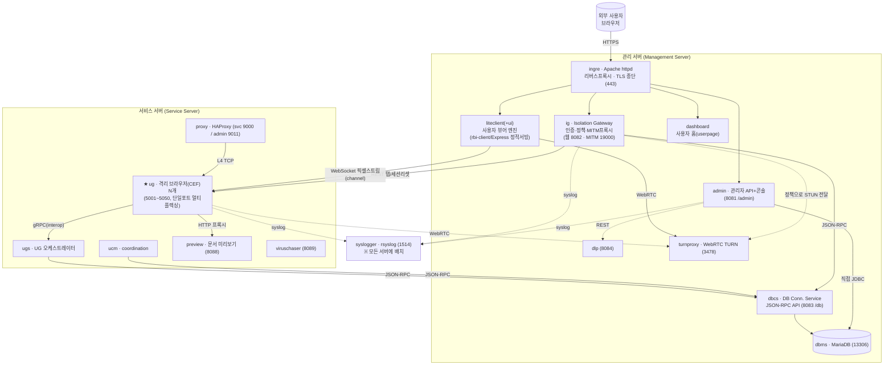
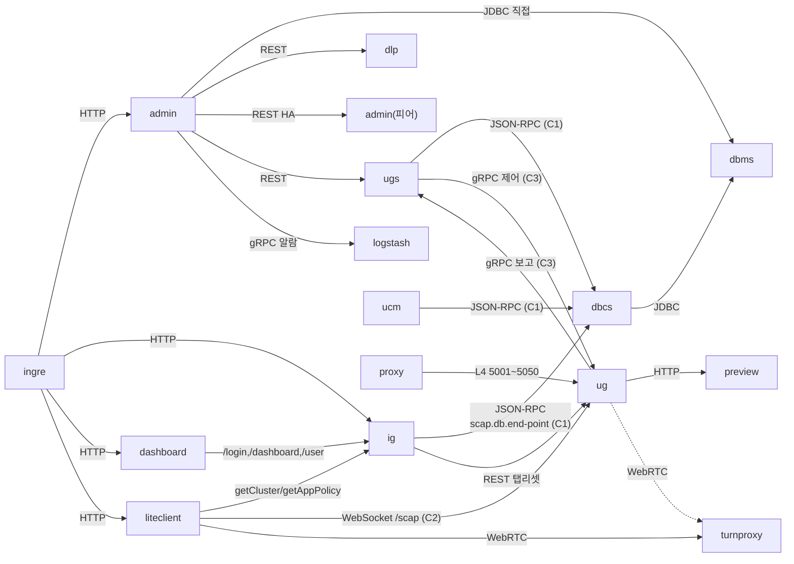
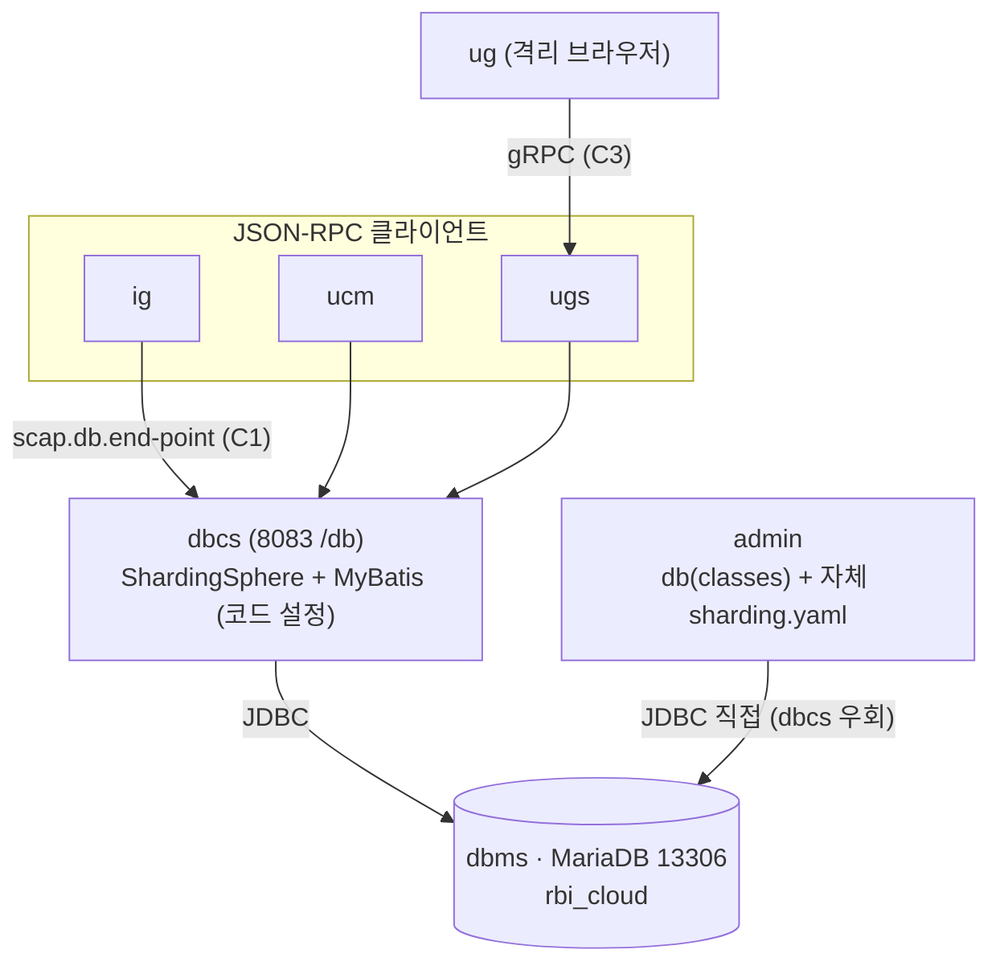

# RBI 솔루션 아키텍처 & 유지보수 가이드

> **목적**: RBI(Remote Browser Isolation, 원격 브라우저 격리) 솔루션을 구성하는 전체 모듈의 구조와 **상관관계**를 정리하고, 향후 **유지보수 · 기능 수정 · 신규 서비스 추가** 시 "어디를 봐야 하는지 / 무엇을 함께 바꿔야 하는지"를 빠르게 찾기 위한 기준 문서.
>
> **작성 기준일**: 2026-06-26 · 소스 코드 정적 분석 기반 (재작성판: `ug` 모듈 추가 및 전 모듈 재검증)
> **분석 대상 소스 저장소 (9개)**:
> `rbi.ig` · `rbi.admin` · `rbi.ig.security` · `db-parent` · `rbi-dashboard` · `rbi-liteclient` · `rbi-liteclient-ui` · `rbi-install-scripts` (모두 `C:\Development\Project\RBI\` 하위) + **`ug`** (`C:\Development\Project\ug`)

---

## 목차

1. [솔루션 개요](#1-솔루션-개요)
2. [전체 아키텍처 & 트래픽 흐름](#2-전체-아키텍처--트래픽-흐름)
3. [소스 저장소 ↔ 배포 모듈 매핑](#3-소스-저장소--배포-모듈-매핑)
4. [모듈 상관관계 — ★6대 모듈 간 계약](#4-모듈-상관관계--6대-모듈-간-계약)
5. [모듈별 상세](#5-모듈별-상세)
6. [데이터 계층 (DB · 샤딩 · 핵심 테이블)](#6-데이터-계층-db--샤딩--핵심-테이블)
7. [보안 · 인증 · 라이선스](#7-보안--인증--라이선스)
8. [빌드 · 배포 체계](#8-빌드--배포-체계)
9. [시나리오별 작업 가이드 (유지보수·기능수정·신규서비스)](#9-시나리오별-작업-가이드-유지보수기능수정신규서비스)
10. [부록 — 포트표 · 환경변수 · 용어집](#10-부록--포트표--환경변수--용어집)

> **이전 가이드 대비 주요 정정** (소스 재검증 결과)
> - **IG MITM 프록시 포트 = `19000`** (이전 18000 오기), IG 웹 포트 `8082`(DEV)/`8080`(기본)
> - **dbcs 포트 = `8083`, 컨텍스트 `/db/`** (소스 기본값)
> - **샤딩 기본 분할 수 = `1`(비샤딩)** — 코드 기본값. 10분할은 *배포 관례*(DDL이 `TC0~TC9` 물리테이블 사전 정의)
> - **admin 뷰 = 순수 JSP include 레이아웃** (Apache Tiles 아님)
> - **admin Retry DB = 4종** (`cadmin`/`admin`/`alarm`/`connection-client-statistics`)
> - **ug = Java 8 + CEF 기반 격리 브라우저** (신규 분석)

---

## 1. 솔루션 개요

**RBI(Remote Browser Isolation)** 는 사용자가 위험한 웹사이트를 자기 PC 브라우저로 직접 여는 대신, **서버 측 격리 브라우저(원격 브라우저)** 를 통해 접속하게 하여 악성코드/유출 위협을 사용자 단말로부터 차단하는 보안 솔루션이다.

동작의 큰 그림:

1. 사용자가 **사용자 홈(dashboard)** 에서 사이트를 클릭하거나 주소를 입력한다.
2. **IG(Isolation Gateway)** 가 인증·정책을 적용하고 어느 격리 브라우저(UG)로 연결할지 결정(`getCluster`)한다.
3. 서버에서 **격리 브라우저(UG)** 가 **CEF(Chromium)** 로 실제 사이트를 렌더링한다.
4. **LiteClient** 가 UG의 화면을 **픽셀(이미지) 스트리밍**(WebSocket 바이너리)으로 받아 OffscreenCanvas에 그리고, 사용자의 마우스/키보드 입력을 UG로 되돌려 보낸다.
5. 파일 다운로드/업로드·클립보드는 **사이트 정책(sitePolicy)** 게이팅 + 감사로그를 거치며, CDR(무해화)·DLP(유출방지)·백신 검사로 연계된다.

전체 솔루션은 **18개 배포 모듈**(컨테이너, `rbi-install-scripts` 기준)로 구성되며, 본 9개 저장소는 그중 핵심 애플리케이션 소스를 담는다. 배포·오케스트레이션은 `rbi-install-scripts`가 Docker(host networking) 기반으로 담당한다.

> **기술 스택 한눈에**
> - **백엔드(Java 21)**: Spring Boot 3.4.3 · MyBatis · Apache ShardingSphere 5.4.1 · JSON-RPC(jsonrpc4j) — `ig`, `admin`, `dbcs`, `security`
> - **격리 브라우저(Java 8)**: CEF(JCEF) · Netty(자체 `channel` 라이브러리) · gRPC(interop) · FFmpeg/Opus · pngj/turbojpeg/webp — `ug`
> - **프론트엔드(JS)**: Vanilla JS(프레임워크 없음) · Webpack 5 · Babel · javascript-obfuscator · jQuery/Bootstrap(liteclient) — `liteclient`, `liteclient-ui`, `dashboard`
> - **관리 UI**: 순수 JSP(include 레이아웃) + Vue 2 컴포넌트 번들(admin)
> - **인프라**: Docker(host networking) · MariaDB 10.11 · Apache httpd(ingre) · HAProxy(proxy) · rsyslog(syslogger)

---

## 2. 전체 아키텍처 & 트래픽 흐름

모든 컨테이너는 **`network_mode: host`** 로 동작한다. 즉 포트 매핑이 없고 호스트 IP(`RBI_IP`) 위에 모든 포트가 평면적으로 노출되며, 모듈 간 통신은 `localhost:<포트>` 또는 `${RBI_IP}:<포트>` 로 이뤄진다.



### 트래픽 흐름 요약

- **제어 평면(인증/정책)**: 사용자 → `ingre`(TLS 종단·경로 라우팅) → `admin`/`ig`/`dashboard`/`liteclient` → `dbcs`(내부 DB API) → `dbms`(MariaDB)
- **데이터 평면(격리 브라우징 화면)**: `liteclient` ↔ `ug` 간 **WebSocket 바이너리 픽셀 스트림**(`com.aircode.scap.channel` 프로토콜), 미디어는 `turnproxy`를 통한 WebRTC
- **격리 브라우저 오케스트레이션**: `proxy`(HAProxy L4) → `ug` 인스턴스(5001~5050) → `ug`가 **gRPC로 `ugs`에 상태 보고/제어 수신** / `ug` → `preview`(문서 미리보기 HTTP 프록시)
- **UG의 데이터 영속화 경로**: `ug`는 DB에 직접 붙지 않음. `ug` → **gRPC** → `ugs` → **JSON-RPC** → `dbcs` → **JDBC** → `dbms` (3-hop)
- **로그**: 모든 컨테이너 → Docker syslog 드라이버(`udp://localhost:1514`) → `syslogger`

> **두 개의 서버 역할**: mgmt(제어 평면: dbms/dbcs/admin/ig/ingre/liteclient/turnproxy/dlp), svc(데이터 평면: proxy/ucm/preview/ug/ugs/viruschaser). `syslogger`는 양쪽 모두. `.local.env`의 `MANAGEMENT_SERVER_MODULES`/`SERVICE_SERVER_MODULES`로 분리.

---

## 3. 소스 저장소 ↔ 배포 모듈 매핑

**핵심**: 분석 대상 소스 저장소(9개)는 배포 모듈(18개)의 **일부**다. 나머지 배포 모듈은 별도 저장소이거나 외부 이미지다.

| 소스 저장소 | 빌드 산출물 | 대응 배포 모듈 | 좌표/버전 |
|---|---|---|---|
| `rbi.ig` | `ig.war` | **ig** | `com.aircode.scap:rbi.ig:1.1.9` |
| `rbi.admin` (`c-admin`) | `admin.war` | **admin** | `com.aircode.scap:admin:1.1.6` |
| `rbi.ig.security` (`security-parent`) | `security-*.jar` | (라이브러리) | `com.aircode.common:security-parent:1.1.9` |
| `db-parent` | `dbcs.war` + `db-*.jar` | **dbcs** | `com.aircode.scap:db-parent:1.2.5` |
| **`ug`** ★신규 | `ug.jar`(fat) | **ug** | `com.aircode.scap:ug:3.3.5` |
| `rbi-liteclient` (`rbi-lc`) | `dist/*.js` | **liteclient** | `rbi-lc 1.6.0` |
| `rbi-liteclient-ui` (`rbi-ui`) | `aircode-rbi-ui-*.min.js` | (liteclient에 합쳐짐) | `rbi-ui 1.5.36` |
| `rbi-dashboard` | `dist/*` | (사용자 홈, `rbi-client/userpage`) | `rbi-dashboard 1.5.6` |
| `rbi-install-scripts` | `deplo`/`insta`/`rbictl` + `.xpack` | (배포 인프라) | — |

### 소스가 본 저장소에 없는 배포 모듈 (참고)

| 배포 모듈 | 역할 | UG와의 관계 |
|---|---|---|
| **ugs** | UG 여러 개 실행·상태 유지(오케스트레이터) | `ug`가 **gRPC(interop)** 로 보고·제어받는 상위. dbcs 의존 |
| **ucm** | Coordination(클러스터 조정) | proxy control(9011), dbcs 의존 |
| **proxy** | HAProxy 리버스 프록시 | `ug` 인스턴스(5001~5050)로 L4 분배 |
| **ug-base / preview-base** | ug·preview 기반 이미지 | `ug`는 `ug-base` 위에 빌드 |
| **preview** | 문서 미리보기 | `ug`가 `/preview/*` HTTP 프록시 |
| **turnproxy** | WebRTC TURN/STUN 미디어 릴레이 | `liteclient`·`ug` in-page WebRTC |
| **ingre** | Apache httpd 프론트도어 | 모든 사용자 트래픽 진입점 |
| **dbms** | MariaDB 10.11 | 공식 이미지 + 초기화 SQL |
| **cdr / dlp / viruschaser** | 무해화 / 유출방지 / 백신 (add-on) | `*_PORT=-1`이면 비활성 |
| **syslogger** | rsyslog 로그 수집 | 공통 |

> **프론트엔드 3종 혼동 주의**:
> - `rbi-dashboard` = **로그인 후 사용자 홈/포털**(즐겨찾기·검색·파일보관함). `rbi-client/userpage`로 배포되는 "허브".
> - `rbi-liteclient` = **격리 브라우저 뷰어(엔진)**. 사이트 클릭 후 원격 화면을 렌더링.
> - `rbi-liteclient-ui` = liteclient의 **UI 부품**(주소창·메뉴·팝업), 빌드 시 liteclient에 합쳐짐(전역 `RBIUI`).

---

## 4. 모듈 상관관계 — ★6대 모듈 간 계약

> 유지보수에서 가장 중요한 것은 "이 모듈을 바꾸면 **어떤 다른 모듈이 함께 깨지는가**"이다. RBI에는 **여러 모듈이 공유하는 6개의 계약(contract)** 이 있고, 이 계약을 건드리면 양쪽(또는 그 이상)을 **동시에 배포**해야 한다.

### 4.1 6대 계약 (변경 시 동시 배포 필요)

| # | 계약 | 정의 위치(소유자) | 소비자 | 깨지면? |
|---|---|---|---|---|
| **C1** | **DB 서비스 인터페이스 FQCN + 모델** (`com.aircode.scap.db.*`) | `db-parent/db` | dbcs(서버), ig·ucm·ugs(JSON-RPC 클라), admin(classes 직접) | 인터페이스 FQCN/시그니처/모델 필드 변경 → JSON-RPC 경로(`/jsonRpc/{FQCN}.json`) 및 클라 컴파일 깨짐 |
| **C2** | **SCAP 바이너리 프로토콜** (`com.aircode.scap:channel` 1.0.46) | 외부 `channel` 라이브러리 | **ug**(서버), **liteclient**(`CMDReader`/`CMDSender`) | 화면/입력 프레임 포맷·opcode 변경 → 화면 깨짐, 입력 오작동 |
| **C3** | **UG↔UGS gRPC proto** (`com.aircode.scap:interop` 1.0.30, `UgProto`) | 외부 `interop` 라이브러리 | **ug**, **ugs** | proto 필드/번호 변경 → 오케스트레이션·감사·에러 보고 깨짐 |
| **C4** | **HMAC 서명 페이로드** (`ScapAppLaunchSignParameter`/`ScapAppPaintSignParameter`) | **ug** `server/` | **liteclient**(서명 생성), ig(토큰 발급) | sitePolicy 항목 추가 시 서명 필드 순서 어긋나면 `ScapSignatureException` 인증 실패 |
| **C5** | **공통 보안 설정** (`CommonSecurityConfiguration`/`CommonSecurityProperties`, prefix `common.security`) | `rbi.ig.security` | **ig**, **admin** (`application.properties`) | 필터체인/프로퍼티 키 변경 → ig·admin 양쪽 인증 흐름 동시 영향 |
| **C6** | **샤딩 룰** (`cl_conn_client_tc` 분할/컬럼/알고리즘) | **이중 정의**: dbcs `DbcsConfiguration.java`(코드) ↔ admin `sharding.yaml` | dbcs, admin | 한쪽만 바꾸면 두 모듈이 서로 다른 물리 테이블을 봄(데이터 불일치) |

### 4.2 런타임 의존성 그래프 (누가 누구를 호출하는가)



### 4.3 통신 방식 매트릭스

| 호출자 | 피호출자 | 프로토콜 | 핵심 키 / 엔드포인트 |
|---|---|---|---|
| ingre | admin / ig / dashboard / liteclient | HTTP 프록시 | `ADMIN_PORT`/`IG_PORT`/… |
| **ig** | **dbcs** | HTTP **JSON-RPC** (C1) | `scap.db.end-point`(=`DBCS_URL`), `/db/jsonRpc/{FQCN}.json` |
| **ig** | **ug** | HTTP REST | `rbi.home.web-isolation-api-client.*` (탭/세션 리셋, `UgApiClientService`) |
| **admin** | **dbms** | **JDBC 직접** | `jdbc:shardingsphere:classpath:sharding.yaml` (dbcs 경유 안 함) |
| admin | dlp | REST | `scap.admin.http-url-dlp`(기본 `:8084`) |
| admin | admin(피어) | REST | `scap.admin.servers[N].end-point` (이중화 전파) |
| admin | ugs/cugs/ig/certification | REST | `ApiClientService` (`ServerModel.TYPE_*`) |
| admin | Logstash | gRPC | `scap.admin.alarm.logstash-alarm-manager.*` |
| ucm / ugs | dbcs | HTTP JSON-RPC (C1) | `scap.db.end-point` |
| dbcs | dbms | JDBC | ShardingSphere DataSource |
| **liteclient** | **ig** | HTTP fetch | `getCluster`, `getAppPolicy` (헤더 `ac-rbi-api-access-key`) |
| **liteclient** | **ug** | **WebSocket 바이너리** (C2) | `/scap?serverId=...` + HTTP `/resource`,`/file`,`/command`,`/preview`,`/auth` |
| liteclient / ug | turnproxy | WebRTC | `iceServers: turn:...:3478` |
| **ug** | **ugs** | **gRPC** (C3) | `scap.server.coordinator.ip/port` (`UgNode`) |
| **ug** | **preview** | HTTP 프록시 | `scap.app.preview.coordinator.ip/port` |
| **ugs** | **ug** | gRPC 역방향 제어 (C3) | `subscribeUgEvent` → Pause/Resume/Shutdown/Command |
| **proxy** | **ug** | TCP L4 패스스루 | `UG_MIN_PORT`~`UG_MAX_PORT` (5001~5050) |

### 4.4 핵심 통찰 (상관관계의 요점)

1. **DB 접근 경로가 두 갈래 + UG는 3-hop이다.**
   - `ig`·`ucm`·`ugs` → **dbcs를 JSON-RPC로 경유** (C1, `db-spring-boot-starter`)
   - `admin` → **DBMS에 직접 JDBC** (`db`(classes) + 자체 `sharding.yaml`)
   - **`ug` → gRPC → `ugs` → JSON-RPC → dbcs → JDBC → dbms** (UG는 DB를 전혀 모름)
   - ⚠️ 따라서 **샤딩 룰이 dbcs(코드)와 admin(yaml) 양쪽에 이중 관리**(C6)된다.

2. **두 개의 직렬화 계약이 데이터 평면을 지배한다.**
   - **C2(channel 바이너리)**: ug↔liteclient 화면/입력 — 이 저장소들 *밖*의 `channel` 라이브러리에 정의
   - **C3(interop gRPC)**: ug↔ugs 오케스트레이션 — 역시 *밖*의 `interop` 라이브러리
   - 즉 ug나 liteclient를 만지면서 새 메시지/필드가 필요하면 **외부 라이브러리(channel/interop)부터 올려야** 한다.

3. **`security` 라이브러리가 ig·admin의 공통 인증 기반(C5)이다.** `CommonSecurityConfiguration` 한 곳을 바꾸면 양쪽 동시 영향. 게다가 `security`는 ProGuard 난독화되어 public/protected만 유지된다.

4. **시작 순서는 데이터 기반이다.** `.local.env`의 `LATEST_VERSION_*` 선언 순서 = 실행 순서. 모듈 간 대기는 `MODULE_RUN_DEPENDS_ON` + TCP 포트 체크(**120초 하드코딩**)로 처리.

### 4.5 진행 중 계약 변경 (2026-07 기준)

- **C7(신설 중) — entry ↔ viruschaser 비동기 스캔 계약**: 대용량 스캔 시 entry의 60초 고정 타임아웃 끊김 대책으로 viruschaser를 콜백 방식으로 전환 중. 계약 정본은 entry 측 작성 `viruschaser/docs/viruschaser-virus-callback.md`(hrchoi), 구현 노트는 `docs/async-scan-callback.md`, 기존/신규 API 대조표는 `docs/api-overview.md`.
  - `POST /scan/jobs`(202+jobId, requestId 멱등) → 완료 시 `POST {callbackUrl}` + 결과 `{resultDirPath}/{jobId}.json` 디스크 영속화(재기동 후 조회 보장)
  - 응답 봉투는 기존 동기 API와 동일한 `{status, message, data}` 규약으로 통일 (2026-07-07 담당자 피드백 반영)
  - 브랜치 `feat-viruschaser-scan-callback-20260706`. 남은 작업: 도커 마운트를 entry 스토리지 루트와 동일 절대경로로 정렬, 실동작 검증, 안정화 후 동기 엔드포인트 제거

- **클립보드 통제 고도화 (클라이언트 선행, C1 확장 예정)**: liteclient에 방향·유형별 클립보드 정책 5종 집행 구현 — `allowInternalCopyPaste`(격리 내) / `allowCopyToLocal`(격리→로컬) / `allowPasteFromLocal`(로컬→격리) / `textOnly` / `textToImage`. 브랜치 `feat-clipboard-policy-20260714` (liteclient + liteclient-ui).
  - 판정 일원화 모듈: `rbi-liteclient\src\v2\solution\ClipboardPolicyManager.js`. **서버 정책 스키마 미확정 → 현재는 이 파일의 DEFAULT_CONFIG 하드코딩(전부 허용=기존 동작)으로만 동작**, sitePolicy.clipboardConfig 병합 로직은 TODO 주석으로 보류.
  - 스키마 확정 시 함께 움직여야 하는 것(C1 확장): admin 설정 UI·DB(clipboardConfig JSON 5키), ig getAppPolicy 응답, liteclient 병합 로직 활성화. 격리 페이지 자체 JS 복사의 완전 차단은 ug 측 협조 필요.
  - 정리된 이슈: 미사용 `allowedCopyToLocal`/`allowedLocalCopying` 필드명 불일치(구필드 하위호환 매핑 준비됨), 미정의 `base64ToBlob` ReferenceError 수정, PolicyBox '클립보드' 단일 표기 → 방향별 3항목 분리.

---

## 5. 모듈별 상세

### 5.1 ug — 격리 브라우저(User Gateway) ★신규

> **좌표**: `com.aircode.scap:ug:3.3.5-SNAPSHOT` · fat-jar(`ug.jar`) · 메인 `com.aircode.scap.html5.ScapHtml5Main` · 경로 `C:\Development\Project\ug`

**역할** — 서버 측에서 **CEF(Chromium Embedded Framework) 오프스크린 브라우저**를 실제로 구동해 위험 사이트를 렌더링하고, 그 화면을 픽셀(이미지)/DOM 미러로 liteclient에 스트리밍하는 **격리 브라우저 본체**. 한 UG 프로세스 = 한 TCP 포트 = 다수 격리 세션(Room). 클라이언트 입력을 CEF에 주입하고, 다운로드/업로드/클립보드/워터마크/미리보기를 **사이트 정책(`AppBrowserSitePolicy`)** 으로 통제한다.

**기술 스택** — **Java 8 (Oracle JDK 강제)** · 자체 Netty 서버 라이브러리 `com.aircode.scap:channel`(상속) · CEF 래퍼 `com.aircode.scap:cef:1.3.0`(네이티브는 `download.aircode.com`에서 빌드 시 다운로드) · gRPC `interop:1.0.30` · FFmpeg(`ffmpeg.javaav`)/Opus(`concentus`) · 이미지 인코딩(pngj/turbojpeg/webp/libimagequant) · log4j2 · fastjson. `js/`는 CEF 페이지 주입용 프리로드 스크립트(TreeMirror DOM 미러링 + WebRTC + 클립보드/네트워크 후킹).

**핵심 구조**
```
src/main/java/com/aircode/scap/
├─ html5/ScapHtml5Main.java        # 진입점 main()
├─ html5/ScapHtml5Server.java      # AppLaunch 수신 → AppBrowser 생성·launch
├─ html5/browser/
│  ├─ AppBrowserSitePolicy.java    # ★DLP 정책: download/upload/clipboard/watermark/preview/readonly/dragAndDrop/webRtc (1305줄)
│  ├─ AbstractAppBrowser.java      # 렌더링·입력·스트리밍 공통 (2574줄)
│  ├─ cef/CefAppBrowser.java       # ★CEF 본체: onPainted 캡처·입력주입·다운로드 (4080줄)
│  └─ cef/CefScapBridge.java       # window.cefQuery JS↔Java 브릿지 라우팅
├─ server/ScapAppServer.java       # ★Netty 서버(channel 상속): 클라/Room/UGS연동 (3087줄)
│  ├─ server/handler/              #   /command /file /preview /proxy /resource /auth (단일 포트 멀티플렉싱)
│  ├─ server/client/UgsClient.java #   UGS를 클라이언트로 표현 (gRPC UgNode)
│  └─ server/audit/               #   ★감사로그 6종(ISOLATED/USER DOWNLOAD/UPLOAD, CLIPBOARD COPY/PASTE)
├─ file/ScapFileStorage           # 업/다운로드 임시·격리 파일 저장
└─ graphic/Image.java             # 인코딩 진입(알파 유무로 PNG vs JPEG)

js/  (closure-compiler가 → rbi.preload.js 로 병합)
├─ scap.js      # 페이지측 SCAP API (window.cefQuery로 Java 호출)
├─ rbi.js       # RBI 인-페이지 에이전트 (DOM 동기화·클립보드·WebRTC·네트워크 필터)
└─ rbi-lib.js   # TreeMirror 라이브러리(MutationObserver DOM 직렬화)
```

**렌더링·스트리밍 동작**
1. liteclient가 `AppLaunchRequest`(URL·해상도·서명) 전송 → `ScapAppServer`가 서명 검증 후 `AppBrowserFactory`로 CEF 브라우저 확보 → `launch(url,w,h,zoom)`
2. CEF가 **오프스크린(OSR)** 으로 실제 Chromium 렌더(프레임레이트 `scap.cef.offscreen.framerate=15`), 프리로드 `rbi.preload.js` 주입
3. `CefAppBrowser.onPainted(ByteBuffer BGRA)` 콜백 → `Image` 생성 → **알파 유무로 PNG/JPEG 선택**, `dirtyRect` 부분 갱신만 잘라 인코딩
4. `ImageBlockStart` → `ImageResponse`(인라인) 또는 `ImageUrlResponse`(클라가 `/resource?key=`로 fetch) → `ImageBlockComplete` 순으로 **SCAP 메시지(C2)** 전송. DOM 모드는 `DomMutation/DomSync`
5. 입력 역방향: 클라 `MouseEventRequest`/`KeyEventRequest`/`ImeCompositionEventRequest` → CEF `dispatchMouseEvent/dispatchKeyEvent`로 주입

**연동** — Outbound: `ugs`(gRPC 보고/제어수신), `preview`(HTTP 프록시), `turnproxy`(in-page WebRTC). Inbound(단일 TCP 포트 멀티플렉싱): liteclient(`/scap` WS + `/resource`,`/file`,`/command`,`/preview`,`/auth`), ugs(gRPC 역방향 제어). proxy가 L4로 EXPOSE_PORT 라우팅.

**데이터** — DB 직접 접근 없음(모두 ugs에 gRPC 보고 → ugs가 dbcs 기록). 로컬: 세션폴더 `app_data/{serverId}/`, 리트라이 큐 `ug-retry.db`(SQLite), 파일 스토리지. 세션/상태는 메모리(`RoomManager`, 최대 `maxroom=10`/`maxapp=10`, 미사용 `exitafterused.timeout=1200s` 후 자동종료).

**포트** — 서비스 = `EXPOSE_PORT`(기본 5001, 범위 `UG_MIN_PORT`~`UG_MAX_PORT`). 파생: `4{port}` CEF inspector, `5{port}` JMX, `3{port}` JDWP(`entrypoint.sh` 산술 생성). gRPC는 아웃바운드 대상 `scap.server.coordinator.port`(9222).

**확장 포인트 / 주의**
- 새 JS↔Java 명령 → `CefScapBridge.COMMAND_EXECUTOR_MAP` + `scap.js` 래퍼
- 새 사이트 정책(DLP) 항목 → `AppBrowserSitePolicy` 필드 + **서명 페이로드(C4) 동기화** + liteclient 직렬화
- 다운로드/CDR/DLP 후킹 → `CefAppBrowser.createCefDownloadHandler`/`checkDownloadSitePolicy`. (`scap.app.file.register.url`은 현재 **미사용** — 외부 스캔 연동 자리)
- ⚠️ **C2/C3 강결합**: 화면·입력은 `channel` 라이브러리, ugs 연동은 `interop` proto. UG 단독 변경으로 끝나지 않음
- ⚠️ **HMAC 서명(C4)**: signVersion별 필드 순서 하드코딩 — sitePolicy 추가 시 liteclient와 1:1 일치 필수
- ⚠️ **Java 8 + Oracle JDK 고착**(JavaFX webkit 잔재 + JCEF). 업그레이드는 대규모 작업
- ⚠️ **CEF 네이티브 버전 짝**: `cef:1.3.0`(Java) ↔ `LIB_CEF_VERSION=1.3.0`(네이티브). 하나만 바꾸면 로드 실패
- ⚠️ **proguard 보존 규칙**: 리플렉션/직렬화 대상은 `proguard.conf`에 keep — 누락 시 **운영 jar(난독화본)에서만** 오류(Docker 미난독화본은 정상이라 발견 지연)

---

### 5.2 rbi.ig — Isolation Gateway (격리 게이트웨이)

> **좌표**: `com.aircode.scap:rbi.ig:1.1.9-SNAPSHOT` · packaging `war` · 메인 `com.aircode.scap.rbi.ig.Ig`

**역할** — RBI의 두뇌. ① **littleproxy-mitm 기반 MITM 포워드 프록시**(포트 **19000**)로 격리 트래픽을 가로채 인증·정책 적용·응답 변조(isolation/proxy/block 판정), ② liteclient/admin/dashboard용 **REST API 서버**(`/api/*`)로 `getCluster`(UG 분배)·`getAppPolicy`·AccessKey/Isolation Token/PAC 발급. 업무 데이터는 직접 DB에 붙지 않고 **dbcs에 JSON-RPC로 위임**(C1).

**기술 스택** — Java 21 · Spring Boot 3.4.3(war) · `littleproxy-mitm 1.1.1` + Netty · BouncyCastle 1.80 · Nimbus JOSE+JWT(HS256) · Caffeine 캐시 · `db-spring-boot-starter 1.2.5` · `security-spring-boot-starter 1.1.9`(C5) · `retry 1.0.16`(SQLite). `DataSourceAutoConfiguration` 제외(로컬 DB 미사용).

**핵심 구조**
```
com.aircode.scap.rbi.ig/
├─ Ig.java                  # 진입점 (SpringBootServletInitializer)
├─ autoconfigure/           # IgConfiguration, IgServer(프록시 기동·ProxyEventListener), IgProperties
├─ controller/              # IgController(/api/getCluster,getAppPolicy,getAccessKey), IgServerController, IgCacheController(/proxy.pac)
├─ service/IgServiceLocal   # ★핵심(1947줄): 토큰 검증/발급, AppRule 조회, ConnectionClient/Cluster 분배, retry
└─ proxy/
   ├─ ProxyEventListener            # ★확장 인터페이스: onAuthenticateEventOccurred / onHttpResponseRequested
   └─ littleproxy/                  #   LittleProxyServer, LittleProxyBearerAuthenticator(인증·SSO리다이렉트),
                                    #   LittleProxyHttpFilterAdapter(요청/응답 변조 진입점)
com.aircode.scap.rbi.home/          # 사용자포털·SSO·SMTP·UgApiClientService(UG 탭리셋 REST)
```

**연동** — dbcs(`scap.db.end-point` JSON-RPC, 핵심 C1), **UG(REST 탭/세션 리셋, `UgApiClientService`)**, 격리 대상 웹사이트(MITM), SSO 게이트웨이(인증실패 302), SMTP/OAuth2·OIDC/SAML2. 호출받는 쪽: liteclient/dashboard(`/api/*`), 사용자 브라우저(프록시 19000, PAC).

**데이터** — `SqlitePersistentRetryStore`(dbcs 쓰기 실패 시 재시도 큐, 경로는 외부 주입), Caffeine 캐시(User/AppRule/Session), MITM 동적 호스트 인증서를 `certification-save-path=./certification/`에 `.p12` 저장. 정적 서버 TLS는 `cert/keystore.p12`.

**환경 분기** — Env profile(DEV/AIRCODE/AWS/DOCKER) × Server Role(1/2/3, spring profile). 역할별 차이는 주로 분배 오프셋(`select-connection-client.sample-offset`). 설정이 (공통 properties)×(Env 4)×(Role 3)로 흩어져 우선순위 추적 난해.

**확장 포인트 / 주의**
- 인증 판정 → `ProxyEventListener.onAuthenticateEventOccurred` / `LittleProxyBearerAuthenticator`
- HTTP 요청/응답 변조 → `ProxyEventListener.onHttpResponseRequested` / `LittleProxyHttpFilterAdapter`
- 정책 판정 → `IgServiceLocal.getAppRuleByUserAndUrl`, `getCluster`의 `ClusterScope`(UCM=dbcs 선택 / UGS=ConnectionClient UG IP 직접)
- ⚠️ **dbcs 강결합(C1)**: `com.aircode.scap.db.*` 모델 변경이 ig 컴파일·런타임을 직접 깨뜨림
- ⚠️ **MITM 신뢰 체인**: CA(dbcs `TYPE_FOR_SUBORDINATE_1` 또는 로컬 p12) 만료/교체 시 전체 HTTPS 격리 SSL 오류. `certification.use=false`가 기본이라 환경별 활성 누락 주의
- ⚠️ DEV properties에 SMTP 비밀번호·OAuth client-secret·keystore 패스워드 **평문 커밋**

---

### 5.3 db-parent — 데이터 접근 계층

> **좌표**: `com.aircode.scap:db-parent:1.2.5-SNAPSHOT` · Maven 멀티모듈 (db / db-datasource / db-spring-boot / dbcs)

**역할** — 솔루션의 데이터 접근 계층.

| 하위모듈 | packaging | 역할 |
|---|---|---|
| **db** | war + **`classes` classifier jar** | DBMS에 직접 붙는 **핵심 라이브러리**(MyBatis Mapper + 샤딩 + JSON-RPC 서버/클라 핸들러). admin·dbcs·starter가 `classes`로 의존 |
| **dbcs** | war(실행형) | `db`를 Spring Boot 3.4.3 서버로 래핑. **포트 8083 컨텍스트 `/db/`**, 메인 `com.aircode.scap.db.dbcs.Dbcs`(Controller 제외 = 순수 RPC 서버) |
| **db-spring-boot** | (autoconfigure + starter) | 클라이언트 starter. ig/ucm/ugs가 의존 시 dbcs JSON-RPC 클라이언트 프록시 자동 생성 |
| **db-datasource** | (shardingsphere-infra-util) | ShardingSphere 5.4.1 `infra-util` **패치 빌드**(상류를 동일 GAV로 대체) |

**내부 API 형태** — REST가 아니라 **JSON-RPC over HTTP**(jsonrpc4j). `@org.springframework.stereotype.Service` 빈이 구현한 `@Service` **인터페이스**를 스캔해 `/jsonRpc/{인터페이스FQCN}.json`(prefix+FQCN+suffix)로 노출. 예: `http://host:8083/db/jsonRpc/com.aircode.scap.db.client.service.ConnectionClientService.json`. 클라이언트(`ScapDbClientConfig`)도 동일 규칙으로 프록시 생성(대칭 계약 C1). 서비스 인터페이스 ~42개(`ConnectionClientService`, `ClusterService`, `RbiAppService`, `RbiUserService` 등).

**샤딩** — [6. 데이터 계층](#6-데이터-계층-db--샤딩--핵심-테이블) 참조. 핵심: **코드 기본 분할 수 = 1(비샤딩)**, 대상 `cl_conn_client_tc`, 설정은 `DbcsConfiguration.java`(코드). admin은 별도 `sharding.yaml`(C6 이중관리).

**확장 포인트 / 주의**
- 새 도메인/테이블(비샤딩) → `db` 모듈에 `model`/`mapper(+xml, java와 co-located)`/`service` 추가. **인터페이스에 `@Service`** 부착해야 JSON-RPC 자동 노출. 새 테이블은 기본 `datasource0` 단일 라우팅
- ⚠️ **인터페이스 FQCN 리네임 시 클라 호출 경로 깨짐(C1)**. `db`(classes) JAR 버전 동기화 필수(`${project.version}` 일괄)
- ⚠️ 샤딩 변경 → `DbcsConfiguration.java`(코드) + admin `sharding.yaml` **양쪽**(C6)
- ⚠️ `shardingsphere-infra-util` 패치 고정 — ShardingSphere 업그레이드 시 이 모듈도 재작성
- ⚠️ 라이선스 프로파일(`LICENSE-KEYLOK`/`LICENSE-AWS`)에 따라 `JsonRpcServiceCreator` 컴파일 포함 여부가 달라짐 — 빌드 profile 주의

---

### 5.4 rbi.admin (c-admin) — 관리자 서버 + 콘솔

> **좌표**: `com.aircode.scap:admin:1.1.6-SNAPSHOT` · packaging `war` · 메인 `com.aircode.scap.admin.Admin` · 실모듈 경로 `rbi.admin/c-admin`

**역할** — 단일 통합 관리 서버 + 웹 콘솔(포트 **8081 `/admin`**). 관리자/RBI 사용자·권한, 앱/사이트/화이트리스트/PAC/결과템플릿(정책), 서버·접속클라이언트·IG·차단 통계, 알람·감사·CUG·DLP, 멀티테넌트(PP/Platform/Proxy)를 관리. **DBMS에 직접 JDBC(ShardingSphere) 접속**해 `rbi_cloud`를 읽고 쓰며 IG/UGS/피어 admin에 변경 전파.

**기술 스택** — Spring Boot 3.4.3 · **순수 JSP(include 레이아웃, Tiles 아님)** + **Vue 2.6 컴포넌트 번들**(사전 빌드 후 커밋, `manifest.json` 해시 로드) · MyBatis · ShardingSphere 5.4.1(직접) · Spring Security + `security-spring-boot-starter 1.1.7`(C5) + `crypto` · SAML2/OAuth2 · LDAP · lucy-xss.

**구조** — 도메인별 수직 분할(`controller`/`service`/`mapper`/`model`). RBI 전용 `rbi/{app,site,template,user,whitelist,ig,block,dlp,home}`. 컨트롤러 **~59개**(`/management/...` JSP + `.json`/`.action`). 대부분 **`db` 라이브러리 서비스 재사용**, admin 자체 Mapper XML은 18개(주로 통계). `db`(classes) 의존하되 db의 `Sharding*Configuration`은 **컴포넌트 스캔 제외**하고 자체 `sharding.yaml`+자체 알고리즘 사용.

**연동** — Outbound: DLP(REST), 피어 admin(REST HA), IG/UGS/CUGS/Certification(REST `ApiClientService`), Logstash(gRPC 알람), Fasoo(문서추적), AD/LDAP·HR(JDBC)·SMTP·SSO. Inbound: `/api/**`(updateSetting/updateMenu/checkHealth — **IP 제한** `hasIpAddress`). **Retry DB 4종**(SQLite): `cadmin-retry.db`·`admin-retry.db`(설정전파)·`alarm-retry.db`·`connection-client-statistics-retry.db`.

**인가** — URL **함수명 기반 권한 Voter**(`read-function-names`: view/get/index… vs `write-function-names`: save/delete/update…). 메뉴/권한 테이블 `CL_ADM_MENU_TC`·`CL_ADM_AUTHORITY_TC`·`*_ROLE_AUTHORITY_TR`·`*_USER_ROLE_TR`. 마스터 권한 `AUTH-ADMIN-RBI` 등. TOTP/MFA(`/admin/mfa.action`).

**확장 포인트 / 주의**
- 새 관리 화면 = `Controller`(`/management/...` JSP+`.json`) + `Service` + `Mapper(+xml)` + `model`. **추가로 `CL_ADM_MENU_TC`(메뉴)·`CL_ADM_AUTHORITY_TC`/`ROLE_AUTHORITY_TR`(권한) DML 마이그레이션** 필수(없으면 메뉴 미표시·403)
- URL 함수명 인가 규칙 준수(새 동사 쓰면 `*-function-names` 목록도 갱신)
- 핵심 설정: `autoconfigure/AdminProperties`(`scap.admin.*`), `common/service/{CommonService,ApiClientService}`, `config/task-config.xml`(스케줄 ~20개)
- ⚠️ 샤딩 이중관리(C6: admin yaml ↔ dbcs 코드), yaml이 프로파일·고객사별 다수 존재
- ⚠️ DLP는 자체 DB 없이 **외부 DLP 서버 REST 프록시**(`RbiDlpPatternController`) — DLP 서버 장애 시 패턴 화면 동작 불가
- ⚠️ `/api/**` IP 화이트리스트(`intercept-urls[11]`) — 환경 이전 시 갱신 필요

---

### 5.5 rbi.ig.security (security-parent) — 공통 보안 라이브러리

> **좌표**: `com.aircode.common:security-parent:1.1.9-SNAPSHOT` · packaging `pom` · 하위: `security`(코어, ProGuard) / `security-spring-boot-autoconfigure` / `security-spring-boot-starter`

**역할** — ig·admin이 공유하는 **설정 주도형 인증/인가 공통 라이브러리(C5)**. 소비 모듈은 `common.security.*` 프로퍼티만으로 Form/SAML2/OAuth2·OIDC/LDAP·AD/JDBC 인증, MFA(TOTP), URL 함수명 인가, CSRF/CORS/로그아웃을 구성. 자동설정 진입점 **`CommonSecurityAutoConfiguration` → `CommonSecurityConfiguration`**(`SecurityFilterChain @Order(101)`), 프로퍼티 **`CommonSecurityProperties`**(prefix `common.security`).

**연동** — `rbi.ig`(`pom.xml`)·`rbi.admin`(`pom.xml`)이 `security-spring-boot-starter` 의존. 소비 측은 `application.properties`의 `common.security.*`만 작성.

**확장 포인트 / 주의**
- 새 인증방식 → `security` 코어 로직 + `CommonSecurityProperties`에 `*LoginSetting` + `CommonSecurityConfiguration.filterChain()`에 `setXxxSetting()` (기존 SAML2/OAuth2 패턴 모방)
- ⚠️ **양쪽 동시 영향(C5)**: `CommonSecurityConfiguration` 변경 = ig·admin 동시 회귀 가능. 키 이름(`common.security.*`) 변경 시 다운스트림 `application.properties` **조용히 깨짐**
- ⚠️ **ProGuard 난독화**(`security/proguard.conf`): public/protected만 keep. 리플렉션/빈이름(`BeanUtil.getInstance`)/직렬화 참조 클래스를 private로 바꾸면 런타임 오류
- ⚠️ **라이선스 검증은 여기 없음** — 별도 `com.aircode.common:crypto` 모듈
- ⚠️ **`AbstractSecretStore.encrypt/decrypt`는 no-op 스텁**(인메모리 시크릿/ TOTP 시드 평문 저장) — 보안 공백 확인됨. 시크릿 암호화하려면 서브클래스에서 override 필요

---

### 5.6 rbi-liteclient (+ rbi-liteclient-ui) — 클라이언트 엔진 + UI

> **좌표**: `rbi-lc 1.6.0` / `rbi-ui 1.5.36` · Vanilla JS + Webpack 5 + javascript-obfuscator

**역할** — RBI **뷰어 엔진**. UG와 WebSocket으로 통신해 화면을 렌더링하고 입력을 전송하며, 다운로드/업로드/클립보드/인쇄/DLP/파일보관함을 정책(sitePolicy)대로 처리. `rbi-liteclient-ui`(전역 `RBIUI`)는 주소창·컨텍스트메뉴·파일보관함·팝업 등 UI 부품으로 빌드 시 liteclient에 합쳐진다.

**동작 (픽셀/이미지 스트리밍)**
1. `ProxyManager`가 IG에 `getCluster`/`getAppPolicy`(POST, `ac-rbi-api-access-key`) → `connectionClient` + `sitePolicy` 수신
2. `UGSConnector`/`WSClient`가 `{host}/scap?serverId=...`로 WebSocket 연결 → `CMDSender.reqAppLaunching` → `reqImage`
3. `CMDReader`가 **4바이트 정수 단위** 파싱(`totalLength→cmdCount→cmd`), `RES_IMAGE`(format 0=PNG/1=JPEG) 레이어 수신
4. `createImageBitmap` → **`canvas.worker.js`(OffscreenCanvas)** 합성 → `RES_IMAGE_BLOCK_COMPLETE`에 한 프레임 커밋
5. `src/v2/solution/event/*`가 마우스/키보드/스크롤/클립보드를 `CMDSender`로 전송

> 렌더 모드(`sitePolicy.paintMethod`): `CLOUD_TYPE_IMG=1`(주력) / `CLOUD_TYPE_DOM=0`(TreeMirror) / `CLOUD_TYPE_VIDEO=2`(WebRTC)

**구조** — `src/v1`(코어 통신: `WSClient`/`CMDReader`/`CMDSender`/`UGSConnector`/`UIManager`/`Constants`), `src/v2`(`RBIClient.js` **싱글톤 오케스트레이터** + `ProxyManager`/`DataManager`/`WebRtcHandler`/각종 Manager + `event/` + `aiStreamParser/`), `src/handler/ClientState.js`(상태머신), `worker/`. UI는 `src/components/{bar,feature,popup}/` + `RBIUI.js`.

**연동** — IG(`getCluster`/`getAppPolicy`), UG(WebSocket `/scap` + HTTP `/resource`,`/file`,`/auth`), turnproxy(WebRTC, `sitePolicy.webRtcConfig.iceServers`), AirDLP(Fasoo, SSE), 파일서버(`getConnectionClient`→handshake→`/file/*`). `ig.rbi.com/`는 **로컬 개발용 mock JSON**.

**확장 포인트 / 주의**
- 정책 항목 추가 → IG `getAppPolicy`의 `sitePolicy` → `RBIClient` getter(`isUseXxx`) → Manager/Handler 분기
- AI 사이트 SSE → `aiStreamParser/`에 파서 추가(ChatGPT/Claude/Gemini/Perplexity)
- 새 UI → `liteclient-ui/src/components/` + `RBIUI.js` 등록 → **ui 빌드 후 `copy-dist.ps1`로 liteclient/dist 복사**. 이벤트 계약 변경 시 `UiState.js`/`ClientState.js` 동기화
- ⚠️ **렌더링/프로토콜 변경 최고 주의(C2)**: `CMDReader`(수신)·`CMDSender`(송신)·`Constants`(opcode)·`UIManager`+`canvas.worker.js`가 UG 바이트 포맷(`channel` 라이브러리)과 강결합. `src/v2/worker/`와 배포용 `workers/` **두 곳 일치** 필수
- ⚠️ `RBIClient.js` 싱글톤이 모든 것을 보유 — 변경 영향 범위 큼
- ⚠️ `clientConfig.json`에 AirDLP 자격증명 평문(아래 7.5), import 대소문자 불일치(리눅스 빌드 위험)

---

### 5.7 rbi-dashboard — 사용자 홈 대시보드

> **좌표**: `rbi-dashboard 1.5.6` · Vanilla JS + Webpack 5 · 배포 대상 `rbi-client/userpage`

**역할** — **일반 사용자용 "사용자 홈"**. 로그인 후 허브: 즐겨찾기(폴더 그룹) · 검색 · **파일 보관함(CDR 무해화 상태)** · 허용 사이트 · 내 정보(비번/전 세션종료/OTP). 즐겨찾기 클릭 시 `/?url=...`로 격리 브라우저 오픈.

**기술 스택** — 순수 Vanilla JS(클래스 컴포넌트 + `onEvent` 콜백) · Webpack 5(멀티 엔트리) · express(로컬 정적 서버, 운영 미사용). **고객사별 화이트라벨링**: `COMPANY_NAME=kakaopay` 등으로 `assets/js/{회사}/theme.js`(전역 `companyTheme`) 교체.

**구조** — `Dashboard.js`(엔트리, `enableSiteGroup` 분기 — 단 **L27에서 `true` 하드코딩**) · `Dashboard.base.js`(평면) / `Dashboard.siteGroup.js`(폴더그룹, 실사용) · `components/`(Bookmark/BookmarkByGroup/FileBox/MyInfo/SearchInput/popup) · **`common/DataManager.js`(모든 백엔드 API 집약)** · `common/DashboardConfig.js`.

**연동** — DataManager가 상대경로로 백엔드 호출: `/login/*`, `/dashboard/*`(userInfo·userbookmark·whitelist), `/user/*`(비번·`getUgTabReset`·MFA totp). 파일보관함은 별도 파일서버 `getConnectionClient`→handshake→`/file/*`. AirDLP 토큰(`{airDlpUrl}/auth/oauth/fasoo-token`).

**확장 포인트 / 주의**
- 새 컴포넌트 → `components/`(클래스+onEvent), 새 백엔드 호출은 **`DataManager.js`에만** (컴포넌트 직접 fetch 금지 — 현행 준수)
- 고객사 추가 = `assets/js/{회사}/theme.js` + `package.json` `build:prod:{회사}` + webpack `ignore` 목록
- 배포 `build-and-copy.ps1`(→`rbi-client/userpage`), 릴리즈 `release.bat`. `publicPath` dev=`/userpage/` prod=`../`
- ⚠️ **즐겨찾기 변경은 base+siteGroup 양쪽 + 팝업 쌍**(`EditPopup.js`/`.siteGroup.js` 등) 모두 수정. 현재 `enableSiteGroup=true` 하드코딩이라 base는 사실상 데드코드
- ⚠️ `clientConfig.json`에 Fasoo AirDLP OAuth 자격증명 **평문** → 브라우저에 노출(아래 7.5)

---

### 5.8 rbi-install-scripts — 배포 오케스트레이션

> **좌표**: Docker(host networking) · CLI `deplo`/`insta`/`rbictl`(commander.js) · 실모듈 경로 `rbi-install-scripts/rbi-install-scripts`

**역할** — 솔루션 전체를 Docker 컨테이너로 빌드·패키징(xpack)·순서 실행·라이선스 발급. `.local.env`(사이트별 `work/local.env/<IP>-<도메인>.local.env`)를 **SSOT**로 삼아 이미지 버전을 결정.

**핵심 메커니즘**
- 모든 컨테이너 **`network_mode: host`**, 로깅 `driver: syslog`(`udp://localhost:1514`)
- 실행 순서 = `.local.env`의 `LATEST_VERSION_*` **선언 순서**. 대기 = `MODULE_RUN_DEPENDS_ON` + TCP 포트 체크(**120초 하드코딩**, 초과 시 경고 후 강행)
- `XEN_*` = base64 인코딩 비밀값(`entrypoint.sh`가 `base64 -d`, 로그엔 마스킹)
- **런타임 생성물**(git 비추적): `.compose.yml`(템플릿→envsubst), `.local.env`, `docker-*.sh`(심볼릭, `docker-activate.sh`만 추적), `solution.lic`, `deplo`/`insta`/`rbictl`, `target/`

**배포 모듈 18개**: `syslogger, dbms, dbcs, admin, ig, proxy, ucm, ingre, liteclient, turnproxy, preview-base, preview, ug-base, ug, ugs, viruschaser, dlp, cdr`. `ug`/`ugs`/`preview`는 base 이미지 의존, `ug`는 `UGS_REPLICAS`만큼 서비스 동적 생성(포트 풀 `UG_MIN~MAX_PORT`).

**CLI 3종**
| 도구 | 용도 | 핵심 명령 |
|---|---|---|
| `deplo` | 빌드/배포 호스트 | `batch [-b build / -r run / -i xpack / --mgmt / --svc]`, `license`, `wizard`, `doctor`, `sql` |
| `insta` | 고객 설치 | `install [modules...]`(xpack 해제→`~/.deploy/<버전>`), `uninstall` |
| `rbictl` | 고객 런타임 제어 | `run`/`stop <module>`, `config <module> [--access-ip / --session-timeout]` |

**서버 분리** — `MANAGEMENT_SERVER_MODULES`/`SERVICE_SERVER_MODULES`로 `--mgmt`/`--svc` 필터. ⚠️ **`-M`과 `-S` 동시 지정 시 service-only로 동작**(버그성, if-else 아님).

**환경설정 계층**(낮음→높음): 모듈 `./.env` → `.local.env`(SSOT, `LATEST_VERSION_*`) → CLI의 `solution.lic` 병합 → 런타임 이미지에 구워진 `target/<ver>/<module>.env`.

**라이선스** — `deplo license`가 **RSA(2048)+AES-256-CBC 봉투 암호화**: 랜덤 AES 키로 `.local.env` 암호화 → AES 키를 벤더 개인키로 RSA 암호화 → `{domain, encryptedAesKey, encryptedData}` = `solution.lic`. 복호는 고객사 `public_license_key.pem`. 메타: `LICENSE_DOMAIN`/`USERS`/`OVER`/`EXPIRE_AT`.

**확장 포인트 / 주의**
- 신규 모듈 → `<module>/`(`.env`/`.compose.template.yml`/`.Dockerfile`/`entrypoint.sh`/`docker-activate.sh`/`target/<ver>/`) → `.local.env`에 `LATEST_VERSION_<MODULE>`(위치=순서)·`<MODULE>_PORT`·mgmt/svc 목록 → `batch-build.sh`의 `MODULE_DEPENDENCIES` → add-on이면 ingre/proxy 노출
- ⚠️ 실행 순서가 `.local.env` 텍스트 줄 순서에 의존(재배치만으로 부팅 순서 깨짐)
- ⚠️ host networking 포트 평면 충돌(mgmt+svc 동일 호스트 시), `*_PORT=-1`=비활성
- ⚠️ 런타임 생성물 직접 편집 금지 — 원본(`.compose.template.yml`, `work/local.env/*`, `scripts/docker-*.sh`)을 수정

---

## 6. 데이터 계층 (DB · 샤딩 · 핵심 테이블)

### 6.1 DB 연결 구조



### 6.2 샤딩 (ShardingSphere 5.4.1)

- **샤딩 대상 = `cl_conn_client_tc` 단일 논리 테이블** (UG 접속/슬롯 상태)
- ⚠️ **코드 기본 분할 수 = 1 (비샤딩, 단일 물리 테이블)** — `DEFAULT_SHARDING_CONNECTION_CLIENT_TABLE_COUNT=1`. **10분할은 배포 관례**(DDL `install_mysql_1.1.sql`이 `CL_CONN_CLIENT_TC0`~`TC9` 물리 테이블을 사전 정의). 실제 분할 수는 `scap.db.sharding.connection-client.table-count`로 설정
- 샤딩 키: DB 전략 = `cluster_id`, 테이블 전략 = `ug_port`, 알고리즘 = `ModuloShardingAlgorithm`(값 % 대상수). 추가로 hint/none-hint 룰 등록
- 나머지 테이블은 `datasource0` 단일 라우팅(비샤딩)
- ⚠️ **이중 관리(C6)**: dbcs는 `DbcsConfiguration.java`(코드), admin은 `sharding.yaml`(프로파일/고객사별 다수). 분할 수·컬럼·알고리즘 변경 시 양쪽 동시 + 물리 테이블 선생성

### 6.3 핵심 테이블 (명명 규칙)

**접두사**: `CL_`(클라우드 코어) · `RBI_`(RBI 앱/정책/감사) · `MLS_`(Oracle 멀티테넌시)
**접미사**: `_TC`(설정/마스터·코드) · `_TR`(관계 N:M) · `_TH`(이력/통계)

| 도메인 | 주요 테이블 |
|---|---|
| 접속(샤딩) | `CL_CONN_CLIENT_TC` (+0~9) — PK `CLUSTER_ID,UG_IP,UG_PORT,UG_SLOT` |
| 클러스터/디바이스 | `CL_CLUSTER_TC`, `CL_DEVICE_TC`, `CL_DEVICE_STATUS_TH` |
| RBI 사용자/사이트 | `RBI_USER_TC`, `RBI_SITE_GROUP_TC`, `RBI_SITE_TC` |
| RBI 앱/정책 | `RBI_APP_TC`, `RBI_APP_POLICY_TC`(proxy_mode BYPASS/BLOCK/ISOLATION), `RBI_APP_PAC_TC`, `RBI_APP_USER_GROUP_TC` |
| RBI 결과/이력 | `RBI_RESULT_TEMPLATE_TC`, `RBI_IG_REQUEST_TH` |
| 관리자 계정/권한 | `CL_ADM_USER_TC`, `CL_ADM_AUTHORITY_TC`, `CL_ADM_MENU_TC`, `CL_ADM_ROLE_TC`, `*_USER_ROLE_TR`, `*_ROLE_AUTHORITY_TR` |
| 통계/감사/알람 | `CL_ADM_STATS_*_TH`, `RBI_ADM_STATS_IG_REQUEST_TH`, `CL_ADM_AUDIT_TH`, `*_USER_ALARM_TH` |

> DDL 정본: `db/sql/`(MySQL `install_mysql_*.sql`), `db/sql/t_cloud/oracle/`(Oracle). admin의 `sql/rbi`·`sql/t_cloud`는 주로 메뉴/권한 **DML 델타**.
> 멀티테넌트: `sql/rbi`(RBI 단독, `AUTH-ADMIN-RBI`) vs `sql/t_cloud`(클라우드, `AUTH-ADMIN-PLATFORM`/`PP`).

---

## 7. 보안 · 인증 · 라이선스

### 7.1 인증/인가
- **공통 기반(C5)**: `security-spring-boot-starter` → `CommonSecurityConfiguration`(`@Order(101)`, ig·admin 공유)
- **방식**: Form · SAML2 · OAuth2/OIDC · LDAP/AD · JDBC · **MFA(TOTP)**
- **인가**: URL 함수명/접미사(read/write) 기반 권한 Voter + 마스터 권한 우회
- **토큰**: IG의 API AccessKey/Isolation Token/Authentication Bearer = **HS256(앱별 `secretKey`)**. 프록시 bearer는 쿠키(`ac-rbi-token`)
- **ICAM SSO (진행 중, 2026-07)**: 외부 계정관리(ICAM, `https://icam.sgasol.kr`) 연동. 진입 `https://icam.sgasol.kr/sgim/sso/login?redirect_uri={RBI 콜백}` → 로그인 후 `{redirect_uri}?accessToken={JWT}` 리디렉션(RS512, exp 1h, 진입 시 기존 세션 클리어). 구현은 rbi.ig `com.aircode.scap.rbi.home.icam` 패키지 4클래스(기존 코드 무수정 분리), 스위치 `rbi.home.icam-login.use`(기본 false), 공개키 `cert/icam.sgasol.kr_jwt_public.pem`. 그룹 매핑: 토큰 scope의 `aircode/그룹` 항목을 DB 대조, 미매칭 시 `icam-login.group-name` fallback, scope에 그룹 없으면 로그인 거부. ⚠️ 기존 `/jwt/login`(DLP용)은 서명 무검증 — 별개 경로임에 주의. `.properties` 한글 값은 반드시 `\uXXXX` 이스케이프(ISO-8859-1 파싱).

### 7.2 격리 데이터 평면 보안
- **MITM(HTTPS 격리)**: IG가 CA(dbcs `TYPE_FOR_SUBORDINATE_1` 또는 로컬 p12)로 사이트 인증서를 **동적 위조**. 클라가 루트 CA 신뢰 필요. `rbi.ig.certification.use`로 출처 전환
- **HMAC 서명(C4)**: UG `AppLaunch`/`Paint` 메시지를 `ugToken` 키로 서명 검증(`ScapAppSignature`). signVersion별 필드 순서 하드코딩 — liteclient와 1:1 일치
- **사이트 정책 게이팅(UG)**: `AppBrowserSitePolicy`가 download/upload/clipboard/watermark/preview/readonly/dragAndDrop/webRtc를 통제. 위반/행위는 **감사로그 6종**(`ISOLATED/USER_DOWNLOAD/UPLOAD`, `CLIPBOARD_COPY/PASTE`)으로 gRPC 보고

### 7.3 요청/응답 암호화
- `CryptoFilter`(`com.aircode.common:crypto`): 지정 API 본문 암복호화, `/api/getEncryptConfig` 키 교환
- 프론트(dashboard/liteclient)도 로그인 파라미터 암호화(`EncryptionManager`)

### 7.4 라이선스 (RSA + AES 봉투 암호화)
- `solution.lic` = `{ domain, encryptedAesKey, encryptedData }` (8.x deplo license 참조)
- 검증: 고객사 `public_license_key.pem`으로 AES 키 복호 → `.local.env` 복원. **공개키가 벤더 개인키로 암호화된 것만 풀 수 있다는 점이 유효성 게이트**
- 애플리케이션 측: `dbcs`는 keylok 동글(`LICENSE-KEYLOK` 프로파일) + `LicenseExpirationMonitor`. 검증은 `crypto`/`license` 모듈 책임(`security`에는 없음)

### 7.5 ⚠️ 알려진 보안 점검 사항 (분석 중 확인)
- **ig** DEV properties에 SMTP 비밀번호·OAuth client-secret·keystore 패스워드 **평문 커밋**
- **dashboard** `clientConfig.json` + `DataManager.getFasooToken()` 폴백에 Fasoo AirDLP OAuth 자격증명(`clientId:clientSecret`) **평문** → 빌드 시 `dist/config/`로 복사되어 **모든 브라우저에 노출**. 백엔드 프록시 발급 권장
- **security** `AbstractSecretStore.encrypt/decrypt` no-op 스텁(인메모리 TOTP 시드 평문 저장)
- **admin** 초기 비밀번호·이중화 엔드포인트 properties 평문
- **ug** `fastjson` 직접 사용(외부 입력 파싱 경로 점검 권장)

> 운영 배포 시 자격증명 외부화/마스킹 검토 권장. (본 가이드 범위 밖의 별도 과제)

---

## 8. 빌드 · 배포 체계

### 8.1 모듈별 빌드 방식

| 모듈 | 빌드 | 산출물 | 비고 |
|---|---|---|---|
| ig / admin / dbcs | Maven (`-P DEV/AIRCODE/AWS/DOCKER` + 고객사) | `.war` | Java 21 |
| security / db 라이브러리 | Maven (`install` → Nexus/.m2) | `.jar` | security/db는 ProGuard |
| **ug** | Maven (멀티스테이지 Docker, `-PDOCKER` fat-jar) | `ug.jar` | **Java 8** · CEF 네이티브 다운로드 · xvfb 런타임 · Docker는 proguard/minify 끔 |
| liteclient / liteclient-ui | Webpack + obfuscator | `dist/*.js` | ui→liteclient `copy-dist.ps1` |
| dashboard | Webpack (`build:prod[:고객사]`) | `dist/*` → `rbi-client/userpage` | 빌드 시 버전 대화형 입력 |

- **Java 환경 분기**: Maven profile(DEV/AIRCODE/AWS/DOCKER + 고객사 GS/SSG/CJO/LOTTE/HYUNDAI/ABN…). 각 profile은 `resources/<PROFILE>/`만 포함
- **사내 인프라**: Nexus(`rndbuild.aircode.com`, 의존성/배포), GitLab

### 8.2 컨테이너 배포 (rbi-install-scripts)

```
deplo batch -b        # activate + build (이미지 빌드/로드), -j N 병렬
deplo batch -r        # run (의존 포트 120초 체크 후 순서대로)
deplo batch -i        # xpack 패키징 (.xpack + solution.lic + public_license_key.pem + CLI + docs + sql)
deplo batch --mgmt    # 관리서버 모듈만   (⚠️ --svc와 동시 지정 금지)
deplo batch --svc     # 서비스서버 모듈만

# 공용 스크립트 (모듈 폴더에서 심볼릭 링크)
./docker-clear.sh && git pull && ./docker-build.sh && ./docker-run.sh && ./docker-tail.sh
```

### 8.3 버전 · 브랜치 규칙 (install-scripts README 기준)

```
master
  └─ rbi-x.y.z                              # 버전(develop) 브랜치
       ├─ {개인 브랜치}                      # 담당 모듈 작업
       ├─ feat_{feature}_YYmmdd             # 공통 기능 (trunk-based)
       ├─ fix_{target}_YYmmdd               # 공통 버그수정
       └─ rbi-x.y.z-rcN-{고객사}-{배포일}    # 사이트 배포용 (rc 태그 기준)
```

- 긴급 패치 → 커밋에 `rbi-x.y.z-rcN` 태그 + 로그에 대상 사이트 명시
- 사이트 배포 → rc 태그 지점에서 브랜치 생성, `site/<고객사>/<버전>/<배포일>/`에 `local.env`+SQL → `build-solution-by-file.lic.sh` → `deplo batch -i`

### 8.4 로컬 개발 빌드·구동 — dbcs + ig (2026-07-08 실검증)

로컬 3계층 체인: **ig(8082) ─JSON-RPC→ dbcs(8083) ─JDBC→ MariaDB(3306/rbi_cloud)**. 이 PC(193.200.10.116) 기준.

| 모듈 | 빌드 | 구동 | 확인 |
|---|---|---|---|
| dbcs | `db-parent`에서 `mvn clean install -DskipTests` (DEV 프로파일 기본 활성) | `java -Dspring.profiles.active=dev -jar target\dbcs.war` (db-parent\dbcs에서) | 8083 리스닝, 루트 404 = 정상(JSON-RPC 전용) |
| ig | `rbi.ig`에서 `mvn clean package -DskipTests` (~50초, 산출 `target\ig.war` 실행형) | `java -Dspring.profiles.active=1-dev -jar target\ig.war` | 8082 리스닝, 루트 → `302 /userpage/login/` |

- **순서**: MariaDB 확인 → dbcs → ig (ig의 dev 설정 `scap.db.end-point=http://193.200.10.116:8083/db`가 dbcs를 가리킴).
- **DEV 리소스 함정**: 두 프로젝트 모두 `src/main/resources/DEV/`를 Maven generate-resources 단계에서 target으로 복사 — **IntelliJ Rebuild는 이 복사를 안 하므로** Rebuild 후엔 `mvn compile` 필요 (rbi.ig는 IntelliJ "rbi.ig [compile]" 실행구성 사용). ig 기동 로그에서 db 서비스가 `...JsonRpc` 프록시로 생성되면 DEV 설정이 제대로 로드된 것.
- **콘솔창 구동(선호 방식)**: `rbi-mcp\launch\run-*.cmd`(apache/dbcs/ig/rbi-client) 더블클릭, 또는 rbi-tools MCP `start_servers`/`stop_servers`. 창을 닫으면 서버 종료. **`start_servers(all)` = Apache(80/443)→dbcs→ig→rbi-client(8080) 풀 로컬환경** — 로컬 Apache는 `C:\Apache24-local.aircode.com`(프록시 프런트, 바탕화면 start-servers.bat가 기존 수동 기동 수단이었음).
- IntelliJ: rbi.ig "Ig" 실행구성은 env(dev)+VM(1-dev) 중 **VM이 우선 → 실제 1-dev**. db-parent "Dbcs" 실행구성은 `-D...`가 프로그램 인자 칸에 있어 무시 의심 — VM 옵션 칸 권장.
- **클라이언트 로컬 배포 (2026-07-13 검증)**: dashboard·liteclient 빌드 결과를 로컬 `rbi-client`(Express 8080, `/userpage`·`/liteclient` 정적 서빙)로 복사 — NAS 배포와 별개.
  - 실행: MCP `deploy_local_client` 또는 `rbi-mcp\launch\deploy-local-client.ps1 [-Dashboard prod|dev|skip] [-Liteclient prod|dev|skip]` (기본 dashboard=prod, liteclient=dev).
  - 내부 동작: dashboard = `build-and-copy.ps1 -Mode <mode>`(빌드+userpage 복사, 버전은 package.json 현행) / liteclient = `copy-dist.ps1 [-dev]`(UI) → `npm run build[-dev]`(버전 현행 유지 입력) → css·dist·font·images·lib·workers·errorDataSet·index.html을 `rbi-client\liteclient`로 복사.
  - 정적 서빙이라 rbi-client 재시작 불필요. 반영 확인: `http://localhost:8080/liteclient/index.html`의 `_VERSION_`, 브라우저는 Ctrl+F5.

### 8.5 로컬 WSL 풀스택 설치 — Rocky8 (2026-07-09 설치, 1.5.6-hotfix 실사 기준)

이 PC의 WSL `Rocky8` 배포판에 **제품 풀스택(RBI 1.5.6-hotfix)이 rbi-install-scripts 표준 절차로 설치**되어 있다. 8.4의 소스 개발 체인(ig+dbcs)과 별개로, 전 모듈이 제품 패키징 형태로 도는 로컬 검증 환경.

**경로 구조** (사용자 `aircode`)

| 경로 | 역할 |
|---|---|
| `/home/aircode/cloud/<모듈>/{bin,config}` | 배포 루트. 컨테이너에 `/cloud/bin`·`/cloud/config`로 마운트 — **호스트에서 war/jar만 교체하면 모듈 교체 가능** (ig=`ig/bin/ig.war`, ug=`ug/bin/ug.jar`) |
| `/home/aircode/cloud/{log,cert,storage}` | 공용. 로그는 syslog 드라이버 → syslogger → `log/*.log` (ig 로그명은 `rbi.ig.log`) |
| `/home/aircode/rbi-install-scripts` | 설치 스크립트 체크아웃. 모듈별 `<모듈>/.compose.yml`+`.env`(독립 compose 프로젝트), **공용 설정 정본 = `.local.env`** (`RBI_DOMAIN=airrbi.aircode.com`, `RBI_IP=127.0.0.1`, UCM `single-docker`, UGS 레플리카 1, UG_MAX_TAB 5). CLI: `insta`·`rbictl`(ELF), `build-batch.sh` |
| `/home/aircode/rbi-1.5.6-hotfix` | 설치 원본 (rbi.zip, liteclient-1.5.43-hotfix.xpack, solution.lic, 라이선스 공개키) |
| `rbi-install-scripts/wsl/` | WSL 전용 보조 (port-forwarding.sh=socat, docker-compose.yml) |

**컨테이너 14개** (전부 `network_mode: host` — 포트 매핑 없이 앱 설정 포트 그대로):
dbms 1.5.5(MariaDB) · dbcs 1.2.5 · ig 1.1.8 · admin 1.1.7 · ucm 1.2.4 · ugs 1.2.3 · ug 3.3.4(컨테이너명 `ug-5001`) · liteclient 1.5.43 · preview 1.0.8 · proxy 2.0.1 · turnproxy 1.0.3 · ingre 1.0.2 · dlp 1.0.0 · syslogger 1.0.5

**운영 주의**
- **ug만 `restart=unless-stopped`, 나머지 13개는 `restart=no`** → WSL 재기동 시 ug만 자동 복구. 전체 기동은 rbi-tools MCP `wsl_rbi`(status/start/stop/logs) 또는 WSL 안에서 `deplo batch -r`(의존 포트 체크 후 순서 기동).
- 기동 순서는 syslogger(로깅 드라이버 대상) → dbms → dbcs → 나머지.
- Windows에서 원커맨드: `wsl -d Rocky8 -- docker ps -a` 식으로 접근 가능 (기본 사용자가 docker 권한 보유).

### 8.6 로컬 단독 ug 격리 연결 — 8.4 체인에 웹격리 붙이기 (2026-07-14 구축·실검증)

8.4 소스 체인(Apache+ig+dbcs+rbi-client)에 **Docker Desktop의 단독 ug 컨테이너(이름 `ug`, 5001→8100)** 를 연결해, UGS/UCM 없이 로컬에서 격리 실행까지 되는 구성.

**연결 체인**
```
liteclient ─wss://airrbi.aircode.com/scap?serverId=UG_SERVER_10_5001_116─▶ Apache(443) ─ws://127.0.0.1:5001─▶ ug(8100)
```

**구성 요소 3가지** (하나라도 빠지면 아래 증상 참조)

| 구성 | 내용 | 빠졌을 때 증상 |
|---|---|---|
| Apache wss 프록시 | `httpd.conf`에 `mod_proxy_wstunnel` 활성 + 443 vhost에 `ProxyPass /scap ws://127.0.0.1:5001/scap` (catch-all `/`보다 **앞**) | wss 연결 실패 (IG 모드는 wss 강제 + https 페이지에서 ws:// 혼합콘텐츠 차단이라 ug 직결 불가) |
| 로컬 DB 등록 | `cl_cluster_tc`에 `UCM-LOCAL-1`(DOMAIN=airrbi.aircode.com, PORT=443 — DOMAIN이 있으면 응답 ipAddress=null) + `cl_conn_client_tc1`에 슬롯 5개(193.200.10.116:5001, `UG_SERVER_10_5001_116`, **UG_TOKEN=ug의 `scap.app.token` 값 필수**). 데브 슬롯(10.25)은 UNAVAILABLE 처리 | UG_TOKEN NULL → ig 서명 NPE로 `getConnectionClient` **500**. 데브 슬롯 살아있으면 데브 UG로 배정됨 |
| ug 검증토큰 스위치 | `ug\ug.env`의 `verification.token.use=${SCAP_VERIFICATION_TOKEN_USE:-true}` + compose/`docker create -e`에서 `false` 지정. **기본 true라 운영 무영향** | `ScapOwnerTokenMismatchException` — env의 검증토큰이 플레이스홀더(`clientToken`)라 UGS 없는 로컬에선 항상 거절 |

**주의·원복**
- ug.env는 이미지에 COPY되어 컨테이너에서 source됨 → 수정 반영은 이미지 재빌드 or `docker cp ug.env ug:/cloud/ug.env` 후 재기동. env 추가는 컨테이너 재생성만 가능.
- dbcs GC가 UNAVAILABLE 슬롯을 주기 삭제 → 데브 슬롯 원복은 `rbi-mcp\backups\backup-ug-tables-20260714.sql` 적재.
- liteclient 로컬 배포 시 `config` 폴더 누락 금지(deploy-local-client.ps1에 포함됨) — 빠지면 clientConfig.json 404로 클라이언트 설정 전체가 기본값.

---

## 9. 시나리오별 작업 가이드 (유지보수·기능수정·신규서비스)

> "무엇을 하려면 **어디를 보고, 무엇을 함께 바꿔야 하는가**" 빠른 참조. 각 시나리오의 ⚠️는 함께 배포해야 하는 계약(C1~C6)을 표시.

### 9.1 격리 정책(다운로드/클립보드/워터마크 등) 추가·변경 — **가장 빈번**

영향 범위가 가장 넓다. **5개 모듈 + DB**를 순서대로 건드린다:

1. **DB**: `RBI_APP_POLICY_TC` 컬럼 추가(`db/sql/rbi/{새버전}_db.sql`)
2. **db/dbcs**: `RbiAppService` 등 모델/매퍼에 필드 추가 → **⚠️ C1**(dbcs↔ig/ucm/ugs 동시 배포)
3. **ig**: `getAppPolicy` 응답에 정책 포함 + 필요 시 `ProxyEventListener`/`LittleProxyHttpFilterAdapter` 적용
4. **liteclient**: `sitePolicy` → `RBIClient` getter(`isUseXxx`) → Manager/Handler 적용, mock `ig.rbi.com/getAppPolicy`에도 추가
5. **ug**: `AppBrowserSitePolicy`에 필드/getter 추가 + **⚠️ C4**(서명 페이로드 `ScapAppPaintSignParameter` 순서를 liteclient와 동기화) + CEF 적용 로직(`CefAppBrowser`)
6. **admin**: 정책 관리 화면(`rbi/app` 컨트롤러+JSP) + **메뉴/권한 DML**

> 클립보드/다운로드처럼 UG가 실제로 강제하는 정책은 **liteclient(표시·게이팅)와 ug(실제 통제)를 모두** 고쳐야 하며, 둘 사이 서명(C4)이 어긋나면 세션 자체가 인증 실패한다.

### 9.2 격리 브라우저 화면 렌더링/입력 처리 변경 (★ug 소스 편입)

1. **ug 캡처/인코딩**: `CefAppBrowser.onPainted`(BGRA 캡처), `graphic/Image`·`ImageUtil`(PNG/JPEG/WebP), `ug.env`의 `paint.type`/`turbojpeg.use`/`offscreen.framerate`
2. **ug 전송**: `ScapAppServer`의 `ImageResponse`/`ImageBlockStart/Complete` 생성
3. **liteclient 수신**: `src/v1/solution/CMDReader.js`(4바이트 파싱, format 0=PNG/1=JPEG)
4. **liteclient 합성**: `UIManager.js` + `src/v2/worker/canvas.worker.js`(+배포용 `workers/` 사본 일치)
5. **입력**: ug는 `CefAppBrowser.onClientMouse*/onClientKey*`, liteclient는 `CMDSender` + `src/v2/solution/event/*`
6. ⚠️ **C2**: 프레임 포맷·opcode는 외부 `com.aircode.scap:channel` 라이브러리에 정의 — 새 메시지/필드는 **channel 버전부터** 올리고 ug·liteclient 동시 배포
7. ⚠️ ug↔ugs 상태 변화가 동반되면 **C3(interop proto)** 도 확인

### 9.3 관리 콘솔에 새 화면/메뉴 추가

1. **admin**: `Controller`(`/management/...` JSP+`.json`) + `Service` + `Mapper(+xml)` + `model` (영속이 기존 도메인이면 `db` 라이브러리 서비스 재사용)
2. **JSP 뷰**: `webapp/WEB-INF/view/<도메인>/`(default include 레이아웃), 필요 시 Vue 컴포넌트(`c-admin/vue`, 빌드 후 번들 커밋)
3. **메뉴/권한 필수**: `CL_ADM_MENU_TC` + `CL_ADM_AUTHORITY_TC`/`ROLE_AUTHORITY_TR` **DML 마이그레이션**(`sql/rbi`·`sql/t_cloud` 양 계열) — 없으면 메뉴 미표시·403
4. URL 함수명 인가 규칙(read/write) 준수, 새 동사면 `*-function-names` 목록 갱신

### 9.4 사용자 홈(dashboard)에 기능 추가

1. **컴포넌트**: `src/client/dashboard/components/`에 클래스+onEvent 패턴
2. **백엔드 호출**: 반드시 `common/DataManager.js`에만 (컴포넌트 직접 fetch 금지)
3. ⚠️ 즐겨찾기 계열이면 `Dashboard.base.js` + `Dashboard.siteGroup.js` 양쪽 + 팝업 쌍(`*.js`/`*.siteGroup.js`)
4. **배포**: `build-and-copy.ps1` → `rbi-client/userpage`

### 9.5 새 인증 방식(SSO 등) 추가

1. **security 라이브러리**: `CommonSecurityConfiguration.filterChain()`에 `setXxxSetting()` + `CommonSecurityProperties`에 `*LoginSetting`
2. 소비 모듈(ig/admin) `application.properties`에 `common.security.<신규>.*`
3. ⚠️ **C5**: ig·admin 양쪽 동시 영향. ProGuard 난독화 규칙(`proguard.conf`) — 리플렉션 참조 클래스 유지 확인

### 9.6 새 DB 도메인/테이블 추가

1. **db**: `model`/`mapper(+xml)`/`service`(인터페이스에 **`@Service`**) 추가, `sql/`에 MySQL/Oracle DDL
2. 비샤딩이면 자동으로 `datasource0` 라우팅. 샤딩 필요 시 `DbcsConfiguration`에 table-rule + ⚠️ **C6**(admin yaml 동기화 + 물리 테이블 선생성)
3. ⚠️ **C1**: 인터페이스 FQCN 확정(리네임 시 클라 경로 깨짐), `db`(classes) 버전 일괄 동기화

### 9.7 신규 배포 모듈(새 서비스) 추가

1. **소스 저장소** 신규 생성(기존 빌드 패턴 참고). DB 필요 시 **dbcs 경유(`db-spring-boot-starter`) vs DBMS 직접(admin 방식)** 결정
2. **install-scripts 모듈 폴더**: `<module>/.env`(`MODULE_NAME`, `MODULE_RUN_DEPENDS_ON`, 볼륨), `.compose.template.yml`(`network_mode: host`, syslog), `.Dockerfile`, `entrypoint.sh`(마운트 확인→`XEN_*` 디코드→`REQUIRED_ENVS` 검증), `target/<version>/<module>.env`, `docker-activate.sh`(유일 git 추적)
3. **`.local.env` 등록**: `LATEST_VERSION_<MODULE>`(위치=실행 순서), `<MODULE>_PORT`, mgmt/svc 목록
4. **병렬 빌드 의존맵**: `scripts/batch-build.sh`의 `MODULE_DEPENDENCIES`
5. **add-on(ingre 노출)이면**: `ingre/entrypoint.sh`에 `<MODULE>_PORT>0` 검사 + Apache `-DENABLE_<MODULE>`, 격리 데이터 평면이면 `proxy`(HAProxy) 라우팅

### 9.8 새 고객사(사이트) 배포

1. rc 태그 지점에서 `rbi-x.y.z-rcN-{고객사}-{배포일}` 브랜치
2. `site/{고객사}/{버전}/{배포일}/`에 `local.env` + 마이그레이션 SQL, **고객사별 `sharding.yaml`**(admin) 확인
3. `build-solution-by-file.lic.sh {local.env}` → `solution.lic` 생성
4. dashboard/ug/admin 고객사 테마·프로파일 필요 시 추가(`theme.js` / Maven profile)
5. `deplo batch -i`로 패키징

### 9.9 트러블슈팅 — "어디가 깨졌나" 역추적

| 증상 | 가장 가능성 높은 원인 | 확인 위치 |
|---|---|---|
| 격리 화면이 안 뜸/깨짐 | C2(channel 포맷 불일치) 또는 ug↔liteclient 버전 불일치 | `CMDReader.js`, ug `ScapAppServer`, `channel` 버전 |
| 세션 인증 실패(`ScapSignatureException`) | C4(서명 페이로드 어긋남, sitePolicy 추가 후 흔함) | ug `ScapAppPaintSignParameter` ↔ liteclient 서명 생성 |
| HTTPS 격리 SSL 오류(전체) | MITM CA 만료/미신뢰 | ig `certification`, 클라 루트 CA |
| ig 컴파일/기동 실패 | C1(dbcs 모델/인터페이스 변경) | `db`(classes) 버전, `scap.db.*` |
| 관리 화면 진입 시 메뉴 없음/403 | 메뉴·권한 DML 누락 | `CL_ADM_MENU_TC`/`AUTHORITY` 마이그레이션 |
| ig·admin 동시 로그인 장애 | C5(security 라이브러리 회귀) | `CommonSecurityConfiguration`, starter 버전 |
| 접속/슬롯 데이터 불일치 | C6(샤딩 룰 불일치) | dbcs `DbcsConfiguration` ↔ admin `sharding.yaml` |
| 특정 모듈이 안 뜸 | 의존 포트 120초 초과 또는 `LATEST_VERSION_*` 순서 | `.local.env`, `MODULE_RUN_DEPENDS_ON` |
| 운영본만 NoSuchMethod(난독화) | ProGuard keep 누락 | `security`/`ug` `proguard.conf` |

---

## 10. 부록 — 포트표 · 환경변수 · 용어집

### 10.1 포트 매핑 (소스/관례 기본값)

> ⚠️ host networking이므로 **실제 포트는 `.local.env`의 `<MODULE>_PORT`로 최종 결정**된다. 아래는 소스 기본값·배포 관례.

| 모듈 | 환경변수 | 포트 | 용도 |
|---|---|---|---|
| syslogger | — | 1514 | 로그 수집(tcp+udp) |
| dbms | `DBMS_PORT` | 13306 | MariaDB |
| **dbcs** | (`DBCS_URL`) | **8083 `/db`** | 내부 DB API (소스 기본) |
| admin | `ADMIN_PORT` | 8081 `/admin` | 관리자 API |
| ig (웹/API) | `IG_PORT` | 8082(DEV)/8080 | Isolation Gateway API |
| **ig (MITM)** | — | **19000** | MITM 포워드 프록시 |
| dlp | `DLP_PORT` | 8084 | 정보유출방지 |
| cdr | `CDR_PORT` | 8085 | 무해화 |
| preview | `PREVIEW_PORT` | 8088 | 문서 미리보기 |
| viruschaser | `VIRUSCHASER_PORT` | 8089 | 백신 |
| proxy | `PROXY_SERVICE_PORT`/`PROXY_ADMIN_PORT` | 9000/9011 | HAProxy |
| ucm | `UCM_PORT`/`UCM_CONTROL_PORT`/`UCM_API_PORT` | 9022/9011/9020 | coordination |
| ugs | `UGS_PORT`/`UGS_API_PORT` | 9222/9220 | UG 오케스트레이터(gRPC) |
| **ug** | `UG_MIN_PORT`~`UG_MAX_PORT` | 5001~5050 | 격리 브라우저(단일포트 멀티플렉싱) |
| ug(파생) | (entrypoint 산술) | 1xxxx/2xxxx/3xxxx | CEF inspector / JMX / JDWP |
| turnproxy | `TURNPROXY_LISTENING_PORT` | 3478 | WebRTC TURN |
| turnproxy | `TURNPROXY_MIN_PORT`~`MAX_PORT` | 51200~51300 | 미디어 릴레이 |

### 10.2 주요 환경변수 (`.local.env` SSOT)

| 변수 | 의미 |
|---|---|
| `RBI_IP` / `RBI_DOMAIN` / `RBI_VERSION` | 호스트 IP / 도메인 / 버전 |
| `DBMS_HOST`/`DBMS_PORT`/`DBMS_DATABASE` | DB 접속(admin 직접) |
| `DBMS_URL` | dbcs용 JDBC URL |
| `DBCS_URL` | ig/ucm/ugs용 dbcs 엔드포인트(→ `scap.db.end-point`) |
| `DBMS_TABLE_COUNT` | 샤딩 분할 수(코드 기본 1, 관례 10) |
| `XEN_DBMS_USER`/`XEN_DBMS_PASSWORD` | base64 인코딩 DB 자격증명 |
| `MANAGEMENT_SERVER_MODULES`/`SERVICE_SERVER_MODULES` | mgmt/svc 서버 모듈 목록 |
| `LATEST_VERSION_<MODULE>` | 모듈 이미지 버전(선언 순서=실행 순서) |
| `UG_MIN_PORT`/`UG_MAX_PORT`/`UGS_REPLICAS` | ug 포트 풀 / 인스턴스 수 |
| `LICENSE_DOMAIN`/`USERS`/`OVER`/`EXPIRE_AT` | 라이선스 메타 |

### 10.3 용어집

| 용어 | 설명 |
|---|---|
| **RBI** | Remote Browser Isolation, 원격 브라우저 격리 |
| **IG** | Isolation Gateway — 인증·정책·연결 결정 게이트웨이 |
| **UG** | User Gateway — 실제 격리 브라우저(CEF 오프스크린) |
| **UGS** | UG들을 실행·유지하는 오케스트레이터(gRPC) |
| **UCM** | coordination(클러스터 조정) |
| **DBCS** | DB Connection Service — JSON-RPC 내부 DB API 서버 |
| **LiteClient** | 격리 브라우저 화면을 받는 클라이언트 엔진 |
| **CEF** | Chromium Embedded Framework — UG의 렌더링 엔진 |
| **channel** | UG↔liteclient 바이너리 SCAP 프로토콜 라이브러리(C2) |
| **interop** | UG↔UGS gRPC proto 라이브러리(C3) |
| **ingre** | Apache httpd 프론트도어(리버스 프록시) |
| **MITM** | Man-In-The-Middle, IG의 투명 프록시 방식 |
| **CDR / DLP** | 콘텐츠 무해화 / 정보 유출 방지 |
| **PAC** | Proxy Auto-Config, 브라우저 프록시 자동 설정 |
| **sitePolicy** | 격리 세션별 정책(다운로드/클립보드/워터마크 등), `getAppPolicy`로 전달 |
| **mgmt/svc** | 관리 서버 / 서비스 서버 (물리 분리 배포) |
| **xpack** | 배포 패키지(이미지+설정+라이선스 묶음) |
| **solution.lic** | RSA+AES 봉투 암호화된 라이선스 파일 |

---

## 부록 A. 모듈별 핵심 파일 빠른 참조

| 모듈 | 핵심 파일 |
|---|---|
| **ug** | `html5/ScapHtml5Server.java`, `html5/browser/cef/CefAppBrowser.java`, `html5/browser/AppBrowserSitePolicy.java`, `server/ScapAppServer.java`, `js/{scap,rbi,rbi-lib}.js`, `ug.env`, `entrypoint.sh` |
| ig | `Ig.java`, `service/IgServiceLocal.java`, `proxy/littleproxy/LittleProxyHttpFilterAdapter.java`, `proxy/ProxyEventListener.java`, `autoconfigure/IgServer.java` |
| dbcs | `dbcs/.../Dbcs.java`, `autoconfigure/DbcsConfiguration.java`(샤딩) |
| db | `com/aircode/scap/db/{도메인}/{service,mapper,model}`, `sql/rbi/*.sql` |
| admin | `Admin.java`, `autoconfigure/AdminProperties.java`, `common/service/{CommonService,ApiClientService}.java`, `config/task-config.xml`, `*/sharding.yaml` |
| security | `CommonSecurityConfiguration.java`, `CommonSecurityProperties.java`, `proguard.conf`, `secret/AbstractSecretStore.java` |
| liteclient | `src/v2/solution/RBIClient.js`, `src/v1/solution/{CMDReader,CMDSender,UIManager}.js`, `src/handler/ClientState.js`, `src/v2/worker/canvas.worker.js` |
| liteclient-ui | `src/main/RBIUI.js`, `src/components/{bar,feature,popup}/`, `copy-dist.ps1` |
| dashboard | `src/client/dashboard/Dashboard.js`, `common/DataManager.js`, `webpack.config.js`, `build-and-copy.ps1` |
| install-scripts | `scripts/batch-build.sh`, `scripts/docker-{env,compose,run}.sh`, `work/util/{deploy,installer,rbictl,license}.js`, `<module>/{.env,.compose.template.yml}` |

---

*이 문서는 정적 코드 분석 기반으로 작성되었으며, 실제 런타임 동작과 일부 차이가 있을 수 있습니다. 일부 저수준 계약(C2 channel 바이너리 포맷, C3 interop gRPC proto)은 본 9개 저장소 밖의 라이브러리에 정의되어 있어 "추정" 표기한 부분이 있습니다. 모듈 시그니처·포트·버전은 변경될 수 있으니 작업 전 해당 소스를 확인하세요.*
